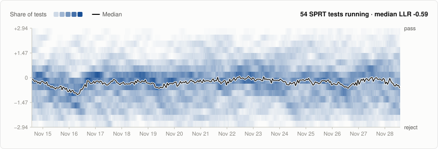
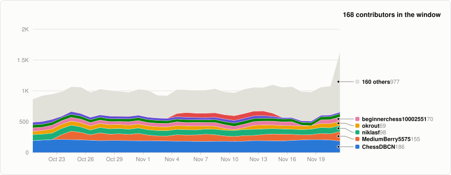
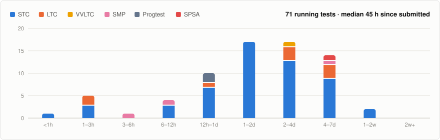

# Fishtest status

Updated Wed 18 Nov 2026, 22:45 UTC

## Trends

### Last 14 days

#### Cores by test type

<picture>
  <source media="(prefers-color-scheme: dark)" srcset="https://raw.githubusercontent.com/xu-shawn/fishtest_track/5a3795aa86681619c85e61a4c39fe5c339ab9f2e/types-dark.svg">
  
</picture>

#### Tests by type

<picture>
  <source media="(prefers-color-scheme: dark)" srcset="https://raw.githubusercontent.com/xu-shawn/fishtest_track/5a3795aa86681619c85e61a4c39fe5c339ab9f2e/type-counts-dark.svg">
  
</picture>

#### Net tests and search tests

<picture>
  <source media="(prefers-color-scheme: dark)" srcset="https://raw.githubusercontent.com/xu-shawn/fishtest_track/5a3795aa86681619c85e61a4c39fe5c339ab9f2e/net-search-trend-dark.svg">
  
</picture>

#### Gainer and simplification bounds

<picture>
  <source media="(prefers-color-scheme: dark)" srcset="https://raw.githubusercontent.com/xu-shawn/fishtest_track/5a3795aa86681619c85e61a4c39fe5c339ab9f2e/bounds-trend-dark.svg">
  
</picture>

#### Cores by test

<picture>
  <source media="(prefers-color-scheme: dark)" srcset="https://raw.githubusercontent.com/xu-shawn/fishtest_track/5a3795aa86681619c85e61a4c39fe5c339ab9f2e/tests-trend-dark.svg">
  
</picture>

#### Cores by author

<picture>
  <source media="(prefers-color-scheme: dark)" srcset="https://raw.githubusercontent.com/xu-shawn/fishtest_track/5a3795aa86681619c85e61a4c39fe5c339ab9f2e/authors-trend-dark.svg">
  
</picture>

#### Tests per author

<picture>
  <source media="(prefers-color-scheme: dark)" srcset="https://raw.githubusercontent.com/xu-shawn/fishtest_track/5a3795aa86681619c85e61a4c39fe5c339ab9f2e/author-tests-trend-dark.svg">
  
</picture>

#### Cores contributed by user

<picture>
  <source media="(prefers-color-scheme: dark)" srcset="https://raw.githubusercontent.com/xu-shawn/fishtest_track/5a3795aa86681619c85e61a4c39fe5c339ab9f2e/contributors-trend-dark.svg">
  
</picture>

#### MNps contributed by user

<picture>
  <source media="(prefers-color-scheme: dark)" srcset="https://raw.githubusercontent.com/xu-shawn/fishtest_track/5a3795aa86681619c85e61a4c39fe5c339ab9f2e/contributors-mnps-trend-dark.svg">
  
</picture>

#### Tests, authors, contributors and throughput

<picture>
  <source media="(prefers-color-scheme: dark)" srcset="https://raw.githubusercontent.com/xu-shawn/fishtest_track/5a3795aa86681619c85e61a4c39fe5c339ab9f2e/activity-dark.svg">
  
</picture>

#### Tests finished per hour

<picture>
  <source media="(prefers-color-scheme: dark)" srcset="https://raw.githubusercontent.com/xu-shawn/fishtest_track/5a3795aa86681619c85e61a4c39fe5c339ab9f2e/throughput-dark.svg">
  
</picture>

#### LLR distribution of running tests

<picture>
  <source media="(prefers-color-scheme: dark)" srcset="https://raw.githubusercontent.com/xu-shawn/fishtest_track/5a3795aa86681619c85e61a4c39fe5c339ab9f2e/llr-dark.svg">
  
</picture>

### Last 30 days

#### Finished tests per day

<picture>
  <source media="(prefers-color-scheme: dark)" srcset="https://raw.githubusercontent.com/xu-shawn/fishtest_track/5a3795aa86681619c85e61a4c39fe5c339ab9f2e/finished-dark.svg">
  
</picture>

Last 7 days: **162 tests** finished, 14.7M games. **21 passed** (17 STC, 2 LTC, 1 SMP, 1 nodestime), 90 rejected, 46 stopped, 3 completed (SPSA or fixed games), 2 failed. SPRT pass rate 18.9%: 14.3% for gainers (98), 53.8% for simplifications (13); 66.7% for net tests (6), 16.2% for search tests (105).

#### Cores by architecture

<picture>
  <source media="(prefers-color-scheme: dark)" srcset="https://raw.githubusercontent.com/xu-shawn/fishtest_track/5a3795aa86681619c85e61a4c39fe5c339ab9f2e/monthly-arch-dark.svg">
  
</picture>

#### Cores by compiler

<picture>
  <source media="(prefers-color-scheme: dark)" srcset="https://raw.githubusercontent.com/xu-shawn/fishtest_track/5a3795aa86681619c85e61a4c39fe5c339ab9f2e/monthly-compiler-dark.svg">
  
</picture>

### Last year

#### Finished tests per week

<picture>
  <source media="(prefers-color-scheme: dark)" srcset="https://raw.githubusercontent.com/xu-shawn/fishtest_track/5a3795aa86681619c85e61a4c39fe5c339ab9f2e/weekly-finished-dark.svg">
  
</picture>

#### Runtime of finished tests

<picture>
  <source media="(prefers-color-scheme: dark)" srcset="https://raw.githubusercontent.com/xu-shawn/fishtest_track/5a3795aa86681619c85e61a4c39fe5c339ab9f2e/runtime-trend-dark.svg">
  
</picture>

#### Average cores per week by test type

<picture>
  <source media="(prefers-color-scheme: dark)" srcset="https://raw.githubusercontent.com/xu-shawn/fishtest_track/5a3795aa86681619c85e61a4c39fe5c339ab9f2e/weekly-types-dark.svg">
  
</picture>

#### Cores by architecture

<picture>
  <source media="(prefers-color-scheme: dark)" srcset="https://raw.githubusercontent.com/xu-shawn/fishtest_track/5a3795aa86681619c85e61a4c39fe5c339ab9f2e/yearly-arch-dark.svg">
  
</picture>

#### Cores by compiler

<picture>
  <source media="(prefers-color-scheme: dark)" srcset="https://raw.githubusercontent.com/xu-shawn/fishtest_track/5a3795aa86681619c85e61a4c39fe5c339ab9f2e/yearly-compiler-dark.svg">
  
</picture>

#### Gainer bounds

<picture>
  <source media="(prefers-color-scheme: dark)" srcset="https://raw.githubusercontent.com/xu-shawn/fishtest_track/5a3795aa86681619c85e61a4c39fe5c339ab9f2e/weekly-gainers-dark.svg">
  
</picture>

#### Simplification bounds

<picture>
  <source media="(prefers-color-scheme: dark)" srcset="https://raw.githubusercontent.com/xu-shawn/fishtest_track/5a3795aa86681619c85e61a4c39fe5c339ab9f2e/weekly-simplifications-dark.svg">
  
</picture>

#### Net tests

<picture>
  <source media="(prefers-color-scheme: dark)" srcset="https://raw.githubusercontent.com/xu-shawn/fishtest_track/5a3795aa86681619c85e61a4c39fe5c339ab9f2e/weekly-net-dark.svg">
  
</picture>

#### Search tests

<picture>
  <source media="(prefers-color-scheme: dark)" srcset="https://raw.githubusercontent.com/xu-shawn/fishtest_track/5a3795aa86681619c85e61a4c39fe5c339ab9f2e/weekly-search-dark.svg">
  
</picture>

### Since 19 Oct 2026, daily averages

#### Cores by test type

<picture>
  <source media="(prefers-color-scheme: dark)" srcset="https://raw.githubusercontent.com/xu-shawn/fishtest_track/5a3795aa86681619c85e61a4c39fe5c339ab9f2e/long-types-dark.svg">
  
</picture>

#### Cores by author

<picture>
  <source media="(prefers-color-scheme: dark)" srcset="https://raw.githubusercontent.com/xu-shawn/fishtest_track/5a3795aa86681619c85e61a4c39fe5c339ab9f2e/long-authors-dark.svg">
  
</picture>

#### Tests per author

<picture>
  <source media="(prefers-color-scheme: dark)" srcset="https://raw.githubusercontent.com/xu-shawn/fishtest_track/5a3795aa86681619c85e61a4c39fe5c339ab9f2e/long-author-tests-dark.svg">
  
</picture>

#### Cores contributed by user

<picture>
  <source media="(prefers-color-scheme: dark)" srcset="https://raw.githubusercontent.com/xu-shawn/fishtest_track/5a3795aa86681619c85e61a4c39fe5c339ab9f2e/long-contributors-dark.svg">
  
</picture>

#### MNps contributed by user

<picture>
  <source media="(prefers-color-scheme: dark)" srcset="https://raw.githubusercontent.com/xu-shawn/fishtest_track/5a3795aa86681619c85e61a4c39fe5c339ab9f2e/long-contributors-mnps-dark.svg">
  
</picture>

#### Tests, authors, contributors and throughput

<picture>
  <source media="(prefers-color-scheme: dark)" srcset="https://raw.githubusercontent.com/xu-shawn/fishtest_track/5a3795aa86681619c85e61a4c39fe5c339ab9f2e/long-activity-dark.svg">
  
</picture>

## Right now

**66 tests** from **20 authors** are running on **1,612 cores** (161 workers from 64 contributors). About 154 hours of work is queued.

| | Now | 24 h avg | 7 d avg | 30 d avg |
|:--|--:|--:|--:|--:|
| Tests running | 66 | 62 | 54 | 46 |
| Authors with running tests | 20 | 20 | 19 | 19 |
| Cores | 1,612 | 1,684 | 1,807 | 1,782 |
| Workers | 161 | 180 | 199 | 201 |
| Contributors with workers | 64 | 64 | 64 | 62 |
| Net tests running | 4 | 3 | 3 | 5 |
| Cores on net tests | 142 | 188 | 235 | 243 |
| Nodes per second | 923M | 955M | 1.03G | 993M |
| Games per minute | 1,509 | 1,598 | 1,636 | 1,619 |
| Pending hours | 154 h | 114 h | 86 h | 146 h |

### Cores by test

<picture>
  <source media="(prefers-color-scheme: dark)" srcset="https://raw.githubusercontent.com/xu-shawn/fishtest_track/5a3795aa86681619c85e61a4c39fe5c339ab9f2e/tests-dark.svg">
  
</picture>

### Runtime of running tests

<picture>
  <source media="(prefers-color-scheme: dark)" srcset="https://raw.githubusercontent.com/xu-shawn/fishtest_track/5a3795aa86681619c85e61a4c39fe5c339ab9f2e/runtime-dark.svg">
  
</picture>

### Cores by author

<picture>
  <source media="(prefers-color-scheme: dark)" srcset="https://raw.githubusercontent.com/xu-shawn/fishtest_track/5a3795aa86681619c85e61a4c39fe5c339ab9f2e/authors-dark.svg">
  
</picture>

### Cores contributed by user

<picture>
  <source media="(prefers-color-scheme: dark)" srcset="https://raw.githubusercontent.com/xu-shawn/fishtest_track/5a3795aa86681619c85e61a4c39fe5c339ab9f2e/contributors-dark.svg">
  
</picture>

### MNps contributed by user

<picture>
  <source media="(prefers-color-scheme: dark)" srcset="https://raw.githubusercontent.com/xu-shawn/fishtest_track/5a3795aa86681619c85e61a4c39fe5c339ab9f2e/contributors-mnps-dark.svg">
  
</picture>

## Last 30 days in detail

### Recently passed

| Finished | Author | Test | TC | Bounds | Elo |
|:--|:--|:--|:--|:--|--:|
| Nov 18 | [Fisherman](https://tests.stockfishchess.org/tests/user/Fisherman) | [`CapHist`](https://tests.stockfishchess.org/tests/view/6af900c58e7fb2e78bc1d77c) | 10+0.1 | [0,2] | +0.99 ±0.79 |
| Nov 18 | [kokodio](https://tests.stockfishchess.org/tests/user/kokodio) | [`nmhist`](https://tests.stockfishchess.org/tests/view/6afb64038e7fb2e78bc1db61) | 10+0.1 | [0,2] | +1.44 ±1.10 |
| Nov 18 | [rn](https://tests.stockfishchess.org/tests/user/rn) | [`fix-multipv-tm`](https://tests.stockfishchess.org/tests/view/6af5a0c58e7fb2e78bc1d1cb) | 10+0.1 | [-1.75,0.25] | -0.16 ±0.47 |
| Nov 17 | [feeling4vibes](https://tests.stockfishchess.org/tests/user/feeling4vibes) | [`test/robinhood-hashing`](https://tests.stockfishchess.org/tests/view/6af9bd9d8e7fb2e78bc1d8ac) | 10+0.1 | [0,2] | +1.45 ±1.09 |
| Nov 17 | [penneponne](https://tests.stockfishchess.org/tests/user/penneponne) | [`c2s/24-se-margin-history`](https://tests.stockfishchess.org/tests/view/6afabccd8e7fb2e78bc1d9f5) | 10+0.1 | [0,2] | +4.14 ±2.16 |
| Nov 16 | [shawnxu](https://tests.stockfishchess.org/tests/user/shawnxu) | [`test1764`](https://tests.stockfishchess.org/tests/view/6af8f5da8e7fb2e78bc1d754) | 10+0.1 | [0,2] | +1.58 ±1.18 |
| Nov 16 | [Bush3r](https://tests.stockfishchess.org/tests/user/Bush3r) | [`nmp-count-fail-high-once`](https://tests.stockfishchess.org/tests/view/6af91cd08e7fb2e78bc1d795) | 10+0.1 | [-1.75,0.25] | +0.69 ±1.12 |
| Nov 16 | [Martin](https://tests.stockfishchess.org/tests/user/Martin) | [`master`](https://tests.stockfishchess.org/tests/view/6af6206b8e7fb2e78bc1d2bd) | 10+0.1 | [-1.75,0.25] | -0.05 ±0.61 |
| Nov 15 | [Gruenerapfel](https://tests.stockfishchess.org/tests/user/Gruenerapfel) | [`recipe-simp`](https://tests.stockfishchess.org/tests/view/6af447668e7fb2e78bc1cf4b) | 10+0.1 | [-1.75,0.25] | +0.03 ±0.72 |
| Nov 15 | [Kaz](https://tests.stockfishchess.org/tests/user/Kaz) | [`key-stack-contcorr-01`](https://tests.stockfishchess.org/tests/view/6af1a4d68e7fb2e78bc1cb59) | 20+0.2 ×8 | [0.5,2.5] | +1.58 ±1.03 |
| Nov 15 | [Dubslow](https://tests.stockfishchess.org/tests/user/Dubslow) | [`rm-optimism`](https://tests.stockfishchess.org/tests/view/6af533468e7fb2e78bc1d0fd) | 10+0.1 | [-1.75,0.25] | +0.16 ±0.82 |
| Nov 14 | [shawnxu](https://tests.stockfishchess.org/tests/user/shawnxu) | [`test1762`](https://tests.stockfishchess.org/tests/view/6af7ab678e7fb2e78bc1d537) | 60+0.6 | [0.5,2.5] | +3.11 ±1.71 |

### Most active authors

| Author | Finished | Passed | Running now | Core-hours | Share |
|:--|--:|--:|--:|--:|--:|
| [Vizvezdenec](https://tests.stockfishchess.org/tests/user/Vizvezdenec) | 54 | 5 | 6 | 143,526 | 13.1% |
| [Gruenerapfel](https://tests.stockfishchess.org/tests/user/Gruenerapfel) | 29 | 6 | 1 | 114,362 | 10.4% |
| [fauzi2](https://tests.stockfishchess.org/tests/user/fauzi2) | 36 | 4 | 8 | 89,981 | 8.2% |
| [sg](https://tests.stockfishchess.org/tests/user/sg) | 41 | 8 | 3 | 81,889 | 7.5% |
| [shawnxu](https://tests.stockfishchess.org/tests/user/shawnxu) | 44 | 23 | 6 | 69,636 | 6.3% |
| [rn](https://tests.stockfishchess.org/tests/user/rn) | 13 | 7 | 1 | 66,524 | 6.1% |
| [Disservin](https://tests.stockfishchess.org/tests/user/Disservin) | 5 | 0 | 0 | 59,540 | 5.4% |
| [DeadK1ng](https://tests.stockfishchess.org/tests/user/DeadK1ng) | 4 | 1 | 0 | 53,670 | 4.9% |
| [vdv](https://tests.stockfishchess.org/tests/user/vdv) | 8 | 2 | 0 | 45,640 | 4.2% |
| [AdrianStockfish](https://tests.stockfishchess.org/tests/user/AdrianStockfish) | 47 | 5 | 3 | 39,194 | 3.6% |

### Top contributors

| Contributor | Core-hours | Share | Cores now | MNps now | Workers now |
|:--|--:|--:|--:|--:|--:|
| [ChessDBCN](https://tests.stockfishchess.org/tests/user/ChessDBCN) | 328,233 | 25.9% | 472 | 209 | 59 |
| [niklasf](https://tests.stockfishchess.org/tests/user/niklasf) | 131,659 | 10.4% | 189 | 96 | 3 |
| [Wencey](https://tests.stockfishchess.org/tests/user/Wencey) | 105,730 | 8.4% | 150 | 42 | 4 |
| [MediumBerry5575](https://tests.stockfishchess.org/tests/user/MediumBerry5575) | 82,633 | 6.5% | 0 | 0.0 | 0 |
| [wizzouk](https://tests.stockfishchess.org/tests/user/wizzouk) | 60,439 | 4.8% | 58 | 27 | 3 |
| [okrout](https://tests.stockfishchess.org/tests/user/okrout) | 58,953 | 4.7% | 82 | 56 | 5 |
| [beginnerchess10002551](https://tests.stockfishchess.org/tests/user/beginnerchess10002551) | 51,913 | 4.1% | 0 | 0.0 | 0 |
| [CypressChess](https://tests.stockfishchess.org/tests/user/CypressChess) | 28,082 | 2.2% | 40 | 16 | 5 |
| [fogleman](https://tests.stockfishchess.org/tests/user/fogleman) | 23,890 | 1.9% | 55 | 35 | 5 |
| [technologov](https://tests.stockfishchess.org/tests/user/technologov) | 23,662 | 1.9% | 44 | 18 | 2 |
