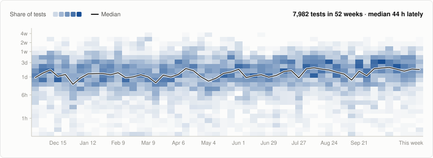
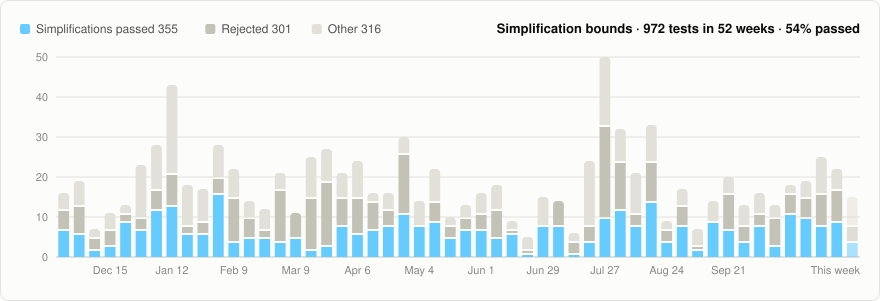

# Fishtest status

Updated Fri 20 Nov 2026, 20:45 UTC

## Trends

### Last 14 days

#### Cores by test type

<picture>
  <source media="(prefers-color-scheme: dark)" srcset="https://raw.githubusercontent.com/xu-shawn/fishtest_track/2030079ceee584a51139713e51fad4a6c7f966ec/types-dark.svg">
  
</picture>

#### Tests by type

<picture>
  <source media="(prefers-color-scheme: dark)" srcset="https://raw.githubusercontent.com/xu-shawn/fishtest_track/2030079ceee584a51139713e51fad4a6c7f966ec/type-counts-dark.svg">
  
</picture>

#### Net tests and search tests

<picture>
  <source media="(prefers-color-scheme: dark)" srcset="https://raw.githubusercontent.com/xu-shawn/fishtest_track/2030079ceee584a51139713e51fad4a6c7f966ec/net-search-trend-dark.svg">
  
</picture>

#### Gainer and simplification bounds

<picture>
  <source media="(prefers-color-scheme: dark)" srcset="https://raw.githubusercontent.com/xu-shawn/fishtest_track/2030079ceee584a51139713e51fad4a6c7f966ec/bounds-trend-dark.svg">
  
</picture>

#### Cores by test

<picture>
  <source media="(prefers-color-scheme: dark)" srcset="https://raw.githubusercontent.com/xu-shawn/fishtest_track/2030079ceee584a51139713e51fad4a6c7f966ec/tests-trend-dark.svg">
  
</picture>

#### Cores by author

<picture>
  <source media="(prefers-color-scheme: dark)" srcset="https://raw.githubusercontent.com/xu-shawn/fishtest_track/2030079ceee584a51139713e51fad4a6c7f966ec/authors-trend-dark.svg">
  
</picture>

#### Tests per author

<picture>
  <source media="(prefers-color-scheme: dark)" srcset="https://raw.githubusercontent.com/xu-shawn/fishtest_track/2030079ceee584a51139713e51fad4a6c7f966ec/author-tests-trend-dark.svg">
  
</picture>

#### Cores contributed by user

<picture>
  <source media="(prefers-color-scheme: dark)" srcset="https://raw.githubusercontent.com/xu-shawn/fishtest_track/2030079ceee584a51139713e51fad4a6c7f966ec/contributors-trend-dark.svg">
  
</picture>

#### MNps contributed by user

<picture>
  <source media="(prefers-color-scheme: dark)" srcset="https://raw.githubusercontent.com/xu-shawn/fishtest_track/2030079ceee584a51139713e51fad4a6c7f966ec/contributors-mnps-trend-dark.svg">
  
</picture>

#### Tests, authors, contributors and throughput

<picture>
  <source media="(prefers-color-scheme: dark)" srcset="https://raw.githubusercontent.com/xu-shawn/fishtest_track/2030079ceee584a51139713e51fad4a6c7f966ec/activity-dark.svg">
  
</picture>

#### Tests finished per hour

<picture>
  <source media="(prefers-color-scheme: dark)" srcset="https://raw.githubusercontent.com/xu-shawn/fishtest_track/2030079ceee584a51139713e51fad4a6c7f966ec/throughput-dark.svg">
  
</picture>

#### LLR distribution of running tests

<picture>
  <source media="(prefers-color-scheme: dark)" srcset="https://raw.githubusercontent.com/xu-shawn/fishtest_track/2030079ceee584a51139713e51fad4a6c7f966ec/llr-dark.svg">
  
</picture>

### Last 30 days

#### Finished tests per day

<picture>
  <source media="(prefers-color-scheme: dark)" srcset="https://raw.githubusercontent.com/xu-shawn/fishtest_track/2030079ceee584a51139713e51fad4a6c7f966ec/finished-dark.svg">
  
</picture>

Last 7 days: **159 tests** finished, 14.5M games. **18 passed** (14 STC, 2 LTC, 1 SMP, 1 nodestime), 91 rejected, 44 stopped, 1 completed (SPSA or fixed games), 5 failed. SPRT pass rate 16.5%: 12.4% for gainers (97), 50.0% for simplifications (12); 80.0% for net tests (5), 13.5% for search tests (104).

#### Cores by architecture

<picture>
  <source media="(prefers-color-scheme: dark)" srcset="https://raw.githubusercontent.com/xu-shawn/fishtest_track/2030079ceee584a51139713e51fad4a6c7f966ec/monthly-arch-dark.svg">
  
</picture>

#### Cores by compiler

<picture>
  <source media="(prefers-color-scheme: dark)" srcset="https://raw.githubusercontent.com/xu-shawn/fishtest_track/2030079ceee584a51139713e51fad4a6c7f966ec/monthly-compiler-dark.svg">
  
</picture>

### Last year

#### Finished tests per week

<picture>
  <source media="(prefers-color-scheme: dark)" srcset="https://raw.githubusercontent.com/xu-shawn/fishtest_track/2030079ceee584a51139713e51fad4a6c7f966ec/weekly-finished-dark.svg">
  
</picture>

#### Runtime of finished tests

<picture>
  <source media="(prefers-color-scheme: dark)" srcset="https://raw.githubusercontent.com/xu-shawn/fishtest_track/2030079ceee584a51139713e51fad4a6c7f966ec/runtime-trend-dark.svg">
  
</picture>

#### Average cores per week by test type

<picture>
  <source media="(prefers-color-scheme: dark)" srcset="https://raw.githubusercontent.com/xu-shawn/fishtest_track/2030079ceee584a51139713e51fad4a6c7f966ec/weekly-types-dark.svg">
  
</picture>

#### Cores by architecture

<picture>
  <source media="(prefers-color-scheme: dark)" srcset="https://raw.githubusercontent.com/xu-shawn/fishtest_track/2030079ceee584a51139713e51fad4a6c7f966ec/yearly-arch-dark.svg">
  
</picture>

#### Cores by compiler

<picture>
  <source media="(prefers-color-scheme: dark)" srcset="https://raw.githubusercontent.com/xu-shawn/fishtest_track/2030079ceee584a51139713e51fad4a6c7f966ec/yearly-compiler-dark.svg">
  
</picture>

#### Gainer bounds

<picture>
  <source media="(prefers-color-scheme: dark)" srcset="https://raw.githubusercontent.com/xu-shawn/fishtest_track/2030079ceee584a51139713e51fad4a6c7f966ec/weekly-gainers-dark.svg">
  
</picture>

#### Simplification bounds

<picture>
  <source media="(prefers-color-scheme: dark)" srcset="https://raw.githubusercontent.com/xu-shawn/fishtest_track/2030079ceee584a51139713e51fad4a6c7f966ec/weekly-simplifications-dark.svg">
  
</picture>

#### Net tests

<picture>
  <source media="(prefers-color-scheme: dark)" srcset="https://raw.githubusercontent.com/xu-shawn/fishtest_track/2030079ceee584a51139713e51fad4a6c7f966ec/weekly-net-dark.svg">
  
</picture>

#### Search tests

<picture>
  <source media="(prefers-color-scheme: dark)" srcset="https://raw.githubusercontent.com/xu-shawn/fishtest_track/2030079ceee584a51139713e51fad4a6c7f966ec/weekly-search-dark.svg">
  
</picture>

### Since 19 Oct 2026, daily averages

#### Cores by test type

<picture>
  <source media="(prefers-color-scheme: dark)" srcset="https://raw.githubusercontent.com/xu-shawn/fishtest_track/2030079ceee584a51139713e51fad4a6c7f966ec/long-types-dark.svg">
  
</picture>

#### Cores by author

<picture>
  <source media="(prefers-color-scheme: dark)" srcset="https://raw.githubusercontent.com/xu-shawn/fishtest_track/2030079ceee584a51139713e51fad4a6c7f966ec/long-authors-dark.svg">
  
</picture>

#### Tests per author

<picture>
  <source media="(prefers-color-scheme: dark)" srcset="https://raw.githubusercontent.com/xu-shawn/fishtest_track/2030079ceee584a51139713e51fad4a6c7f966ec/long-author-tests-dark.svg">
  
</picture>

#### Cores contributed by user

<picture>
  <source media="(prefers-color-scheme: dark)" srcset="https://raw.githubusercontent.com/xu-shawn/fishtest_track/2030079ceee584a51139713e51fad4a6c7f966ec/long-contributors-dark.svg">
  
</picture>

#### MNps contributed by user

<picture>
  <source media="(prefers-color-scheme: dark)" srcset="https://raw.githubusercontent.com/xu-shawn/fishtest_track/2030079ceee584a51139713e51fad4a6c7f966ec/long-contributors-mnps-dark.svg">
  
</picture>

#### Tests, authors, contributors and throughput

<picture>
  <source media="(prefers-color-scheme: dark)" srcset="https://raw.githubusercontent.com/xu-shawn/fishtest_track/2030079ceee584a51139713e51fad4a6c7f966ec/long-activity-dark.svg">
  
</picture>

## Right now

**75 tests** from **23 authors** are running on **1,708 cores** (180 workers from 67 contributors). About 139 hours of work is queued.

| | Now | 24 h avg | 7 d avg | 30 d avg |
|:--|--:|--:|--:|--:|
| Tests running | 75 | 72 | 58 | 48 |
| Authors with running tests | 23 | 23 | 19 | 19 |
| Cores | 1,708 | 1,766 | 1,789 | 1,797 |
| Workers | 180 | 202 | 200 | 204 |
| Contributors with workers | 67 | 66 | 65 | 62 |
| Net tests running | 8 | 6 | 4 | 5 |
| Cores on net tests | 512 | 373 | 205 | 254 |
| Nodes per second | 985M | 1.05G | 1.04G | 1.01G |
| Games per minute | 1,422 | 1,693 | 1,685 | 1,646 |
| Pending hours | 139 h | 127 h | 96 h | 84 h |

### Cores by test

<picture>
  <source media="(prefers-color-scheme: dark)" srcset="https://raw.githubusercontent.com/xu-shawn/fishtest_track/2030079ceee584a51139713e51fad4a6c7f966ec/tests-dark.svg">
  
</picture>

### Runtime of running tests

<picture>
  <source media="(prefers-color-scheme: dark)" srcset="https://raw.githubusercontent.com/xu-shawn/fishtest_track/2030079ceee584a51139713e51fad4a6c7f966ec/runtime-dark.svg">
  
</picture>

### Cores by author

<picture>
  <source media="(prefers-color-scheme: dark)" srcset="https://raw.githubusercontent.com/xu-shawn/fishtest_track/2030079ceee584a51139713e51fad4a6c7f966ec/authors-dark.svg">
  
</picture>

### Cores contributed by user

<picture>
  <source media="(prefers-color-scheme: dark)" srcset="https://raw.githubusercontent.com/xu-shawn/fishtest_track/2030079ceee584a51139713e51fad4a6c7f966ec/contributors-dark.svg">
  
</picture>

### MNps contributed by user

<picture>
  <source media="(prefers-color-scheme: dark)" srcset="https://raw.githubusercontent.com/xu-shawn/fishtest_track/2030079ceee584a51139713e51fad4a6c7f966ec/contributors-mnps-dark.svg">
  
</picture>

## Last 30 days in detail

### Recently passed

| Finished | Author | Test | TC | Bounds | Elo |
|:--|:--|:--|:--|:--|--:|
| Nov 20 | [Gruenerapfel](https://tests.stockfishchess.org/tests/user/Gruenerapfel) | [`alternative-failhighrec…`](https://tests.stockfishchess.org/tests/view/6afe39aa2ff81bd6a63442b8) | 10+0.1 | [0,2] | +2.51 ±1.60 |
| Nov 19 | [shawnxu](https://tests.stockfishchess.org/tests/user/shawnxu) | [`test1767`](https://tests.stockfishchess.org/tests/view/6afd53fb2ff81bd6a6344172) | 100+1 nodestime | [0,2] | +6.49 ±2.81 |
| Nov 18 | [Fisherman](https://tests.stockfishchess.org/tests/user/Fisherman) | [`CapHist`](https://tests.stockfishchess.org/tests/view/6af900c58e7fb2e78bc1d77c) | 10+0.1 | [0,2] | +0.99 ±0.79 |
| Nov 18 | [kokodio](https://tests.stockfishchess.org/tests/user/kokodio) | [`nmhist`](https://tests.stockfishchess.org/tests/view/6afb64038e7fb2e78bc1db61) | 10+0.1 | [0,2] | +1.44 ±1.10 |
| Nov 18 | [rn](https://tests.stockfishchess.org/tests/user/rn) | [`fix-multipv-tm`](https://tests.stockfishchess.org/tests/view/6af5a0c58e7fb2e78bc1d1cb) | 10+0.1 | [-1.75,0.25] | -0.16 ±0.47 |
| Nov 17 | [feeling4vibes](https://tests.stockfishchess.org/tests/user/feeling4vibes) | [`test/robinhood-hashing`](https://tests.stockfishchess.org/tests/view/6af9bd9d8e7fb2e78bc1d8ac) | 10+0.1 | [0,2] | +1.45 ±1.09 |
| Nov 17 | [penneponne](https://tests.stockfishchess.org/tests/user/penneponne) | [`c2s/24-se-margin-history`](https://tests.stockfishchess.org/tests/view/6afabccd8e7fb2e78bc1d9f5) | 10+0.1 | [0,2] | +4.14 ±2.16 |
| Nov 16 | [shawnxu](https://tests.stockfishchess.org/tests/user/shawnxu) | [`test1764`](https://tests.stockfishchess.org/tests/view/6af8f5da8e7fb2e78bc1d754) | 10+0.1 | [0,2] | +1.58 ±1.18 |
| Nov 16 | [Bush3r](https://tests.stockfishchess.org/tests/user/Bush3r) | [`nmp-count-fail-high-once`](https://tests.stockfishchess.org/tests/view/6af91cd08e7fb2e78bc1d795) | 10+0.1 | [-1.75,0.25] | +0.69 ±1.12 |
| Nov 16 | [Martin](https://tests.stockfishchess.org/tests/user/Martin) | [`master`](https://tests.stockfishchess.org/tests/view/6af6206b8e7fb2e78bc1d2bd) | 10+0.1 | [-1.75,0.25] | -0.05 ±0.61 |
| Nov 15 | [Gruenerapfel](https://tests.stockfishchess.org/tests/user/Gruenerapfel) | [`recipe-simp`](https://tests.stockfishchess.org/tests/view/6af447668e7fb2e78bc1cf4b) | 10+0.1 | [-1.75,0.25] | +0.03 ±0.72 |
| Nov 15 | [Kaz](https://tests.stockfishchess.org/tests/user/Kaz) | [`key-stack-contcorr-01`](https://tests.stockfishchess.org/tests/view/6af1a4d68e7fb2e78bc1cb59) | 20+0.2 ×8 | [0.5,2.5] | +1.58 ±1.03 |

### Most active authors

| Author | Finished | Passed | Running now | Core-hours | Share |
|:--|--:|--:|--:|--:|--:|
| [Gruenerapfel](https://tests.stockfishchess.org/tests/user/Gruenerapfel) | 31 | 7 | 4 | 115,177 | 10.9% |
| [fauzi2](https://tests.stockfishchess.org/tests/user/fauzi2) | 40 | 4 | 7 | 89,183 | 8.5% |
| [sg](https://tests.stockfishchess.org/tests/user/sg) | 41 | 7 | 2 | 83,793 | 7.9% |
| [Vizvezdenec](https://tests.stockfishchess.org/tests/user/Vizvezdenec) | 53 | 5 | 6 | 75,687 | 7.2% |
| [rn](https://tests.stockfishchess.org/tests/user/rn) | 12 | 7 | 4 | 64,023 | 6.1% |
| [shawnxu](https://tests.stockfishchess.org/tests/user/shawnxu) | 43 | 22 | 4 | 62,914 | 6.0% |
| [Disservin](https://tests.stockfishchess.org/tests/user/Disservin) | 5 | 0 | 0 | 59,540 | 5.6% |
| [AdrianStockfish](https://tests.stockfishchess.org/tests/user/AdrianStockfish) | 46 | 4 | 3 | 56,873 | 5.4% |
| [DeadK1ng](https://tests.stockfishchess.org/tests/user/DeadK1ng) | 4 | 1 | 0 | 53,670 | 5.1% |
| [vdv](https://tests.stockfishchess.org/tests/user/vdv) | 8 | 1 | 6 | 40,596 | 3.8% |

### Top contributors

| Contributor | Core-hours | Share | Cores now | MNps now | Workers now |
|:--|--:|--:|--:|--:|--:|
| [ChessDBCN](https://tests.stockfishchess.org/tests/user/ChessDBCN) | 326,948 | 25.8% | 464 | 208 | 58 |
| [niklasf](https://tests.stockfishchess.org/tests/user/niklasf) | 131,304 | 10.4% | 189 | 102 | 3 |
| [Wencey](https://tests.stockfishchess.org/tests/user/Wencey) | 105,398 | 8.3% | 150 | 42 | 4 |
| [MediumBerry5575](https://tests.stockfishchess.org/tests/user/MediumBerry5575) | 87,576 | 6.9% | 0 | 0.0 | 0 |
| [okrout](https://tests.stockfishchess.org/tests/user/okrout) | 59,052 | 4.7% | 94 | 69 | 7 |
| [wizzouk](https://tests.stockfishchess.org/tests/user/wizzouk) | 58,600 | 4.6% | 43 | 22 | 2 |
| [beginnerchess10002551](https://tests.stockfishchess.org/tests/user/beginnerchess10002551) | 51,426 | 4.1% | 80 | 62 | 20 |
| [CypressChess](https://tests.stockfishchess.org/tests/user/CypressChess) | 27,989 | 2.2% | 40 | 18 | 5 |
| [fogleman](https://tests.stockfishchess.org/tests/user/fogleman) | 24,542 | 1.9% | 48 | 29 | 4 |
| [technologov](https://tests.stockfishchess.org/tests/user/technologov) | 23,588 | 1.9% | 44 | 18 | 2 |
