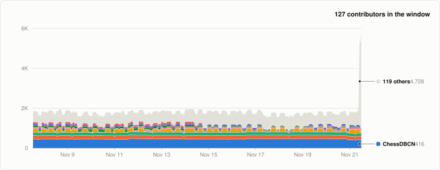
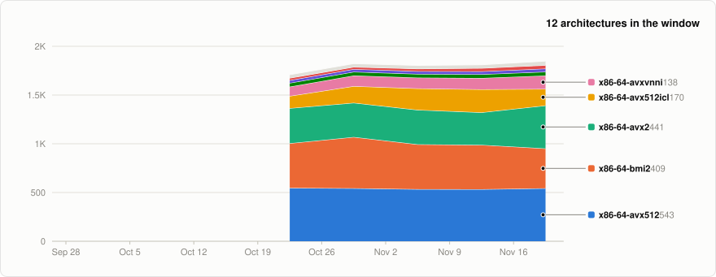

# Fishtest status

Updated Wed 25 Nov 2026, 16:45 UTC

## Trends

### Last 14 days

#### Cores by test type

<picture>
  <source media="(prefers-color-scheme: dark)" srcset="https://raw.githubusercontent.com/xu-shawn/fishtest_track/51873a6dd5f98bff2e07ece7a68cc8ff9d0a6bbc/types-dark.svg">
  
</picture>

#### Tests by type

<picture>
  <source media="(prefers-color-scheme: dark)" srcset="https://raw.githubusercontent.com/xu-shawn/fishtest_track/51873a6dd5f98bff2e07ece7a68cc8ff9d0a6bbc/type-counts-dark.svg">
  
</picture>

#### Net tests and search tests

<picture>
  <source media="(prefers-color-scheme: dark)" srcset="https://raw.githubusercontent.com/xu-shawn/fishtest_track/51873a6dd5f98bff2e07ece7a68cc8ff9d0a6bbc/net-search-trend-dark.svg">
  
</picture>

#### Gainer and simplification bounds

<picture>
  <source media="(prefers-color-scheme: dark)" srcset="https://raw.githubusercontent.com/xu-shawn/fishtest_track/51873a6dd5f98bff2e07ece7a68cc8ff9d0a6bbc/bounds-trend-dark.svg">
  
</picture>

#### Cores by test

<picture>
  <source media="(prefers-color-scheme: dark)" srcset="https://raw.githubusercontent.com/xu-shawn/fishtest_track/51873a6dd5f98bff2e07ece7a68cc8ff9d0a6bbc/tests-trend-dark.svg">
  
</picture>

#### Cores by author

<picture>
  <source media="(prefers-color-scheme: dark)" srcset="https://raw.githubusercontent.com/xu-shawn/fishtest_track/51873a6dd5f98bff2e07ece7a68cc8ff9d0a6bbc/authors-trend-dark.svg">
  
</picture>

#### Tests per author

<picture>
  <source media="(prefers-color-scheme: dark)" srcset="https://raw.githubusercontent.com/xu-shawn/fishtest_track/51873a6dd5f98bff2e07ece7a68cc8ff9d0a6bbc/author-tests-trend-dark.svg">
  
</picture>

#### Cores contributed by user

<picture>
  <source media="(prefers-color-scheme: dark)" srcset="https://raw.githubusercontent.com/xu-shawn/fishtest_track/51873a6dd5f98bff2e07ece7a68cc8ff9d0a6bbc/contributors-trend-dark.svg">
  
</picture>

#### MNps contributed by user

<picture>
  <source media="(prefers-color-scheme: dark)" srcset="https://raw.githubusercontent.com/xu-shawn/fishtest_track/51873a6dd5f98bff2e07ece7a68cc8ff9d0a6bbc/contributors-mnps-trend-dark.svg">
  
</picture>

#### Tests, authors, contributors and throughput

<picture>
  <source media="(prefers-color-scheme: dark)" srcset="https://raw.githubusercontent.com/xu-shawn/fishtest_track/51873a6dd5f98bff2e07ece7a68cc8ff9d0a6bbc/activity-dark.svg">
  
</picture>

#### Tests finished per hour

<picture>
  <source media="(prefers-color-scheme: dark)" srcset="https://raw.githubusercontent.com/xu-shawn/fishtest_track/51873a6dd5f98bff2e07ece7a68cc8ff9d0a6bbc/throughput-dark.svg">
  
</picture>

#### LLR distribution of running tests

<picture>
  <source media="(prefers-color-scheme: dark)" srcset="https://raw.githubusercontent.com/xu-shawn/fishtest_track/51873a6dd5f98bff2e07ece7a68cc8ff9d0a6bbc/llr-dark.svg">
  
</picture>

### Last 30 days

#### Finished tests per day

<picture>
  <source media="(prefers-color-scheme: dark)" srcset="https://raw.githubusercontent.com/xu-shawn/fishtest_track/51873a6dd5f98bff2e07ece7a68cc8ff9d0a6bbc/finished-dark.svg">
  
</picture>

Last 7 days: **182 tests** finished, 16.9M games. **34 passed** (30 STC, 3 LTC, 1 nodestime), 91 rejected, 46 stopped, 5 completed (SPSA or fixed games), 6 failed. SPRT pass rate 27.2%: 17.5% for gainers (103), 72.7% for simplifications (22); 36.4% for net tests (11), 26.3% for search tests (114).

#### Cores by architecture

<picture>
  <source media="(prefers-color-scheme: dark)" srcset="https://raw.githubusercontent.com/xu-shawn/fishtest_track/51873a6dd5f98bff2e07ece7a68cc8ff9d0a6bbc/monthly-arch-dark.svg">
  
</picture>

#### Cores by compiler

<picture>
  <source media="(prefers-color-scheme: dark)" srcset="https://raw.githubusercontent.com/xu-shawn/fishtest_track/51873a6dd5f98bff2e07ece7a68cc8ff9d0a6bbc/monthly-compiler-dark.svg">
  
</picture>

### Last year

#### Finished tests per week

<picture>
  <source media="(prefers-color-scheme: dark)" srcset="https://raw.githubusercontent.com/xu-shawn/fishtest_track/51873a6dd5f98bff2e07ece7a68cc8ff9d0a6bbc/weekly-finished-dark.svg">
  
</picture>

#### Runtime of finished tests

<picture>
  <source media="(prefers-color-scheme: dark)" srcset="https://raw.githubusercontent.com/xu-shawn/fishtest_track/51873a6dd5f98bff2e07ece7a68cc8ff9d0a6bbc/runtime-trend-dark.svg">
  
</picture>

#### Average cores per week by test type

<picture>
  <source media="(prefers-color-scheme: dark)" srcset="https://raw.githubusercontent.com/xu-shawn/fishtest_track/51873a6dd5f98bff2e07ece7a68cc8ff9d0a6bbc/weekly-types-dark.svg">
  
</picture>

#### Cores by architecture

<picture>
  <source media="(prefers-color-scheme: dark)" srcset="https://raw.githubusercontent.com/xu-shawn/fishtest_track/51873a6dd5f98bff2e07ece7a68cc8ff9d0a6bbc/yearly-arch-dark.svg">
  
</picture>

#### Cores by compiler

<picture>
  <source media="(prefers-color-scheme: dark)" srcset="https://raw.githubusercontent.com/xu-shawn/fishtest_track/51873a6dd5f98bff2e07ece7a68cc8ff9d0a6bbc/yearly-compiler-dark.svg">
  
</picture>

#### Gainer bounds

<picture>
  <source media="(prefers-color-scheme: dark)" srcset="https://raw.githubusercontent.com/xu-shawn/fishtest_track/51873a6dd5f98bff2e07ece7a68cc8ff9d0a6bbc/weekly-gainers-dark.svg">
  
</picture>

#### Simplification bounds

<picture>
  <source media="(prefers-color-scheme: dark)" srcset="https://raw.githubusercontent.com/xu-shawn/fishtest_track/51873a6dd5f98bff2e07ece7a68cc8ff9d0a6bbc/weekly-simplifications-dark.svg">
  
</picture>

#### Net tests

<picture>
  <source media="(prefers-color-scheme: dark)" srcset="https://raw.githubusercontent.com/xu-shawn/fishtest_track/51873a6dd5f98bff2e07ece7a68cc8ff9d0a6bbc/weekly-net-dark.svg">
  
</picture>

#### Search tests

<picture>
  <source media="(prefers-color-scheme: dark)" srcset="https://raw.githubusercontent.com/xu-shawn/fishtest_track/51873a6dd5f98bff2e07ece7a68cc8ff9d0a6bbc/weekly-search-dark.svg">
  
</picture>

### Since 19 Oct 2026, daily averages

#### Cores by test type

<picture>
  <source media="(prefers-color-scheme: dark)" srcset="https://raw.githubusercontent.com/xu-shawn/fishtest_track/51873a6dd5f98bff2e07ece7a68cc8ff9d0a6bbc/long-types-dark.svg">
  
</picture>

#### Cores by author

<picture>
  <source media="(prefers-color-scheme: dark)" srcset="https://raw.githubusercontent.com/xu-shawn/fishtest_track/51873a6dd5f98bff2e07ece7a68cc8ff9d0a6bbc/long-authors-dark.svg">
  
</picture>

#### Tests per author

<picture>
  <source media="(prefers-color-scheme: dark)" srcset="https://raw.githubusercontent.com/xu-shawn/fishtest_track/51873a6dd5f98bff2e07ece7a68cc8ff9d0a6bbc/long-author-tests-dark.svg">
  
</picture>

#### Cores contributed by user

<picture>
  <source media="(prefers-color-scheme: dark)" srcset="https://raw.githubusercontent.com/xu-shawn/fishtest_track/51873a6dd5f98bff2e07ece7a68cc8ff9d0a6bbc/long-contributors-dark.svg">
  
</picture>

#### MNps contributed by user

<picture>
  <source media="(prefers-color-scheme: dark)" srcset="https://raw.githubusercontent.com/xu-shawn/fishtest_track/51873a6dd5f98bff2e07ece7a68cc8ff9d0a6bbc/long-contributors-mnps-dark.svg">
  
</picture>

#### Tests, authors, contributors and throughput

<picture>
  <source media="(prefers-color-scheme: dark)" srcset="https://raw.githubusercontent.com/xu-shawn/fishtest_track/51873a6dd5f98bff2e07ece7a68cc8ff9d0a6bbc/long-activity-dark.svg">
  
</picture>

## Right now

**59 tests** from **19 authors** are running on **3,765 cores** (347 workers from 67 contributors). About 71 hours of work is queued.

| | Now | 24 h avg | 7 d avg | 30 d avg |
|:--|--:|--:|--:|--:|
| Tests running | 59 | 61 | 67 | 51 |
| Authors with running tests | 19 | 20 | 21 | 19 |
| Cores | 3,765 | 3,352 | 2,817 | 2,038 |
| Workers | 347 | 316 | 277 | 221 |
| Contributors with workers | 67 | 65 | 66 | 63 |
| Net tests running | 4 | 4 | 5 | 5 |
| Cores on net tests | 363 | 318 | 527 | 327 |
| Nodes per second | 1.86G | 1.72G | 1.52G | 1.12G |
| Games per minute | 1,942 | 2,162 | 2,003 | 1,731 |
| Pending hours | 71 h | 83 h | 123 h | 94 h |

### Cores by test

<picture>
  <source media="(prefers-color-scheme: dark)" srcset="https://raw.githubusercontent.com/xu-shawn/fishtest_track/51873a6dd5f98bff2e07ece7a68cc8ff9d0a6bbc/tests-dark.svg">
  
</picture>

### Runtime of running tests

<picture>
  <source media="(prefers-color-scheme: dark)" srcset="https://raw.githubusercontent.com/xu-shawn/fishtest_track/51873a6dd5f98bff2e07ece7a68cc8ff9d0a6bbc/runtime-dark.svg">
  
</picture>

### Cores by author

<picture>
  <source media="(prefers-color-scheme: dark)" srcset="https://raw.githubusercontent.com/xu-shawn/fishtest_track/51873a6dd5f98bff2e07ece7a68cc8ff9d0a6bbc/authors-dark.svg">
  
</picture>

### Cores contributed by user

<picture>
  <source media="(prefers-color-scheme: dark)" srcset="https://raw.githubusercontent.com/xu-shawn/fishtest_track/51873a6dd5f98bff2e07ece7a68cc8ff9d0a6bbc/contributors-dark.svg">
  
</picture>

### MNps contributed by user

<picture>
  <source media="(prefers-color-scheme: dark)" srcset="https://raw.githubusercontent.com/xu-shawn/fishtest_track/51873a6dd5f98bff2e07ece7a68cc8ff9d0a6bbc/contributors-mnps-dark.svg">
  
</picture>

## Last 30 days in detail

### Recently passed

| Finished | Author | Test | TC | Bounds | Elo |
|:--|:--|:--|:--|:--|--:|
| Nov 25 | [fwoodruff](https://tests.stockfishchess.org/tests/user/fwoodruff) | [`correction-minor-few-pl…`](https://tests.stockfishchess.org/tests/view/6b0433109f65cf9079e256e1) | 10+0.1 | [0,2] | +1.66 ±1.22 |
| Nov 25 | [penneponne](https://tests.stockfishchess.org/tests/user/penneponne) | [`c2s/51-se-margin-histor…`](https://tests.stockfishchess.org/tests/view/6b03bbc39f65cf9079e25608) | 10+0.1 | [0,2] | +1.77 ±1.28 |
| Nov 25 | [Gruenerapfel](https://tests.stockfishchess.org/tests/user/Gruenerapfel) | [`nmp-verify-minimal`](https://tests.stockfishchess.org/tests/view/6b031d38b9d0e035d605fed1) | 10+0.1 | [-1.75,0.25] | +0.53 ±1.07 |
| Nov 25 | [Fisherman](https://tests.stockfishchess.org/tests/user/Fisherman) | [`CorrHist`](https://tests.stockfishchess.org/tests/view/6aff816e2ff81bd6a63444aa) | 10+0.1 | [0,2] | +0.82 ±0.66 |
| Nov 25 | [Vizvezdenec](https://tests.stockfishchess.org/tests/user/Vizvezdenec) | [`qsSimpCiekReb3`](https://tests.stockfishchess.org/tests/view/6b028921b9d0e035d605fce6) | 60+0.6 | [-1.75,0.25] | +1.48 ±1.47 |
| Nov 25 | [Shreeyans](https://tests.stockfishchess.org/tests/user/Shreeyans) | [`ttvalue-valid-pv-lmr`](https://tests.stockfishchess.org/tests/view/6b029a03b9d0e035d605fcfa) | 10+0.1 | [-1.75,0.25] | +0.66 ±1.15 |
| Nov 25 | [Sam](https://tests.stockfishchess.org/tests/user/Sam) | [`elo-hist1`](https://tests.stockfishchess.org/tests/view/6b027e95b9d0e035d605fcde) | 10+0.1 | [0,2] | +1.12 ±0.90 |
| Nov 24 | [sscg13](https://tests.stockfishchess.org/tests/user/sscg13) | [`pp-k2h3`](https://tests.stockfishchess.org/tests/view/6b036fcab9d0e035d605ff6a) | 10+0.1 | [0,2] | +1.76 ±1.28 |
| Nov 24 | [Shreeyans](https://tests.stockfishchess.org/tests/user/Shreeyans) | [`remove-correl`](https://tests.stockfishchess.org/tests/view/6b026703b9d0e035d605fb9b) | 10+0.1 | [-1.75,0.25] | +0.77 ±1.21 |
| Nov 24 | [shawnxu](https://tests.stockfishchess.org/tests/user/shawnxu) | [`test1772`](https://tests.stockfishchess.org/tests/view/6b032de9b9d0e035d605fef9) | 10+0.1 | [0,2] | +2.22 ±1.49 |
| Nov 24 | [noobpwnftw](https://tests.stockfishchess.org/tests/user/noobpwnftw) | [`remove-constexpr-limits`](https://tests.stockfishchess.org/tests/view/6b0232fab9d0e035d605fb12) | 10+0.1 | [-1.75,0.25] | +0.33 ±0.92 |
| Nov 23 | [Vizvezdenec](https://tests.stockfishchess.org/tests/user/Vizvezdenec) | [`checksMpM3`](https://tests.stockfishchess.org/tests/view/6b006cbe2ff81bd6a63445e3) | 10+0.1 | [0,2] | +1.15 ±0.91 |

### Most active authors

| Author | Finished | Passed | Running now | Core-hours | Share |
|:--|--:|--:|--:|--:|--:|
| [Gruenerapfel](https://tests.stockfishchess.org/tests/user/Gruenerapfel) | 30 | 9 | 5 | 99,102 | 9.1% |
| [fauzi2](https://tests.stockfishchess.org/tests/user/fauzi2) | 46 | 4 | 8 | 95,688 | 8.8% |
| [shawnxu](https://tests.stockfishchess.org/tests/user/shawnxu) | 49 | 21 | 2 | 94,148 | 8.7% |
| [sg](https://tests.stockfishchess.org/tests/user/sg) | 38 | 6 | 4 | 84,530 | 7.8% |
| [vdv](https://tests.stockfishchess.org/tests/user/vdv) | 15 | 3 | 0 | 74,611 | 6.9% |
| [Vizvezdenec](https://tests.stockfishchess.org/tests/user/Vizvezdenec) | 50 | 9 | 6 | 74,206 | 6.8% |
| [rn](https://tests.stockfishchess.org/tests/user/rn) | 12 | 7 | 3 | 64,338 | 5.9% |
| [Disservin](https://tests.stockfishchess.org/tests/user/Disservin) | 5 | 0 | 0 | 59,540 | 5.5% |
| [AdrianStockfish](https://tests.stockfishchess.org/tests/user/AdrianStockfish) | 44 | 4 | 4 | 52,910 | 4.9% |
| [Kaz](https://tests.stockfishchess.org/tests/user/Kaz) | 13 | 3 | 2 | 39,115 | 3.6% |

### Top contributors

| Contributor | Core-hours | Share | Cores now | MNps now | Workers now |
|:--|--:|--:|--:|--:|--:|
| [ChessDBCN](https://tests.stockfishchess.org/tests/user/ChessDBCN) | 320,121 | 22.3% | 456 | 199 | 57 |
| [vdv](https://tests.stockfishchess.org/tests/user/vdv) | 179,472 | 12.5% | 2,048 | 851 | 128 |
| [niklasf](https://tests.stockfishchess.org/tests/user/niklasf) | 119,659 | 8.3% | 63 | 30 | 1 |
| [Wencey](https://tests.stockfishchess.org/tests/user/Wencey) | 105,407 | 7.3% | 150 | 53 | 4 |
| [MediumBerry5575](https://tests.stockfishchess.org/tests/user/MediumBerry5575) | 87,537 | 6.1% | 124 | 103 | 31 |
| [okrout](https://tests.stockfishchess.org/tests/user/okrout) | 59,151 | 4.1% | 94 | 67 | 7 |
| [wizzouk](https://tests.stockfishchess.org/tests/user/wizzouk) | 55,248 | 3.8% | 74 | 35 | 3 |
| [beginnerchess10002551](https://tests.stockfishchess.org/tests/user/beginnerchess10002551) | 51,176 | 3.6% | 80 | 71 | 20 |
| [CypressChess](https://tests.stockfishchess.org/tests/user/CypressChess) | 28,083 | 2.0% | 40 | 20 | 5 |
| [fogleman](https://tests.stockfishchess.org/tests/user/fogleman) | 26,535 | 1.8% | 53 | 39 | 5 |
