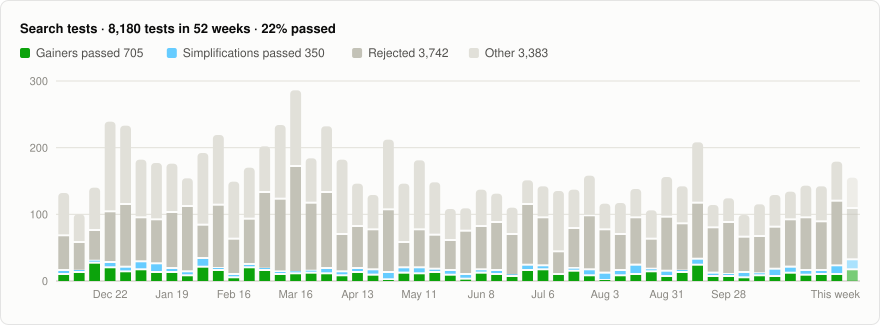

# Fishtest status

Updated Thu 26 Nov 2026, 08:45 UTC

## Trends

### Last 14 days

#### Cores by test type

<picture>
  <source media="(prefers-color-scheme: dark)" srcset="https://raw.githubusercontent.com/xu-shawn/fishtest_track/7f2d7c5e49111410be31c40a503d08194e598d4f/types-dark.svg">
  
</picture>

#### Tests by type

<picture>
  <source media="(prefers-color-scheme: dark)" srcset="https://raw.githubusercontent.com/xu-shawn/fishtest_track/7f2d7c5e49111410be31c40a503d08194e598d4f/type-counts-dark.svg">
  
</picture>

#### Net tests and search tests

<picture>
  <source media="(prefers-color-scheme: dark)" srcset="https://raw.githubusercontent.com/xu-shawn/fishtest_track/7f2d7c5e49111410be31c40a503d08194e598d4f/net-search-trend-dark.svg">
  
</picture>

#### Gainer and simplification bounds

<picture>
  <source media="(prefers-color-scheme: dark)" srcset="https://raw.githubusercontent.com/xu-shawn/fishtest_track/7f2d7c5e49111410be31c40a503d08194e598d4f/bounds-trend-dark.svg">
  
</picture>

#### Cores by test

<picture>
  <source media="(prefers-color-scheme: dark)" srcset="https://raw.githubusercontent.com/xu-shawn/fishtest_track/7f2d7c5e49111410be31c40a503d08194e598d4f/tests-trend-dark.svg">
  
</picture>

#### Cores by author

<picture>
  <source media="(prefers-color-scheme: dark)" srcset="https://raw.githubusercontent.com/xu-shawn/fishtest_track/7f2d7c5e49111410be31c40a503d08194e598d4f/authors-trend-dark.svg">
  
</picture>

#### Tests per author

<picture>
  <source media="(prefers-color-scheme: dark)" srcset="https://raw.githubusercontent.com/xu-shawn/fishtest_track/7f2d7c5e49111410be31c40a503d08194e598d4f/author-tests-trend-dark.svg">
  
</picture>

#### Cores contributed by user

<picture>
  <source media="(prefers-color-scheme: dark)" srcset="https://raw.githubusercontent.com/xu-shawn/fishtest_track/7f2d7c5e49111410be31c40a503d08194e598d4f/contributors-trend-dark.svg">
  
</picture>

#### MNps contributed by user

<picture>
  <source media="(prefers-color-scheme: dark)" srcset="https://raw.githubusercontent.com/xu-shawn/fishtest_track/7f2d7c5e49111410be31c40a503d08194e598d4f/contributors-mnps-trend-dark.svg">
  
</picture>

#### Tests, authors, contributors and throughput

<picture>
  <source media="(prefers-color-scheme: dark)" srcset="https://raw.githubusercontent.com/xu-shawn/fishtest_track/7f2d7c5e49111410be31c40a503d08194e598d4f/activity-dark.svg">
  
</picture>

#### Tests finished per hour

<picture>
  <source media="(prefers-color-scheme: dark)" srcset="https://raw.githubusercontent.com/xu-shawn/fishtest_track/7f2d7c5e49111410be31c40a503d08194e598d4f/throughput-dark.svg">
  
</picture>

#### LLR distribution of running tests

<picture>
  <source media="(prefers-color-scheme: dark)" srcset="https://raw.githubusercontent.com/xu-shawn/fishtest_track/7f2d7c5e49111410be31c40a503d08194e598d4f/llr-dark.svg">
  
</picture>

### Last 30 days

#### Finished tests per day

<picture>
  <source media="(prefers-color-scheme: dark)" srcset="https://raw.githubusercontent.com/xu-shawn/fishtest_track/7f2d7c5e49111410be31c40a503d08194e598d4f/finished-dark.svg">
  
</picture>

Last 7 days: **203 tests** finished, 17.9M games. **40 passed** (32 STC, 6 LTC, 2 nodestime), 102 rejected, 47 stopped, 5 completed (SPSA or fixed games), 9 failed. SPRT pass rate 28.2%: 18.6% for gainers (118), 75.0% for simplifications (24); 33.3% for net tests (15), 27.6% for search tests (127).

#### Cores by architecture

<picture>
  <source media="(prefers-color-scheme: dark)" srcset="https://raw.githubusercontent.com/xu-shawn/fishtest_track/7f2d7c5e49111410be31c40a503d08194e598d4f/monthly-arch-dark.svg">
  
</picture>

#### Cores by compiler

<picture>
  <source media="(prefers-color-scheme: dark)" srcset="https://raw.githubusercontent.com/xu-shawn/fishtest_track/7f2d7c5e49111410be31c40a503d08194e598d4f/monthly-compiler-dark.svg">
  
</picture>

### Last year

#### Finished tests per week

<picture>
  <source media="(prefers-color-scheme: dark)" srcset="https://raw.githubusercontent.com/xu-shawn/fishtest_track/7f2d7c5e49111410be31c40a503d08194e598d4f/weekly-finished-dark.svg">
  
</picture>

#### Runtime of finished tests

<picture>
  <source media="(prefers-color-scheme: dark)" srcset="https://raw.githubusercontent.com/xu-shawn/fishtest_track/7f2d7c5e49111410be31c40a503d08194e598d4f/runtime-trend-dark.svg">
  
</picture>

#### Average cores per week by test type

<picture>
  <source media="(prefers-color-scheme: dark)" srcset="https://raw.githubusercontent.com/xu-shawn/fishtest_track/7f2d7c5e49111410be31c40a503d08194e598d4f/weekly-types-dark.svg">
  
</picture>

#### Cores by architecture

<picture>
  <source media="(prefers-color-scheme: dark)" srcset="https://raw.githubusercontent.com/xu-shawn/fishtest_track/7f2d7c5e49111410be31c40a503d08194e598d4f/yearly-arch-dark.svg">
  
</picture>

#### Cores by compiler

<picture>
  <source media="(prefers-color-scheme: dark)" srcset="https://raw.githubusercontent.com/xu-shawn/fishtest_track/7f2d7c5e49111410be31c40a503d08194e598d4f/yearly-compiler-dark.svg">
  
</picture>

#### Gainer bounds

<picture>
  <source media="(prefers-color-scheme: dark)" srcset="https://raw.githubusercontent.com/xu-shawn/fishtest_track/7f2d7c5e49111410be31c40a503d08194e598d4f/weekly-gainers-dark.svg">
  
</picture>

#### Simplification bounds

<picture>
  <source media="(prefers-color-scheme: dark)" srcset="https://raw.githubusercontent.com/xu-shawn/fishtest_track/7f2d7c5e49111410be31c40a503d08194e598d4f/weekly-simplifications-dark.svg">
  
</picture>

#### Net tests

<picture>
  <source media="(prefers-color-scheme: dark)" srcset="https://raw.githubusercontent.com/xu-shawn/fishtest_track/7f2d7c5e49111410be31c40a503d08194e598d4f/weekly-net-dark.svg">
  
</picture>

#### Search tests

<picture>
  <source media="(prefers-color-scheme: dark)" srcset="https://raw.githubusercontent.com/xu-shawn/fishtest_track/7f2d7c5e49111410be31c40a503d08194e598d4f/weekly-search-dark.svg">
  
</picture>

### Since 19 Oct 2026, daily averages

#### Cores by test type

<picture>
  <source media="(prefers-color-scheme: dark)" srcset="https://raw.githubusercontent.com/xu-shawn/fishtest_track/7f2d7c5e49111410be31c40a503d08194e598d4f/long-types-dark.svg">
  
</picture>

#### Cores by author

<picture>
  <source media="(prefers-color-scheme: dark)" srcset="https://raw.githubusercontent.com/xu-shawn/fishtest_track/7f2d7c5e49111410be31c40a503d08194e598d4f/long-authors-dark.svg">
  
</picture>

#### Tests per author

<picture>
  <source media="(prefers-color-scheme: dark)" srcset="https://raw.githubusercontent.com/xu-shawn/fishtest_track/7f2d7c5e49111410be31c40a503d08194e598d4f/long-author-tests-dark.svg">
  
</picture>

#### Cores contributed by user

<picture>
  <source media="(prefers-color-scheme: dark)" srcset="https://raw.githubusercontent.com/xu-shawn/fishtest_track/7f2d7c5e49111410be31c40a503d08194e598d4f/long-contributors-dark.svg">
  
</picture>

#### MNps contributed by user

<picture>
  <source media="(prefers-color-scheme: dark)" srcset="https://raw.githubusercontent.com/xu-shawn/fishtest_track/7f2d7c5e49111410be31c40a503d08194e598d4f/long-contributors-mnps-dark.svg">
  
</picture>

#### Tests, authors, contributors and throughput

<picture>
  <source media="(prefers-color-scheme: dark)" srcset="https://raw.githubusercontent.com/xu-shawn/fishtest_track/7f2d7c5e49111410be31c40a503d08194e598d4f/long-activity-dark.svg">
  
</picture>

## Right now

**65 tests** from **19 authors** are running on **3,550 cores** (314 workers from 67 contributors). About 80 hours of work is queued.

| | Now | 24 h avg | 7 d avg | 30 d avg |
|:--|--:|--:|--:|--:|
| Tests running | 65 | 63 | 66 | 52 |
| Authors with running tests | 19 | 20 | 21 | 19 |
| Cores | 3,550 | 5,536 | 3,260 | 2,144 |
| Workers | 314 | 456 | 307 | 228 |
| Contributors with workers | 67 | 68 | 66 | 63 |
| Net tests running | 3 | 5 | 5 | 5 |
| Cores on net tests | 269 | 546 | 565 | 336 |
| Nodes per second | 1.76G | 2.66G | 1.71G | 1.17G |
| Games per minute | 1,939 | 2,836 | 2,149 | 1,759 |
| Pending hours | 80 h | 53 h | 114 h | 90 h |

### Cores by test

<picture>
  <source media="(prefers-color-scheme: dark)" srcset="https://raw.githubusercontent.com/xu-shawn/fishtest_track/7f2d7c5e49111410be31c40a503d08194e598d4f/tests-dark.svg">
  
</picture>

### Runtime of running tests

<picture>
  <source media="(prefers-color-scheme: dark)" srcset="https://raw.githubusercontent.com/xu-shawn/fishtest_track/7f2d7c5e49111410be31c40a503d08194e598d4f/runtime-dark.svg">
  
</picture>

### Cores by author

<picture>
  <source media="(prefers-color-scheme: dark)" srcset="https://raw.githubusercontent.com/xu-shawn/fishtest_track/7f2d7c5e49111410be31c40a503d08194e598d4f/authors-dark.svg">
  
</picture>

### Cores contributed by user

<picture>
  <source media="(prefers-color-scheme: dark)" srcset="https://raw.githubusercontent.com/xu-shawn/fishtest_track/7f2d7c5e49111410be31c40a503d08194e598d4f/contributors-dark.svg">
  
</picture>

### MNps contributed by user

<picture>
  <source media="(prefers-color-scheme: dark)" srcset="https://raw.githubusercontent.com/xu-shawn/fishtest_track/7f2d7c5e49111410be31c40a503d08194e598d4f/contributors-mnps-dark.svg">
  
</picture>

## Last 30 days in detail

### Recently passed

| Finished | Author | Test | TC | Bounds | Elo |
|:--|:--|:--|:--|:--|--:|
| Nov 26 | [Disservin](https://tests.stockfishchess.org/tests/user/Disservin) | [`skip-destructors-trivia…`](https://tests.stockfishchess.org/tests/view/6b0728389f65cf9079e25c1d) | 10+0.1 | [-1.75,0.25] | +1.01 ±1.29 |
| Nov 26 | [Gruenerapfel](https://tests.stockfishchess.org/tests/user/Gruenerapfel) | [`nmp-verify-root-fp`](https://tests.stockfishchess.org/tests/view/6b033f01b9d0e035d605ff0b) | 10+0.1 | [-1.75,0.25] | +0.16 ±0.82 |
| Nov 26 | [tsoj](https://tests.stockfishchess.org/tests/user/tsoj) | [`se-node-count`](https://tests.stockfishchess.org/tests/view/6b072f9c9f65cf9079e25c30) | 60+0.6 | [0.5,2.5] | +4.45 ±2.11 |
| Nov 26 | [shawnxu](https://tests.stockfishchess.org/tests/user/shawnxu) | [`test1772`](https://tests.stockfishchess.org/tests/view/6b05dec29f65cf9079e25903) | 60+0.6 | [0.5,2.5] | +2.46 ±1.46 |
| Nov 25 | [sg](https://tests.stockfishchess.org/tests/user/sg) | [`cram2_i8_array_embed_mo…`](https://tests.stockfishchess.org/tests/view/6b0497959f65cf9079e2576d) | 100+1 nodestime | [0,2] | +2.17 ±1.47 |
| Nov 25 | [Fisherman](https://tests.stockfishchess.org/tests/user/Fisherman) | [`PawnHistQueen`](https://tests.stockfishchess.org/tests/view/6b022c07b9d0e035d605fb07) | 60+0.6 | [0.5,2.5] | +1.45 ±0.96 |
| Nov 25 | [Mineta](https://tests.stockfishchess.org/tests/user/Mineta) | [`nettest/1`](https://tests.stockfishchess.org/tests/view/6b0735669f65cf9079e25c37) | 67.2+0.672 nodestime | [0,2] | +35.43 ±7.34 |
| Nov 25 | [tsoj](https://tests.stockfishchess.org/tests/user/tsoj) | [`se-node-count`](https://tests.stockfishchess.org/tests/view/6b06009f9f65cf9079e2593f) | 10+0.1 | [0,2] | +1.86 ±1.33 |
| Nov 25 | [fwoodruff](https://tests.stockfishchess.org/tests/user/fwoodruff) | [`correction-minor-degene…`](https://tests.stockfishchess.org/tests/view/6b02987db9d0e035d605fcf6) | 10+0.1 | [0,2] | +1.24 ±0.98 |
| Nov 25 | [fwoodruff](https://tests.stockfishchess.org/tests/user/fwoodruff) | [`correction-minor-few-pl…`](https://tests.stockfishchess.org/tests/view/6b0433109f65cf9079e256e1) | 10+0.1 | [0,2] | +1.66 ±1.22 |
| Nov 25 | [penneponne](https://tests.stockfishchess.org/tests/user/penneponne) | [`c2s/51-se-margin-histor…`](https://tests.stockfishchess.org/tests/view/6b03bbc39f65cf9079e25608) | 10+0.1 | [0,2] | +1.77 ±1.28 |
| Nov 25 | [Gruenerapfel](https://tests.stockfishchess.org/tests/user/Gruenerapfel) | [`nmp-verify-minimal`](https://tests.stockfishchess.org/tests/view/6b031d38b9d0e035d605fed1) | 10+0.1 | [-1.75,0.25] | +0.53 ±1.07 |

### Most active authors

| Author | Finished | Passed | Running now | Core-hours | Share |
|:--|--:|--:|--:|--:|--:|
| [sg](https://tests.stockfishchess.org/tests/user/sg) | 40 | 7 | 3 | 119,404 | 10.4% |
| [shawnxu](https://tests.stockfishchess.org/tests/user/shawnxu) | 51 | 22 | 1 | 101,361 | 8.9% |
| [Gruenerapfel](https://tests.stockfishchess.org/tests/user/Gruenerapfel) | 30 | 9 | 4 | 98,780 | 8.6% |
| [fauzi2](https://tests.stockfishchess.org/tests/user/fauzi2) | 47 | 4 | 8 | 96,240 | 8.4% |
| [Vizvezdenec](https://tests.stockfishchess.org/tests/user/Vizvezdenec) | 54 | 9 | 6 | 78,651 | 6.9% |
| [vdv](https://tests.stockfishchess.org/tests/user/vdv) | 15 | 3 | 0 | 74,611 | 6.5% |
| [rn](https://tests.stockfishchess.org/tests/user/rn) | 12 | 7 | 3 | 64,338 | 5.6% |
| [Disservin](https://tests.stockfishchess.org/tests/user/Disservin) | 6 | 1 | 0 | 60,062 | 5.3% |
| [AdrianStockfish](https://tests.stockfishchess.org/tests/user/AdrianStockfish) | 44 | 4 | 8 | 52,910 | 4.6% |
| [Kaz](https://tests.stockfishchess.org/tests/user/Kaz) | 13 | 3 | 3 | 39,115 | 3.4% |

### Top contributors

| Contributor | Core-hours | Share | Cores now | MNps now | Workers now |
|:--|--:|--:|--:|--:|--:|
| [ChessDBCN](https://tests.stockfishchess.org/tests/user/ChessDBCN) | 316,737 | 21.2% | 472 | 204 | 59 |
| [vdv](https://tests.stockfishchess.org/tests/user/vdv) | 251,433 | 16.9% | 1,984 | 833 | 124 |
| [niklasf](https://tests.stockfishchess.org/tests/user/niklasf) | 116,237 | 7.8% | 63 | 32 | 1 |
| [Wencey](https://tests.stockfishchess.org/tests/user/Wencey) | 104,256 | 7.0% | 150 | 50 | 4 |
| [MediumBerry5575](https://tests.stockfishchess.org/tests/user/MediumBerry5575) | 85,556 | 5.7% | 0 | 0.0 | 0 |
| [okrout](https://tests.stockfishchess.org/tests/user/okrout) | 58,464 | 3.9% | 94 | 67 | 7 |
| [wizzouk](https://tests.stockfishchess.org/tests/user/wizzouk) | 53,933 | 3.6% | 58 | 34 | 3 |
| [beginnerchess10002551](https://tests.stockfishchess.org/tests/user/beginnerchess10002551) | 50,485 | 3.4% | 80 | 66 | 20 |
| [CypressChess](https://tests.stockfishchess.org/tests/user/CypressChess) | 27,778 | 1.9% | 40 | 18 | 5 |
| [fogleman](https://tests.stockfishchess.org/tests/user/fogleman) | 26,605 | 1.8% | 53 | 47 | 5 |
