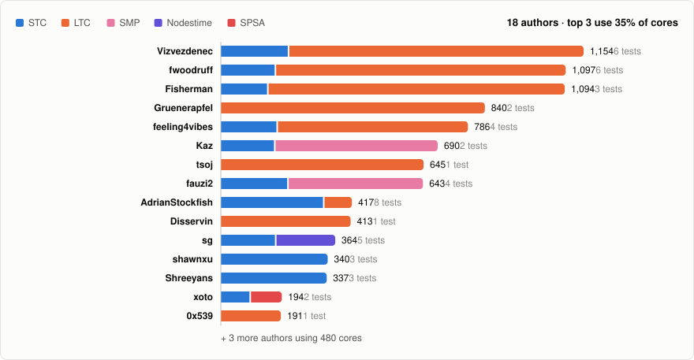

# Fishtest status

Updated Thu 26 Nov 2026, 22:45 UTC

## Trends

### Last 14 days

#### Cores by test type

<picture>
  <source media="(prefers-color-scheme: dark)" srcset="https://raw.githubusercontent.com/xu-shawn/fishtest_track/7b52ff8328144355c58f9f074524b2ae6a2ac633/types-dark.svg">
  
</picture>

#### Tests by type

<picture>
  <source media="(prefers-color-scheme: dark)" srcset="https://raw.githubusercontent.com/xu-shawn/fishtest_track/7b52ff8328144355c58f9f074524b2ae6a2ac633/type-counts-dark.svg">
  
</picture>

#### Net tests and search tests

<picture>
  <source media="(prefers-color-scheme: dark)" srcset="https://raw.githubusercontent.com/xu-shawn/fishtest_track/7b52ff8328144355c58f9f074524b2ae6a2ac633/net-search-trend-dark.svg">
  
</picture>

#### Gainer and simplification bounds

<picture>
  <source media="(prefers-color-scheme: dark)" srcset="https://raw.githubusercontent.com/xu-shawn/fishtest_track/7b52ff8328144355c58f9f074524b2ae6a2ac633/bounds-trend-dark.svg">
  
</picture>

#### Cores by test

<picture>
  <source media="(prefers-color-scheme: dark)" srcset="https://raw.githubusercontent.com/xu-shawn/fishtest_track/7b52ff8328144355c58f9f074524b2ae6a2ac633/tests-trend-dark.svg">
  
</picture>

#### Cores by author

<picture>
  <source media="(prefers-color-scheme: dark)" srcset="https://raw.githubusercontent.com/xu-shawn/fishtest_track/7b52ff8328144355c58f9f074524b2ae6a2ac633/authors-trend-dark.svg">
  
</picture>

#### Tests per author

<picture>
  <source media="(prefers-color-scheme: dark)" srcset="https://raw.githubusercontent.com/xu-shawn/fishtest_track/7b52ff8328144355c58f9f074524b2ae6a2ac633/author-tests-trend-dark.svg">
  
</picture>

#### Cores contributed by user

<picture>
  <source media="(prefers-color-scheme: dark)" srcset="https://raw.githubusercontent.com/xu-shawn/fishtest_track/7b52ff8328144355c58f9f074524b2ae6a2ac633/contributors-trend-dark.svg">
  
</picture>

#### MNps contributed by user

<picture>
  <source media="(prefers-color-scheme: dark)" srcset="https://raw.githubusercontent.com/xu-shawn/fishtest_track/7b52ff8328144355c58f9f074524b2ae6a2ac633/contributors-mnps-trend-dark.svg">
  
</picture>

#### Tests, authors, contributors and throughput

<picture>
  <source media="(prefers-color-scheme: dark)" srcset="https://raw.githubusercontent.com/xu-shawn/fishtest_track/7b52ff8328144355c58f9f074524b2ae6a2ac633/activity-dark.svg">
  
</picture>

#### Tests finished per hour

<picture>
  <source media="(prefers-color-scheme: dark)" srcset="https://raw.githubusercontent.com/xu-shawn/fishtest_track/7b52ff8328144355c58f9f074524b2ae6a2ac633/throughput-dark.svg">
  
</picture>

#### LLR distribution of running tests

<picture>
  <source media="(prefers-color-scheme: dark)" srcset="https://raw.githubusercontent.com/xu-shawn/fishtest_track/7b52ff8328144355c58f9f074524b2ae6a2ac633/llr-dark.svg">
  
</picture>

### Last 30 days

#### Finished tests per day

<picture>
  <source media="(prefers-color-scheme: dark)" srcset="https://raw.githubusercontent.com/xu-shawn/fishtest_track/7b52ff8328144355c58f9f074524b2ae6a2ac633/finished-dark.svg">
  
</picture>

Last 7 days: **203 tests** finished, 18.7M games. **44 passed** (35 STC, 7 LTC, 2 nodestime), 103 rejected, 45 stopped, 4 completed (SPSA or fixed games), 7 failed. SPRT pass rate 29.9%: 20.2% for gainers (119), 71.4% for simplifications (28); 33.3% for net tests (15), 29.5% for search tests (132).

#### Cores by architecture

<picture>
  <source media="(prefers-color-scheme: dark)" srcset="https://raw.githubusercontent.com/xu-shawn/fishtest_track/7b52ff8328144355c58f9f074524b2ae6a2ac633/monthly-arch-dark.svg">
  
</picture>

#### Cores by compiler

<picture>
  <source media="(prefers-color-scheme: dark)" srcset="https://raw.githubusercontent.com/xu-shawn/fishtest_track/7b52ff8328144355c58f9f074524b2ae6a2ac633/monthly-compiler-dark.svg">
  
</picture>

### Last year

#### Finished tests per week

<picture>
  <source media="(prefers-color-scheme: dark)" srcset="https://raw.githubusercontent.com/xu-shawn/fishtest_track/7b52ff8328144355c58f9f074524b2ae6a2ac633/weekly-finished-dark.svg">
  
</picture>

#### Runtime of finished tests

<picture>
  <source media="(prefers-color-scheme: dark)" srcset="https://raw.githubusercontent.com/xu-shawn/fishtest_track/7b52ff8328144355c58f9f074524b2ae6a2ac633/runtime-trend-dark.svg">
  
</picture>

#### Average cores per week by test type

<picture>
  <source media="(prefers-color-scheme: dark)" srcset="https://raw.githubusercontent.com/xu-shawn/fishtest_track/7b52ff8328144355c58f9f074524b2ae6a2ac633/weekly-types-dark.svg">
  
</picture>

#### Cores by architecture

<picture>
  <source media="(prefers-color-scheme: dark)" srcset="https://raw.githubusercontent.com/xu-shawn/fishtest_track/7b52ff8328144355c58f9f074524b2ae6a2ac633/yearly-arch-dark.svg">
  
</picture>

#### Cores by compiler

<picture>
  <source media="(prefers-color-scheme: dark)" srcset="https://raw.githubusercontent.com/xu-shawn/fishtest_track/7b52ff8328144355c58f9f074524b2ae6a2ac633/yearly-compiler-dark.svg">
  
</picture>

#### Gainer bounds

<picture>
  <source media="(prefers-color-scheme: dark)" srcset="https://raw.githubusercontent.com/xu-shawn/fishtest_track/7b52ff8328144355c58f9f074524b2ae6a2ac633/weekly-gainers-dark.svg">
  
</picture>

#### Simplification bounds

<picture>
  <source media="(prefers-color-scheme: dark)" srcset="https://raw.githubusercontent.com/xu-shawn/fishtest_track/7b52ff8328144355c58f9f074524b2ae6a2ac633/weekly-simplifications-dark.svg">
  
</picture>

#### Net tests

<picture>
  <source media="(prefers-color-scheme: dark)" srcset="https://raw.githubusercontent.com/xu-shawn/fishtest_track/7b52ff8328144355c58f9f074524b2ae6a2ac633/weekly-net-dark.svg">
  
</picture>

#### Search tests

<picture>
  <source media="(prefers-color-scheme: dark)" srcset="https://raw.githubusercontent.com/xu-shawn/fishtest_track/7b52ff8328144355c58f9f074524b2ae6a2ac633/weekly-search-dark.svg">
  
</picture>

### Since 19 Oct 2026, daily averages

#### Cores by test type

<picture>
  <source media="(prefers-color-scheme: dark)" srcset="https://raw.githubusercontent.com/xu-shawn/fishtest_track/7b52ff8328144355c58f9f074524b2ae6a2ac633/long-types-dark.svg">
  
</picture>

#### Cores by author

<picture>
  <source media="(prefers-color-scheme: dark)" srcset="https://raw.githubusercontent.com/xu-shawn/fishtest_track/7b52ff8328144355c58f9f074524b2ae6a2ac633/long-authors-dark.svg">
  
</picture>

#### Tests per author

<picture>
  <source media="(prefers-color-scheme: dark)" srcset="https://raw.githubusercontent.com/xu-shawn/fishtest_track/7b52ff8328144355c58f9f074524b2ae6a2ac633/long-author-tests-dark.svg">
  
</picture>

#### Cores contributed by user

<picture>
  <source media="(prefers-color-scheme: dark)" srcset="https://raw.githubusercontent.com/xu-shawn/fishtest_track/7b52ff8328144355c58f9f074524b2ae6a2ac633/long-contributors-dark.svg">
  
</picture>

#### MNps contributed by user

<picture>
  <source media="(prefers-color-scheme: dark)" srcset="https://raw.githubusercontent.com/xu-shawn/fishtest_track/7b52ff8328144355c58f9f074524b2ae6a2ac633/long-contributors-mnps-dark.svg">
  
</picture>

#### Tests, authors, contributors and throughput

<picture>
  <source media="(prefers-color-scheme: dark)" srcset="https://raw.githubusercontent.com/xu-shawn/fishtest_track/7b52ff8328144355c58f9f074524b2ae6a2ac633/long-activity-dark.svg">
  
</picture>

## Right now

**63 tests** from **23 authors** are running on **5,502 cores** (421 workers from 69 contributors). About 58 hours of work is queued.

| | Now | 24 h avg | 7 d avg | 30 d avg |
|:--|--:|--:|--:|--:|
| Tests running | 63 | 64 | 66 | 52 |
| Authors with running tests | 23 | 21 | 21 | 19 |
| Cores | 5,502 | 5,388 | 3,542 | 2,206 |
| Workers | 421 | 441 | 325 | 232 |
| Contributors with workers | 69 | 69 | 66 | 64 |
| Net tests running | 5 | 4 | 5 | 5 |
| Cores on net tests | 563 | 531 | 585 | 340 |
| Nodes per second | 2.58G | 2.58G | 1.83G | 1.20G |
| Games per minute | 2,655 | 2,818 | 2,233 | 1,771 |
| Pending hours | 58 h | 60 h | 109 h | 90 h |

### Cores by test

<picture>
  <source media="(prefers-color-scheme: dark)" srcset="https://raw.githubusercontent.com/xu-shawn/fishtest_track/7b52ff8328144355c58f9f074524b2ae6a2ac633/tests-dark.svg">
  
</picture>

### Runtime of running tests

<picture>
  <source media="(prefers-color-scheme: dark)" srcset="https://raw.githubusercontent.com/xu-shawn/fishtest_track/7b52ff8328144355c58f9f074524b2ae6a2ac633/runtime-dark.svg">
  
</picture>

### Cores by author

<picture>
  <source media="(prefers-color-scheme: dark)" srcset="https://raw.githubusercontent.com/xu-shawn/fishtest_track/7b52ff8328144355c58f9f074524b2ae6a2ac633/authors-dark.svg">
  
</picture>

### Cores contributed by user

<picture>
  <source media="(prefers-color-scheme: dark)" srcset="https://raw.githubusercontent.com/xu-shawn/fishtest_track/7b52ff8328144355c58f9f074524b2ae6a2ac633/contributors-dark.svg">
  
</picture>

### MNps contributed by user

<picture>
  <source media="(prefers-color-scheme: dark)" srcset="https://raw.githubusercontent.com/xu-shawn/fishtest_track/7b52ff8328144355c58f9f074524b2ae6a2ac633/contributors-mnps-dark.svg">
  
</picture>

## Last 30 days in detail

### Recently passed

| Finished | Author | Test | TC | Bounds | Elo |
|:--|:--|:--|:--|:--|--:|
| Nov 26 | [Vizvezdenec](https://tests.stockfishchess.org/tests/user/Vizvezdenec) | [`ttmrCutNode1`](https://tests.stockfishchess.org/tests/view/6b0699629f65cf9079e25a50) | 10+0.1 | [0,2] | +1.67 ±1.22 |
| Nov 26 | [Gruenerapfel](https://tests.stockfishchess.org/tests/user/Gruenerapfel) | [`alternative-failhighrec…`](https://tests.stockfishchess.org/tests/view/6b05d1a19f65cf9079e258f2) | 10+0.1 | [0,2] | +1.26 ±0.99 |
| Nov 26 | [Shreeyans](https://tests.stockfishchess.org/tests/user/Shreeyans) | [`remove-correl`](https://tests.stockfishchess.org/tests/view/6b05eb189f65cf9079e25927) | 60+0.6 | [-1.75,0.25] | +0.94 ±1.24 |
| Nov 26 | [rn](https://tests.stockfishchess.org/tests/user/rn) | [`fix-1-move-pvs`](https://tests.stockfishchess.org/tests/view/6b0032952ff81bd6a63445a5) | 10+0.1 | [-1.75,0.25] | -0.16 ±0.51 |
| Nov 26 | [Disservin](https://tests.stockfishchess.org/tests/user/Disservin) | [`skip-destructors-trivia…`](https://tests.stockfishchess.org/tests/view/6b0728389f65cf9079e25c1d) | 10+0.1 | [-1.75,0.25] | +1.01 ±1.29 |
| Nov 26 | [Gruenerapfel](https://tests.stockfishchess.org/tests/user/Gruenerapfel) | [`nmp-verify-root-fp`](https://tests.stockfishchess.org/tests/view/6b033f01b9d0e035d605ff0b) | 10+0.1 | [-1.75,0.25] | +0.16 ±0.82 |
| Nov 26 | [tsoj](https://tests.stockfishchess.org/tests/user/tsoj) | [`se-node-count`](https://tests.stockfishchess.org/tests/view/6b072f9c9f65cf9079e25c30) | 60+0.6 | [0.5,2.5] | +4.45 ±2.11 |
| Nov 26 | [shawnxu](https://tests.stockfishchess.org/tests/user/shawnxu) | [`test1772`](https://tests.stockfishchess.org/tests/view/6b05dec29f65cf9079e25903) | 60+0.6 | [0.5,2.5] | +2.46 ±1.46 |
| Nov 25 | [sg](https://tests.stockfishchess.org/tests/user/sg) | [`cram2_i8_array_embed_mo…`](https://tests.stockfishchess.org/tests/view/6b0497959f65cf9079e2576d) | 100+1 nodestime | [0,2] | +2.17 ±1.47 |
| Nov 25 | [Fisherman](https://tests.stockfishchess.org/tests/user/Fisherman) | [`PawnHistQueen`](https://tests.stockfishchess.org/tests/view/6b022c07b9d0e035d605fb07) | 60+0.6 | [0.5,2.5] | +1.45 ±0.96 |
| Nov 25 | [Mineta](https://tests.stockfishchess.org/tests/user/Mineta) | [`nettest/1`](https://tests.stockfishchess.org/tests/view/6b0735669f65cf9079e25c37) | 67.2+0.672 nodestime | [0,2] | +35.43 ±7.34 |
| Nov 25 | [tsoj](https://tests.stockfishchess.org/tests/user/tsoj) | [`se-node-count`](https://tests.stockfishchess.org/tests/view/6b06009f9f65cf9079e2593f) | 10+0.1 | [0,2] | +1.86 ±1.33 |

### Most active authors

| Author | Finished | Passed | Running now | Core-hours | Share |
|:--|--:|--:|--:|--:|--:|
| [fauzi2](https://tests.stockfishchess.org/tests/user/fauzi2) | 51 | 4 | 6 | 136,141 | 11.5% |
| [sg](https://tests.stockfishchess.org/tests/user/sg) | 39 | 6 | 3 | 117,703 | 9.9% |
| [Gruenerapfel](https://tests.stockfishchess.org/tests/user/Gruenerapfel) | 30 | 10 | 4 | 99,710 | 8.4% |
| [shawnxu](https://tests.stockfishchess.org/tests/user/shawnxu) | 48 | 20 | 2 | 97,527 | 8.2% |
| [Vizvezdenec](https://tests.stockfishchess.org/tests/user/Vizvezdenec) | 52 | 10 | 6 | 77,066 | 6.5% |
| [vdv](https://tests.stockfishchess.org/tests/user/vdv) | 15 | 3 | 0 | 74,611 | 6.3% |
| [rn](https://tests.stockfishchess.org/tests/user/rn) | 14 | 8 | 1 | 73,476 | 6.2% |
| [Disservin](https://tests.stockfishchess.org/tests/user/Disservin) | 6 | 1 | 0 | 60,062 | 5.1% |
| [AdrianStockfish](https://tests.stockfishchess.org/tests/user/AdrianStockfish) | 43 | 4 | 8 | 52,830 | 4.5% |
| [Kaz](https://tests.stockfishchess.org/tests/user/Kaz) | 14 | 3 | 2 | 41,482 | 3.5% |

### Top contributors

| Contributor | Core-hours | Share | Cores now | MNps now | Workers now |
|:--|--:|--:|--:|--:|--:|
| [ChessDBCN](https://tests.stockfishchess.org/tests/user/ChessDBCN) | 323,301 | 20.7% | 464 | 201 | 58 |
| [vdv](https://tests.stockfishchess.org/tests/user/vdv) | 299,446 | 19.2% | 3,936 | 1,656 | 246 |
| [niklasf](https://tests.stockfishchess.org/tests/user/niklasf) | 117,119 | 7.5% | 63 | 35 | 1 |
| [Wencey](https://tests.stockfishchess.org/tests/user/Wencey) | 106,356 | 6.8% | 150 | 53 | 4 |
| [MediumBerry5575](https://tests.stockfishchess.org/tests/user/MediumBerry5575) | 86,636 | 5.5% | 0 | 0.0 | 0 |
| [okrout](https://tests.stockfishchess.org/tests/user/okrout) | 59,780 | 3.8% | 94 | 66 | 7 |
| [wizzouk](https://tests.stockfishchess.org/tests/user/wizzouk) | 54,830 | 3.5% | 58 | 28 | 3 |
| [beginnerchess10002551](https://tests.stockfishchess.org/tests/user/beginnerchess10002551) | 50,805 | 3.3% | 0 | 0.0 | 0 |
| [CypressChess](https://tests.stockfishchess.org/tests/user/CypressChess) | 28,338 | 1.8% | 40 | 18 | 5 |
| [fogleman](https://tests.stockfishchess.org/tests/user/fogleman) | 27,347 | 1.8% | 53 | 41 | 5 |
