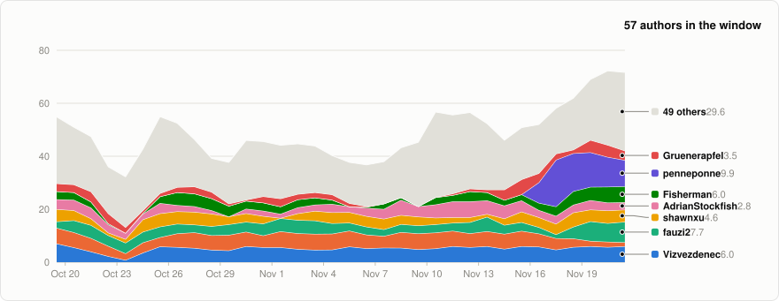

# Fishtest status

Updated Sat 28 Nov 2026, 07:45 UTC

## Trends

### Last 14 days

#### Cores by test type

<picture>
  <source media="(prefers-color-scheme: dark)" srcset="https://raw.githubusercontent.com/xu-shawn/fishtest_track/31694bb893eff2258e919d4bb78cbb4eefe60914/types-dark.svg">
  
</picture>

#### Tests by type

<picture>
  <source media="(prefers-color-scheme: dark)" srcset="https://raw.githubusercontent.com/xu-shawn/fishtest_track/31694bb893eff2258e919d4bb78cbb4eefe60914/type-counts-dark.svg">
  
</picture>

#### Net tests and search tests

<picture>
  <source media="(prefers-color-scheme: dark)" srcset="https://raw.githubusercontent.com/xu-shawn/fishtest_track/31694bb893eff2258e919d4bb78cbb4eefe60914/net-search-trend-dark.svg">
  
</picture>

#### Gainer and simplification bounds

<picture>
  <source media="(prefers-color-scheme: dark)" srcset="https://raw.githubusercontent.com/xu-shawn/fishtest_track/31694bb893eff2258e919d4bb78cbb4eefe60914/bounds-trend-dark.svg">
  
</picture>

#### Cores by test

<picture>
  <source media="(prefers-color-scheme: dark)" srcset="https://raw.githubusercontent.com/xu-shawn/fishtest_track/31694bb893eff2258e919d4bb78cbb4eefe60914/tests-trend-dark.svg">
  
</picture>

#### Cores by author

<picture>
  <source media="(prefers-color-scheme: dark)" srcset="https://raw.githubusercontent.com/xu-shawn/fishtest_track/31694bb893eff2258e919d4bb78cbb4eefe60914/authors-trend-dark.svg">
  
</picture>

#### Tests per author

<picture>
  <source media="(prefers-color-scheme: dark)" srcset="https://raw.githubusercontent.com/xu-shawn/fishtest_track/31694bb893eff2258e919d4bb78cbb4eefe60914/author-tests-trend-dark.svg">
  
</picture>

#### Cores contributed by user

<picture>
  <source media="(prefers-color-scheme: dark)" srcset="https://raw.githubusercontent.com/xu-shawn/fishtest_track/31694bb893eff2258e919d4bb78cbb4eefe60914/contributors-trend-dark.svg">
  
</picture>

#### MNps contributed by user

<picture>
  <source media="(prefers-color-scheme: dark)" srcset="https://raw.githubusercontent.com/xu-shawn/fishtest_track/31694bb893eff2258e919d4bb78cbb4eefe60914/contributors-mnps-trend-dark.svg">
  
</picture>

#### Tests, authors, contributors and throughput

<picture>
  <source media="(prefers-color-scheme: dark)" srcset="https://raw.githubusercontent.com/xu-shawn/fishtest_track/31694bb893eff2258e919d4bb78cbb4eefe60914/activity-dark.svg">
  
</picture>

#### Tests finished per hour

<picture>
  <source media="(prefers-color-scheme: dark)" srcset="https://raw.githubusercontent.com/xu-shawn/fishtest_track/31694bb893eff2258e919d4bb78cbb4eefe60914/throughput-dark.svg">
  
</picture>

#### LLR distribution of running tests

<picture>
  <source media="(prefers-color-scheme: dark)" srcset="https://raw.githubusercontent.com/xu-shawn/fishtest_track/31694bb893eff2258e919d4bb78cbb4eefe60914/llr-dark.svg">
  
</picture>

### Last 30 days

#### Finished tests per day

<picture>
  <source media="(prefers-color-scheme: dark)" srcset="https://raw.githubusercontent.com/xu-shawn/fishtest_track/31694bb893eff2258e919d4bb78cbb4eefe60914/finished-dark.svg">
  
</picture>

Last 7 days: **228 tests** finished, 20.6M games. **50 passed** (37 STC, 9 LTC, 2 VVLTC, 2 nodestime), 114 rejected, 56 stopped, 3 completed (SPSA or fixed games), 5 failed. SPRT pass rate 30.5%: 21.1% for gainers (133), 71.0% for simplifications (31); 31.2% for net tests (16), 30.4% for search tests (148).

#### Cores by architecture

<picture>
  <source media="(prefers-color-scheme: dark)" srcset="https://raw.githubusercontent.com/xu-shawn/fishtest_track/31694bb893eff2258e919d4bb78cbb4eefe60914/monthly-arch-dark.svg">
  
</picture>

#### Cores by compiler

<picture>
  <source media="(prefers-color-scheme: dark)" srcset="https://raw.githubusercontent.com/xu-shawn/fishtest_track/31694bb893eff2258e919d4bb78cbb4eefe60914/monthly-compiler-dark.svg">
  
</picture>

### Last year

#### Finished tests per week

<picture>
  <source media="(prefers-color-scheme: dark)" srcset="https://raw.githubusercontent.com/xu-shawn/fishtest_track/31694bb893eff2258e919d4bb78cbb4eefe60914/weekly-finished-dark.svg">
  
</picture>

#### Runtime of finished tests

<picture>
  <source media="(prefers-color-scheme: dark)" srcset="https://raw.githubusercontent.com/xu-shawn/fishtest_track/31694bb893eff2258e919d4bb78cbb4eefe60914/runtime-trend-dark.svg">
  
</picture>

#### Average cores per week by test type

<picture>
  <source media="(prefers-color-scheme: dark)" srcset="https://raw.githubusercontent.com/xu-shawn/fishtest_track/31694bb893eff2258e919d4bb78cbb4eefe60914/weekly-types-dark.svg">
  
</picture>

#### Cores by architecture

<picture>
  <source media="(prefers-color-scheme: dark)" srcset="https://raw.githubusercontent.com/xu-shawn/fishtest_track/31694bb893eff2258e919d4bb78cbb4eefe60914/yearly-arch-dark.svg">
  
</picture>

#### Cores by compiler

<picture>
  <source media="(prefers-color-scheme: dark)" srcset="https://raw.githubusercontent.com/xu-shawn/fishtest_track/31694bb893eff2258e919d4bb78cbb4eefe60914/yearly-compiler-dark.svg">
  
</picture>

#### Gainer bounds

<picture>
  <source media="(prefers-color-scheme: dark)" srcset="https://raw.githubusercontent.com/xu-shawn/fishtest_track/31694bb893eff2258e919d4bb78cbb4eefe60914/weekly-gainers-dark.svg">
  
</picture>

#### Simplification bounds

<picture>
  <source media="(prefers-color-scheme: dark)" srcset="https://raw.githubusercontent.com/xu-shawn/fishtest_track/31694bb893eff2258e919d4bb78cbb4eefe60914/weekly-simplifications-dark.svg">
  
</picture>

#### Net tests

<picture>
  <source media="(prefers-color-scheme: dark)" srcset="https://raw.githubusercontent.com/xu-shawn/fishtest_track/31694bb893eff2258e919d4bb78cbb4eefe60914/weekly-net-dark.svg">
  
</picture>

#### Search tests

<picture>
  <source media="(prefers-color-scheme: dark)" srcset="https://raw.githubusercontent.com/xu-shawn/fishtest_track/31694bb893eff2258e919d4bb78cbb4eefe60914/weekly-search-dark.svg">
  
</picture>

### Since 19 Oct 2026, daily averages

#### Cores by test type

<picture>
  <source media="(prefers-color-scheme: dark)" srcset="https://raw.githubusercontent.com/xu-shawn/fishtest_track/31694bb893eff2258e919d4bb78cbb4eefe60914/long-types-dark.svg">
  
</picture>

#### Cores by author

<picture>
  <source media="(prefers-color-scheme: dark)" srcset="https://raw.githubusercontent.com/xu-shawn/fishtest_track/31694bb893eff2258e919d4bb78cbb4eefe60914/long-authors-dark.svg">
  
</picture>

#### Tests per author

<picture>
  <source media="(prefers-color-scheme: dark)" srcset="https://raw.githubusercontent.com/xu-shawn/fishtest_track/31694bb893eff2258e919d4bb78cbb4eefe60914/long-author-tests-dark.svg">
  
</picture>

#### Cores contributed by user

<picture>
  <source media="(prefers-color-scheme: dark)" srcset="https://raw.githubusercontent.com/xu-shawn/fishtest_track/31694bb893eff2258e919d4bb78cbb4eefe60914/long-contributors-dark.svg">
  
</picture>

#### MNps contributed by user

<picture>
  <source media="(prefers-color-scheme: dark)" srcset="https://raw.githubusercontent.com/xu-shawn/fishtest_track/31694bb893eff2258e919d4bb78cbb4eefe60914/long-contributors-mnps-dark.svg">
  
</picture>

#### Tests, authors, contributors and throughput

<picture>
  <source media="(prefers-color-scheme: dark)" srcset="https://raw.githubusercontent.com/xu-shawn/fishtest_track/31694bb893eff2258e919d4bb78cbb4eefe60914/long-activity-dark.svg">
  
</picture>

## Right now

**58 tests** from **22 authors** are running on **9,528 cores** (672 workers from 66 contributors). About 19 hours of work is queued.

| | Now | 24 h avg | 7 d avg | 30 d avg |
|:--|--:|--:|--:|--:|
| Tests running | 58 | 55 | 63 | 53 |
| Authors with running tests | 22 | 21 | 21 | 19 |
| Cores | 9,528 | 7,979 | 4,634 | 2,457 |
| Workers | 672 | 593 | 394 | 248 |
| Contributors with workers | 66 | 68 | 67 | 64 |
| Net tests running | 7 | 5 | 5 | 5 |
| Cores on net tests | 1,739 | 796 | 643 | 363 |
| Nodes per second | 4.36G | 3.76G | 2.31G | 1.31G |
| Games per minute | 5,492 | 3,123 | 2,496 | 1,837 |
| Pending hours | 19 h | 30 h | 92 h | 87 h |

### Cores by test

<picture>
  <source media="(prefers-color-scheme: dark)" srcset="https://raw.githubusercontent.com/xu-shawn/fishtest_track/31694bb893eff2258e919d4bb78cbb4eefe60914/tests-dark.svg">
  
</picture>

### Runtime of running tests

<picture>
  <source media="(prefers-color-scheme: dark)" srcset="https://raw.githubusercontent.com/xu-shawn/fishtest_track/31694bb893eff2258e919d4bb78cbb4eefe60914/runtime-dark.svg">
  
</picture>

### Cores by author

<picture>
  <source media="(prefers-color-scheme: dark)" srcset="https://raw.githubusercontent.com/xu-shawn/fishtest_track/31694bb893eff2258e919d4bb78cbb4eefe60914/authors-dark.svg">
  
</picture>

### Cores contributed by user

<picture>
  <source media="(prefers-color-scheme: dark)" srcset="https://raw.githubusercontent.com/xu-shawn/fishtest_track/31694bb893eff2258e919d4bb78cbb4eefe60914/contributors-dark.svg">
  
</picture>

### MNps contributed by user

<picture>
  <source media="(prefers-color-scheme: dark)" srcset="https://raw.githubusercontent.com/xu-shawn/fishtest_track/31694bb893eff2258e919d4bb78cbb4eefe60914/contributors-mnps-dark.svg">
  
</picture>

## Last 30 days in detail

### Recently passed

| Finished | Author | Test | TC | Bounds | Elo |
|:--|:--|:--|:--|:--|--:|
| Nov 28 | [fauzi2](https://tests.stockfishchess.org/tests/user/fauzi2) | [`wave11b`](https://tests.stockfishchess.org/tests/view/6b0982d79f65cf9079e261af) | 60+0.6 ×8 | [0.5,2.5] | +1.38 ±0.90 |
| Nov 28 | [penneponne](https://tests.stockfishchess.org/tests/user/penneponne) | [`c2s/15b-depth1-dead-lmr`](https://tests.stockfishchess.org/tests/view/6b071a749f65cf9079e25bcd) | 10+0.1 | [0,2] | +0.90 ±0.73 |
| Nov 28 | [rn](https://tests.stockfishchess.org/tests/user/rn) | [`fix-1-move-pvs-take3`](https://tests.stockfishchess.org/tests/view/6b02a6ccb9d0e035d605fd3c) | 60+0.6 | [-1.75,0.25] | +0.03 ±0.66 |
| Nov 27 | [fauzi2](https://tests.stockfishchess.org/tests/user/fauzi2) | [`wave11b`](https://tests.stockfishchess.org/tests/view/6b08995a9f65cf9079e26001) | 60+0.6 ×8 | [0,2] | +2.65 ±1.54 |
| Nov 27 | [luiscortespenguin](https://tests.stockfishchess.org/tests/user/luiscortespenguin) | [`fishtest-sse2-test`](https://tests.stockfishchess.org/tests/view/6b0926289f65cf9079e260d5) | 10+0.1 | [0,2] | +31.80 ±6.09 |
| Nov 27 | [Shreeyans](https://tests.stockfishchess.org/tests/user/Shreeyans) | [`ttvalue-valid-pv-lmr`](https://tests.stockfishchess.org/tests/view/6b07230e9f65cf9079e25c14) | 60+0.6 | [-1.75,0.25] | +0.95 ±1.24 |
| Nov 27 | [feeling4vibes](https://tests.stockfishchess.org/tests/user/feeling4vibes) | [`test/adaptive-probcut-d…`](https://tests.stockfishchess.org/tests/view/6b08880a9f65cf9079e25fe5) | 10+0.1 | [0,2] | +4.04 ±2.13 |
| Nov 26 | [Vizvezdenec](https://tests.stockfishchess.org/tests/user/Vizvezdenec) | [`ttmrCutNode1`](https://tests.stockfishchess.org/tests/view/6b0699629f65cf9079e25a50) | 10+0.1 | [0,2] | +1.67 ±1.22 |
| Nov 26 | [Gruenerapfel](https://tests.stockfishchess.org/tests/user/Gruenerapfel) | [`alternative-failhighrec…`](https://tests.stockfishchess.org/tests/view/6b05d1a19f65cf9079e258f2) | 10+0.1 | [0,2] | +1.26 ±0.99 |
| Nov 26 | [Shreeyans](https://tests.stockfishchess.org/tests/user/Shreeyans) | [`remove-correl`](https://tests.stockfishchess.org/tests/view/6b05eb189f65cf9079e25927) | 60+0.6 | [-1.75,0.25] | +0.94 ±1.24 |
| Nov 26 | [rn](https://tests.stockfishchess.org/tests/user/rn) | [`fix-1-move-pvs`](https://tests.stockfishchess.org/tests/view/6b0032952ff81bd6a63445a5) | 10+0.1 | [-1.75,0.25] | -0.16 ±0.51 |
| Nov 26 | [Disservin](https://tests.stockfishchess.org/tests/user/Disservin) | [`skip-destructors-trivia…`](https://tests.stockfishchess.org/tests/view/6b0728389f65cf9079e25c1d) | 10+0.1 | [-1.75,0.25] | +1.01 ±1.29 |

### Most active authors

| Author | Finished | Passed | Running now | Core-hours | Share |
|:--|--:|--:|--:|--:|--:|
| [fauzi2](https://tests.stockfishchess.org/tests/user/fauzi2) | 59 | 6 | 2 | 208,404 | 16.1% |
| [sg](https://tests.stockfishchess.org/tests/user/sg) | 41 | 6 | 4 | 135,001 | 10.4% |
| [shawnxu](https://tests.stockfishchess.org/tests/user/shawnxu) | 46 | 19 | 3 | 92,867 | 7.2% |
| [Gruenerapfel](https://tests.stockfishchess.org/tests/user/Gruenerapfel) | 30 | 9 | 2 | 89,382 | 6.9% |
| [rn](https://tests.stockfishchess.org/tests/user/rn) | 13 | 8 | 1 | 82,181 | 6.4% |
| [vdv](https://tests.stockfishchess.org/tests/user/vdv) | 15 | 3 | 0 | 74,611 | 5.8% |
| [Vizvezdenec](https://tests.stockfishchess.org/tests/user/Vizvezdenec) | 50 | 9 | 6 | 74,535 | 5.8% |
| [Disservin](https://tests.stockfishchess.org/tests/user/Disservin) | 7 | 1 | 1 | 60,610 | 4.7% |
| [AdrianStockfish](https://tests.stockfishchess.org/tests/user/AdrianStockfish) | 45 | 3 | 8 | 56,035 | 4.3% |
| [Kaz](https://tests.stockfishchess.org/tests/user/Kaz) | 14 | 3 | 2 | 41,482 | 3.2% |

### Top contributors

| Contributor | Core-hours | Share | Cores now | MNps now | Workers now |
|:--|--:|--:|--:|--:|--:|
| [vdv](https://tests.stockfishchess.org/tests/user/vdv) | 485,079 | 28.3% | 8,064 | 3,462 | 504 |
| [ChessDBCN](https://tests.stockfishchess.org/tests/user/ChessDBCN) | 316,716 | 18.5% | 464 | 200 | 58 |
| [niklasf](https://tests.stockfishchess.org/tests/user/niklasf) | 110,434 | 6.4% | 63 | 34 | 1 |
| [Wencey](https://tests.stockfishchess.org/tests/user/Wencey) | 104,175 | 6.1% | 150 | 49 | 4 |
| [MediumBerry5575](https://tests.stockfishchess.org/tests/user/MediumBerry5575) | 82,954 | 4.8% | 0 | 0.0 | 0 |
| [okrout](https://tests.stockfishchess.org/tests/user/okrout) | 58,456 | 3.4% | 94 | 68 | 7 |
| [wizzouk](https://tests.stockfishchess.org/tests/user/wizzouk) | 52,386 | 3.1% | 58 | 29 | 3 |
| [beginnerchess10002551](https://tests.stockfishchess.org/tests/user/beginnerchess10002551) | 47,492 | 2.8% | 0 | 0.0 | 0 |
| [CypressChess](https://tests.stockfishchess.org/tests/user/CypressChess) | 27,756 | 1.6% | 40 | 17 | 5 |
| [fogleman](https://tests.stockfishchess.org/tests/user/fogleman) | 27,522 | 1.6% | 53 | 35 | 5 |
