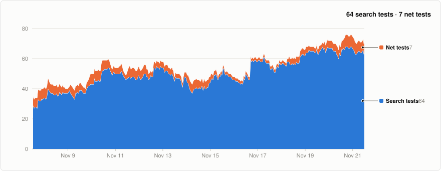
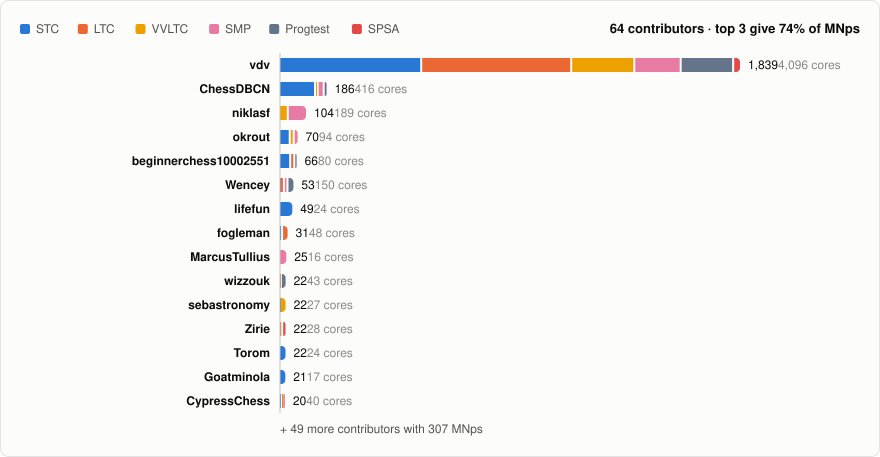

# Fishtest status

Updated Sat 14 Nov 2026, 20:45 UTC

## Trends

### Last 14 days

#### Cores by test type

<picture>
  <source media="(prefers-color-scheme: dark)" srcset="https://raw.githubusercontent.com/xu-shawn/fishtest_track/54dbc47d191b4946f08e3cdc16e2f7e22d3bc0d9/types-dark.svg">
  
</picture>

#### Tests by type

<picture>
  <source media="(prefers-color-scheme: dark)" srcset="https://raw.githubusercontent.com/xu-shawn/fishtest_track/54dbc47d191b4946f08e3cdc16e2f7e22d3bc0d9/type-counts-dark.svg">
  
</picture>

#### Net tests and search tests

<picture>
  <source media="(prefers-color-scheme: dark)" srcset="https://raw.githubusercontent.com/xu-shawn/fishtest_track/54dbc47d191b4946f08e3cdc16e2f7e22d3bc0d9/net-search-trend-dark.svg">
  
</picture>

#### Gainer and simplification bounds

<picture>
  <source media="(prefers-color-scheme: dark)" srcset="https://raw.githubusercontent.com/xu-shawn/fishtest_track/54dbc47d191b4946f08e3cdc16e2f7e22d3bc0d9/bounds-trend-dark.svg">
  
</picture>

#### Cores by test

<picture>
  <source media="(prefers-color-scheme: dark)" srcset="https://raw.githubusercontent.com/xu-shawn/fishtest_track/54dbc47d191b4946f08e3cdc16e2f7e22d3bc0d9/tests-trend-dark.svg">
  
</picture>

#### Cores by author

<picture>
  <source media="(prefers-color-scheme: dark)" srcset="https://raw.githubusercontent.com/xu-shawn/fishtest_track/54dbc47d191b4946f08e3cdc16e2f7e22d3bc0d9/authors-trend-dark.svg">
  
</picture>

#### Tests per author

<picture>
  <source media="(prefers-color-scheme: dark)" srcset="https://raw.githubusercontent.com/xu-shawn/fishtest_track/54dbc47d191b4946f08e3cdc16e2f7e22d3bc0d9/author-tests-trend-dark.svg">
  
</picture>

#### Cores contributed by user

<picture>
  <source media="(prefers-color-scheme: dark)" srcset="https://raw.githubusercontent.com/xu-shawn/fishtest_track/54dbc47d191b4946f08e3cdc16e2f7e22d3bc0d9/contributors-trend-dark.svg">
  
</picture>

#### MNps contributed by user

<picture>
  <source media="(prefers-color-scheme: dark)" srcset="https://raw.githubusercontent.com/xu-shawn/fishtest_track/54dbc47d191b4946f08e3cdc16e2f7e22d3bc0d9/contributors-mnps-trend-dark.svg">
  
</picture>

#### Tests, authors, contributors and throughput

<picture>
  <source media="(prefers-color-scheme: dark)" srcset="https://raw.githubusercontent.com/xu-shawn/fishtest_track/54dbc47d191b4946f08e3cdc16e2f7e22d3bc0d9/activity-dark.svg">
  
</picture>

#### Tests finished per hour

<picture>
  <source media="(prefers-color-scheme: dark)" srcset="https://raw.githubusercontent.com/xu-shawn/fishtest_track/54dbc47d191b4946f08e3cdc16e2f7e22d3bc0d9/throughput-dark.svg">
  
</picture>

#### LLR distribution of running tests

<picture>
  <source media="(prefers-color-scheme: dark)" srcset="https://raw.githubusercontent.com/xu-shawn/fishtest_track/54dbc47d191b4946f08e3cdc16e2f7e22d3bc0d9/llr-dark.svg">
  
</picture>

### Last 30 days

#### Finished tests per day

<picture>
  <source media="(prefers-color-scheme: dark)" srcset="https://raw.githubusercontent.com/xu-shawn/fishtest_track/54dbc47d191b4946f08e3cdc16e2f7e22d3bc0d9/finished-dark.svg">
  
</picture>

Last 7 days: **156 tests** finished, 13.5M games. **29 passed** (22 STC, 5 LTC, 1 SMP, 1 nodestime), 74 rejected, 50 stopped, 3 completed (SPSA or fixed games). SPRT pass rate 28.2%: 25.0% for gainers (88), 46.7% for simplifications (15); 64.3% for net tests (14), 22.5% for search tests (89).

#### Cores by architecture

<picture>
  <source media="(prefers-color-scheme: dark)" srcset="https://raw.githubusercontent.com/xu-shawn/fishtest_track/54dbc47d191b4946f08e3cdc16e2f7e22d3bc0d9/monthly-arch-dark.svg">
  
</picture>

#### Cores by compiler

<picture>
  <source media="(prefers-color-scheme: dark)" srcset="https://raw.githubusercontent.com/xu-shawn/fishtest_track/54dbc47d191b4946f08e3cdc16e2f7e22d3bc0d9/monthly-compiler-dark.svg">
  
</picture>

### Last year

#### Finished tests per week

<picture>
  <source media="(prefers-color-scheme: dark)" srcset="https://raw.githubusercontent.com/xu-shawn/fishtest_track/54dbc47d191b4946f08e3cdc16e2f7e22d3bc0d9/weekly-finished-dark.svg">
  
</picture>

#### Runtime of finished tests

<picture>
  <source media="(prefers-color-scheme: dark)" srcset="https://raw.githubusercontent.com/xu-shawn/fishtest_track/54dbc47d191b4946f08e3cdc16e2f7e22d3bc0d9/runtime-trend-dark.svg">
  
</picture>

#### Average cores per week by test type

<picture>
  <source media="(prefers-color-scheme: dark)" srcset="https://raw.githubusercontent.com/xu-shawn/fishtest_track/54dbc47d191b4946f08e3cdc16e2f7e22d3bc0d9/weekly-types-dark.svg">
  
</picture>

#### Cores by architecture

<picture>
  <source media="(prefers-color-scheme: dark)" srcset="https://raw.githubusercontent.com/xu-shawn/fishtest_track/54dbc47d191b4946f08e3cdc16e2f7e22d3bc0d9/yearly-arch-dark.svg">
  
</picture>

#### Cores by compiler

<picture>
  <source media="(prefers-color-scheme: dark)" srcset="https://raw.githubusercontent.com/xu-shawn/fishtest_track/54dbc47d191b4946f08e3cdc16e2f7e22d3bc0d9/yearly-compiler-dark.svg">
  
</picture>

#### Gainer bounds

<picture>
  <source media="(prefers-color-scheme: dark)" srcset="https://raw.githubusercontent.com/xu-shawn/fishtest_track/54dbc47d191b4946f08e3cdc16e2f7e22d3bc0d9/weekly-gainers-dark.svg">
  
</picture>

#### Simplification bounds

<picture>
  <source media="(prefers-color-scheme: dark)" srcset="https://raw.githubusercontent.com/xu-shawn/fishtest_track/54dbc47d191b4946f08e3cdc16e2f7e22d3bc0d9/weekly-simplifications-dark.svg">
  
</picture>

#### Net tests

<picture>
  <source media="(prefers-color-scheme: dark)" srcset="https://raw.githubusercontent.com/xu-shawn/fishtest_track/54dbc47d191b4946f08e3cdc16e2f7e22d3bc0d9/weekly-net-dark.svg">
  
</picture>

#### Search tests

<picture>
  <source media="(prefers-color-scheme: dark)" srcset="https://raw.githubusercontent.com/xu-shawn/fishtest_track/54dbc47d191b4946f08e3cdc16e2f7e22d3bc0d9/weekly-search-dark.svg">
  
</picture>

### Since 19 Oct 2026, daily averages

#### Cores by test type

<picture>
  <source media="(prefers-color-scheme: dark)" srcset="https://raw.githubusercontent.com/xu-shawn/fishtest_track/54dbc47d191b4946f08e3cdc16e2f7e22d3bc0d9/long-types-dark.svg">
  
</picture>

#### Cores by author

<picture>
  <source media="(prefers-color-scheme: dark)" srcset="https://raw.githubusercontent.com/xu-shawn/fishtest_track/54dbc47d191b4946f08e3cdc16e2f7e22d3bc0d9/long-authors-dark.svg">
  
</picture>

#### Tests per author

<picture>
  <source media="(prefers-color-scheme: dark)" srcset="https://raw.githubusercontent.com/xu-shawn/fishtest_track/54dbc47d191b4946f08e3cdc16e2f7e22d3bc0d9/long-author-tests-dark.svg">
  
</picture>

#### Cores contributed by user

<picture>
  <source media="(prefers-color-scheme: dark)" srcset="https://raw.githubusercontent.com/xu-shawn/fishtest_track/54dbc47d191b4946f08e3cdc16e2f7e22d3bc0d9/long-contributors-dark.svg">
  
</picture>

#### MNps contributed by user

<picture>
  <source media="(prefers-color-scheme: dark)" srcset="https://raw.githubusercontent.com/xu-shawn/fishtest_track/54dbc47d191b4946f08e3cdc16e2f7e22d3bc0d9/long-contributors-mnps-dark.svg">
  
</picture>

#### Tests, authors, contributors and throughput

<picture>
  <source media="(prefers-color-scheme: dark)" srcset="https://raw.githubusercontent.com/xu-shawn/fishtest_track/54dbc47d191b4946f08e3cdc16e2f7e22d3bc0d9/long-activity-dark.svg">
  
</picture>

## Right now

**46 tests** from **17 authors** are running on **1,791 cores** (178 workers from 70 contributors). About 80 hours of work is queued.

| | Now | 24 h avg | 7 d avg | 30 d avg |
|:--|--:|--:|--:|--:|
| Tests running | 46 | 47 | 51 | 45 |
| Authors with running tests | 17 | 18 | 20 | 19 |
| Cores | 1,791 | 1,887 | 1,817 | 1,779 |
| Workers | 178 | 209 | 202 | 201 |
| Contributors with workers | 70 | 66 | 62 | 61 |
| Net tests running | 5 | 5 | 5 | 5 |
| Cores on net tests | 254 | 252 | 374 | 265 |
| Nodes per second | 972M | 1.08G | 1.02G | 988M |
| Games per minute | 1,497 | 1,805 | 1,557 | 1,604 |
| Pending hours | 80 h | 64 h | 89 h | 152 h |

### Cores by test

<picture>
  <source media="(prefers-color-scheme: dark)" srcset="https://raw.githubusercontent.com/xu-shawn/fishtest_track/54dbc47d191b4946f08e3cdc16e2f7e22d3bc0d9/tests-dark.svg">
  
</picture>

### Runtime of running tests

<picture>
  <source media="(prefers-color-scheme: dark)" srcset="https://raw.githubusercontent.com/xu-shawn/fishtest_track/54dbc47d191b4946f08e3cdc16e2f7e22d3bc0d9/runtime-dark.svg">
  
</picture>

### Cores by author

<picture>
  <source media="(prefers-color-scheme: dark)" srcset="https://raw.githubusercontent.com/xu-shawn/fishtest_track/54dbc47d191b4946f08e3cdc16e2f7e22d3bc0d9/authors-dark.svg">
  
</picture>

### Cores contributed by user

<picture>
  <source media="(prefers-color-scheme: dark)" srcset="https://raw.githubusercontent.com/xu-shawn/fishtest_track/54dbc47d191b4946f08e3cdc16e2f7e22d3bc0d9/contributors-dark.svg">
  
</picture>

### MNps contributed by user

<picture>
  <source media="(prefers-color-scheme: dark)" srcset="https://raw.githubusercontent.com/xu-shawn/fishtest_track/54dbc47d191b4946f08e3cdc16e2f7e22d3bc0d9/contributors-mnps-dark.svg">
  
</picture>

## Last 30 days in detail

### Recently passed

| Finished | Author | Test | TC | Bounds | Elo |
|:--|:--|:--|:--|:--|--:|
| Nov 14 | [rjhanson](https://tests.stockfishchess.org/tests/user/rjhanson) | [`movegen-lazy-king-threa…`](https://tests.stockfishchess.org/tests/view/6af7f6b58e7fb2e78bc1d5a5) | 10+0.1 | [0,2] | +3.16 ±1.81 |
| Nov 14 | [Vizvezdenec](https://tests.stockfishchess.org/tests/user/Vizvezdenec) | [`alphabetaEval3`](https://tests.stockfishchess.org/tests/view/6af212f28e7fb2e78bc1cbcf) | 10+0.1 | [0,2] | +1.08 ±0.87 |
| Nov 14 | [0x539](https://tests.stockfishchess.org/tests/user/0x539) | [`tt-stm`](https://tests.stockfishchess.org/tests/view/6af520a18e7fb2e78bc1d0ea) | 60+0.6 | [-1.75,0.25] | +0.78 ±1.16 |
| Nov 14 | [shawnxu](https://tests.stockfishchess.org/tests/user/shawnxu) | [`test1762`](https://tests.stockfishchess.org/tests/view/6af7979e8e7fb2e78bc1d512) | 10+0.1 | [0,2] | +3.64 ±2.03 |
| Nov 13 | [rjhanson](https://tests.stockfishchess.org/tests/user/rjhanson) | [`movepick-hoist-histories`](https://tests.stockfishchess.org/tests/view/6af0914289c6931c272dea9e) | 10+0.1 | [0,2] | +0.75 ±0.59 |
| Nov 12 | [rn](https://tests.stockfishchess.org/tests/user/rn) | [`fix-multipv-tm`](https://tests.stockfishchess.org/tests/view/6af5a0f88e7fb2e78bc1d1cd) | 10+0.1 | [0,2] | +30.88 ±6.42 |
| Nov 12 | [shawnxu](https://tests.stockfishchess.org/tests/user/shawnxu) | [`test1760`](https://tests.stockfishchess.org/tests/view/6af45b3f8e7fb2e78bc1cf67) | 100+1 nodestime | [0,2] | +5.03 ±2.43 |
| Nov 12 | [Vizvezdenec](https://tests.stockfishchess.org/tests/user/Vizvezdenec) | [`pvnodeLmrExt5`](https://tests.stockfishchess.org/tests/view/6af0dcd98e7fb2e78bc1ca1b) | 10+0.1 | [0,2] | +1.30 ±1.02 |
| Nov 11 | [rn](https://tests.stockfishchess.org/tests/user/rn) | [`fix-multipv-tm`](https://tests.stockfishchess.org/tests/view/6af342e68e7fb2e78bc1cd86) | 10+0.1 | [-1.75,0.25] | +1.52 ±1.50 |
| Nov 11 | [sg](https://tests.stockfishchess.org/tests/user/sg) | [`simple_pv_history_update`](https://tests.stockfishchess.org/tests/view/6aedc23d20cd2dc3f03d20fb) | 60+0.6 | [-1.75,0.25] | +0.28 ±0.86 |
| Nov 11 | [0x539](https://tests.stockfishchess.org/tests/user/0x539) | [`tt-stm`](https://tests.stockfishchess.org/tests/view/6af2c8b68e7fb2e78bc1ccec) | 10+0.1 | [-1.75,0.25] | +1.61 ±1.59 |
| Nov 11 | [sanityeclipse000](https://tests.stockfishchess.org/tests/user/sanityeclipse000) | [`prefetch-next-tile-v4`](https://tests.stockfishchess.org/tests/view/6af2eeb28e7fb2e78bc1cd1a) | 10+0.1 | [0,2] | +2.91 ±1.73 |

### Most active authors

| Author | Finished | Passed | Running now | Core-hours | Share |
|:--|--:|--:|--:|--:|--:|
| [Vizvezdenec](https://tests.stockfishchess.org/tests/user/Vizvezdenec) | 49 | 5 | 6 | 124,732 | 11.2% |
| [Gruenerapfel](https://tests.stockfishchess.org/tests/user/Gruenerapfel) | 24 | 6 | 6 | 113,329 | 10.2% |
| [fauzi2](https://tests.stockfishchess.org/tests/user/fauzi2) | 35 | 4 | 2 | 102,289 | 9.2% |
| [sg](https://tests.stockfishchess.org/tests/user/sg) | 41 | 9 | 6 | 85,555 | 7.7% |
| [vdv](https://tests.stockfishchess.org/tests/user/vdv) | 11 | 2 | 0 | 74,997 | 6.7% |
| [shawnxu](https://tests.stockfishchess.org/tests/user/shawnxu) | 50 | 22 | 2 | 74,740 | 6.7% |
| [Disservin](https://tests.stockfishchess.org/tests/user/Disservin) | 4 | 0 | 1 | 58,207 | 5.2% |
| [rn](https://tests.stockfishchess.org/tests/user/rn) | 16 | 6 | 2 | 55,334 | 5.0% |
| [DeadK1ng](https://tests.stockfishchess.org/tests/user/DeadK1ng) | 4 | 1 | 0 | 53,670 | 4.8% |
| [AdrianStockfish](https://tests.stockfishchess.org/tests/user/AdrianStockfish) | 51 | 5 | 5 | 41,357 | 3.7% |

### Top contributors

| Contributor | Core-hours | Share | Cores now | MNps now | Workers now |
|:--|--:|--:|--:|--:|--:|
| [ChessDBCN](https://tests.stockfishchess.org/tests/user/ChessDBCN) | 291,383 | 26.0% | 456 | 187 | 57 |
| [niklasf](https://tests.stockfishchess.org/tests/user/niklasf) | 116,663 | 10.4% | 189 | 89 | 3 |
| [Wencey](https://tests.stockfishchess.org/tests/user/Wencey) | 93,778 | 8.4% | 150 | 47 | 4 |
| [MediumBerry5575](https://tests.stockfishchess.org/tests/user/MediumBerry5575) | 71,733 | 6.4% | 0 | 0.0 | 0 |
| [wizzouk](https://tests.stockfishchess.org/tests/user/wizzouk) | 57,293 | 5.1% | 43 | 20 | 2 |
| [okrout](https://tests.stockfishchess.org/tests/user/okrout) | 52,642 | 4.7% | 82 | 58 | 5 |
| [beginnerchess10002551](https://tests.stockfishchess.org/tests/user/beginnerchess10002551) | 48,829 | 4.3% | 80 | 63 | 20 |
| [CypressChess](https://tests.stockfishchess.org/tests/user/CypressChess) | 24,893 | 2.2% | 40 | 18 | 5 |
| [maximmasiutin](https://tests.stockfishchess.org/tests/user/maximmasiutin) | 21,508 | 1.9% | 10 | 3.2 | 2 |
| [technologov](https://tests.stockfishchess.org/tests/user/technologov) | 20,447 | 1.8% | 44 | 17 | 2 |
