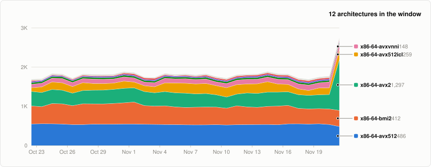
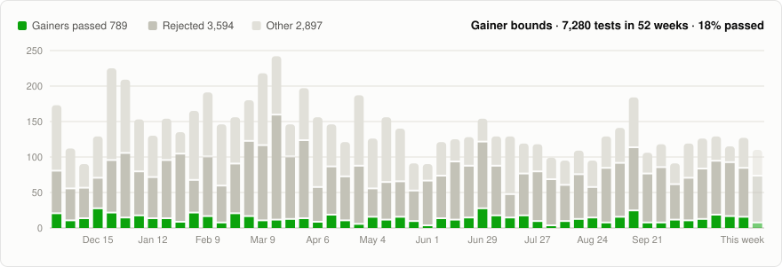

# Fishtest status

Updated Fri 27 Nov 2026, 23:45 UTC

## Trends

### Last 14 days

#### Cores by test type

<picture>
  <source media="(prefers-color-scheme: dark)" srcset="https://raw.githubusercontent.com/xu-shawn/fishtest_track/4da1d389a0b58e8ba3e70c6553bb25182b16cbbf/types-dark.svg">
  
</picture>

#### Tests by type

<picture>
  <source media="(prefers-color-scheme: dark)" srcset="https://raw.githubusercontent.com/xu-shawn/fishtest_track/4da1d389a0b58e8ba3e70c6553bb25182b16cbbf/type-counts-dark.svg">
  
</picture>

#### Net tests and search tests

<picture>
  <source media="(prefers-color-scheme: dark)" srcset="https://raw.githubusercontent.com/xu-shawn/fishtest_track/4da1d389a0b58e8ba3e70c6553bb25182b16cbbf/net-search-trend-dark.svg">
  
</picture>

#### Gainer and simplification bounds

<picture>
  <source media="(prefers-color-scheme: dark)" srcset="https://raw.githubusercontent.com/xu-shawn/fishtest_track/4da1d389a0b58e8ba3e70c6553bb25182b16cbbf/bounds-trend-dark.svg">
  
</picture>

#### Cores by test

<picture>
  <source media="(prefers-color-scheme: dark)" srcset="https://raw.githubusercontent.com/xu-shawn/fishtest_track/4da1d389a0b58e8ba3e70c6553bb25182b16cbbf/tests-trend-dark.svg">
  
</picture>

#### Cores by author

<picture>
  <source media="(prefers-color-scheme: dark)" srcset="https://raw.githubusercontent.com/xu-shawn/fishtest_track/4da1d389a0b58e8ba3e70c6553bb25182b16cbbf/authors-trend-dark.svg">
  
</picture>

#### Tests per author

<picture>
  <source media="(prefers-color-scheme: dark)" srcset="https://raw.githubusercontent.com/xu-shawn/fishtest_track/4da1d389a0b58e8ba3e70c6553bb25182b16cbbf/author-tests-trend-dark.svg">
  
</picture>

#### Cores contributed by user

<picture>
  <source media="(prefers-color-scheme: dark)" srcset="https://raw.githubusercontent.com/xu-shawn/fishtest_track/4da1d389a0b58e8ba3e70c6553bb25182b16cbbf/contributors-trend-dark.svg">
  
</picture>

#### MNps contributed by user

<picture>
  <source media="(prefers-color-scheme: dark)" srcset="https://raw.githubusercontent.com/xu-shawn/fishtest_track/4da1d389a0b58e8ba3e70c6553bb25182b16cbbf/contributors-mnps-trend-dark.svg">
  
</picture>

#### Tests, authors, contributors and throughput

<picture>
  <source media="(prefers-color-scheme: dark)" srcset="https://raw.githubusercontent.com/xu-shawn/fishtest_track/4da1d389a0b58e8ba3e70c6553bb25182b16cbbf/activity-dark.svg">
  
</picture>

#### Tests finished per hour

<picture>
  <source media="(prefers-color-scheme: dark)" srcset="https://raw.githubusercontent.com/xu-shawn/fishtest_track/4da1d389a0b58e8ba3e70c6553bb25182b16cbbf/throughput-dark.svg">
  
</picture>

#### LLR distribution of running tests

<picture>
  <source media="(prefers-color-scheme: dark)" srcset="https://raw.githubusercontent.com/xu-shawn/fishtest_track/4da1d389a0b58e8ba3e70c6553bb25182b16cbbf/llr-dark.svg">
  
</picture>

### Last 30 days

#### Finished tests per day

<picture>
  <source media="(prefers-color-scheme: dark)" srcset="https://raw.githubusercontent.com/xu-shawn/fishtest_track/4da1d389a0b58e8ba3e70c6553bb25182b16cbbf/finished-dark.svg">
  
</picture>

Last 7 days: **230 tests** finished, 20.7M games. **47 passed** (36 STC, 8 LTC, 1 VVLTC, 2 nodestime), 117 rejected, 57 stopped, 4 completed (SPSA or fixed games), 5 failed. SPRT pass rate 28.7%: 19.4% for gainers (134), 70.0% for simplifications (30); 31.2% for net tests (16), 28.4% for search tests (148).

#### Cores by architecture

<picture>
  <source media="(prefers-color-scheme: dark)" srcset="https://raw.githubusercontent.com/xu-shawn/fishtest_track/4da1d389a0b58e8ba3e70c6553bb25182b16cbbf/monthly-arch-dark.svg">
  
</picture>

#### Cores by compiler

<picture>
  <source media="(prefers-color-scheme: dark)" srcset="https://raw.githubusercontent.com/xu-shawn/fishtest_track/4da1d389a0b58e8ba3e70c6553bb25182b16cbbf/monthly-compiler-dark.svg">
  
</picture>

### Last year

#### Finished tests per week

<picture>
  <source media="(prefers-color-scheme: dark)" srcset="https://raw.githubusercontent.com/xu-shawn/fishtest_track/4da1d389a0b58e8ba3e70c6553bb25182b16cbbf/weekly-finished-dark.svg">
  
</picture>

#### Runtime of finished tests

<picture>
  <source media="(prefers-color-scheme: dark)" srcset="https://raw.githubusercontent.com/xu-shawn/fishtest_track/4da1d389a0b58e8ba3e70c6553bb25182b16cbbf/runtime-trend-dark.svg">
  
</picture>

#### Average cores per week by test type

<picture>
  <source media="(prefers-color-scheme: dark)" srcset="https://raw.githubusercontent.com/xu-shawn/fishtest_track/4da1d389a0b58e8ba3e70c6553bb25182b16cbbf/weekly-types-dark.svg">
  
</picture>

#### Cores by architecture

<picture>
  <source media="(prefers-color-scheme: dark)" srcset="https://raw.githubusercontent.com/xu-shawn/fishtest_track/4da1d389a0b58e8ba3e70c6553bb25182b16cbbf/yearly-arch-dark.svg">
  
</picture>

#### Cores by compiler

<picture>
  <source media="(prefers-color-scheme: dark)" srcset="https://raw.githubusercontent.com/xu-shawn/fishtest_track/4da1d389a0b58e8ba3e70c6553bb25182b16cbbf/yearly-compiler-dark.svg">
  
</picture>

#### Gainer bounds

<picture>
  <source media="(prefers-color-scheme: dark)" srcset="https://raw.githubusercontent.com/xu-shawn/fishtest_track/4da1d389a0b58e8ba3e70c6553bb25182b16cbbf/weekly-gainers-dark.svg">
  
</picture>

#### Simplification bounds

<picture>
  <source media="(prefers-color-scheme: dark)" srcset="https://raw.githubusercontent.com/xu-shawn/fishtest_track/4da1d389a0b58e8ba3e70c6553bb25182b16cbbf/weekly-simplifications-dark.svg">
  
</picture>

#### Net tests

<picture>
  <source media="(prefers-color-scheme: dark)" srcset="https://raw.githubusercontent.com/xu-shawn/fishtest_track/4da1d389a0b58e8ba3e70c6553bb25182b16cbbf/weekly-net-dark.svg">
  
</picture>

#### Search tests

<picture>
  <source media="(prefers-color-scheme: dark)" srcset="https://raw.githubusercontent.com/xu-shawn/fishtest_track/4da1d389a0b58e8ba3e70c6553bb25182b16cbbf/weekly-search-dark.svg">
  
</picture>

### Since 19 Oct 2026, daily averages

#### Cores by test type

<picture>
  <source media="(prefers-color-scheme: dark)" srcset="https://raw.githubusercontent.com/xu-shawn/fishtest_track/4da1d389a0b58e8ba3e70c6553bb25182b16cbbf/long-types-dark.svg">
  
</picture>

#### Cores by author

<picture>
  <source media="(prefers-color-scheme: dark)" srcset="https://raw.githubusercontent.com/xu-shawn/fishtest_track/4da1d389a0b58e8ba3e70c6553bb25182b16cbbf/long-authors-dark.svg">
  
</picture>

#### Tests per author

<picture>
  <source media="(prefers-color-scheme: dark)" srcset="https://raw.githubusercontent.com/xu-shawn/fishtest_track/4da1d389a0b58e8ba3e70c6553bb25182b16cbbf/long-author-tests-dark.svg">
  
</picture>

#### Cores contributed by user

<picture>
  <source media="(prefers-color-scheme: dark)" srcset="https://raw.githubusercontent.com/xu-shawn/fishtest_track/4da1d389a0b58e8ba3e70c6553bb25182b16cbbf/long-contributors-dark.svg">
  
</picture>

#### MNps contributed by user

<picture>
  <source media="(prefers-color-scheme: dark)" srcset="https://raw.githubusercontent.com/xu-shawn/fishtest_track/4da1d389a0b58e8ba3e70c6553bb25182b16cbbf/long-contributors-mnps-dark.svg">
  
</picture>

#### Tests, authors, contributors and throughput

<picture>
  <source media="(prefers-color-scheme: dark)" srcset="https://raw.githubusercontent.com/xu-shawn/fishtest_track/4da1d389a0b58e8ba3e70c6553bb25182b16cbbf/long-activity-dark.svg">
  
</picture>

## Right now

**55 tests** from **20 authors** are running on **9,672 cores** (681 workers from 66 contributors). About 19 hours of work is queued.

| | Now | 24 h avg | 7 d avg | 30 d avg |
|:--|--:|--:|--:|--:|
| Tests running | 55 | 57 | 64 | 53 |
| Authors with running tests | 20 | 21 | 21 | 19 |
| Cores | 9,672 | 6,567 | 4,251 | 2,369 |
| Workers | 681 | 505 | 370 | 242 |
| Contributors with workers | 66 | 68 | 67 | 64 |
| Net tests running | 5 | 4 | 5 | 5 |
| Cores on net tests | 894 | 675 | 624 | 355 |
| Nodes per second | 4.47G | 3.12G | 2.14G | 1.27G |
| Games per minute | 3,238 | 2,929 | 2,414 | 1,816 |
| Pending hours | 19 h | 44 h | 97 h | 88 h |

### Cores by test

<picture>
  <source media="(prefers-color-scheme: dark)" srcset="https://raw.githubusercontent.com/xu-shawn/fishtest_track/4da1d389a0b58e8ba3e70c6553bb25182b16cbbf/tests-dark.svg">
  
</picture>

### Runtime of running tests

<picture>
  <source media="(prefers-color-scheme: dark)" srcset="https://raw.githubusercontent.com/xu-shawn/fishtest_track/4da1d389a0b58e8ba3e70c6553bb25182b16cbbf/runtime-dark.svg">
  
</picture>

### Cores by author

<picture>
  <source media="(prefers-color-scheme: dark)" srcset="https://raw.githubusercontent.com/xu-shawn/fishtest_track/4da1d389a0b58e8ba3e70c6553bb25182b16cbbf/authors-dark.svg">
  
</picture>

### Cores contributed by user

<picture>
  <source media="(prefers-color-scheme: dark)" srcset="https://raw.githubusercontent.com/xu-shawn/fishtest_track/4da1d389a0b58e8ba3e70c6553bb25182b16cbbf/contributors-dark.svg">
  
</picture>

### MNps contributed by user

<picture>
  <source media="(prefers-color-scheme: dark)" srcset="https://raw.githubusercontent.com/xu-shawn/fishtest_track/4da1d389a0b58e8ba3e70c6553bb25182b16cbbf/contributors-mnps-dark.svg">
  
</picture>

## Last 30 days in detail

### Recently passed

| Finished | Author | Test | TC | Bounds | Elo |
|:--|:--|:--|:--|:--|--:|
| Nov 27 | [fauzi2](https://tests.stockfishchess.org/tests/user/fauzi2) | [`wave11b`](https://tests.stockfishchess.org/tests/view/6b08995a9f65cf9079e26001) | 60+0.6 ×8 | [0,2] | +2.65 ±1.54 |
| Nov 27 | [luiscortespenguin](https://tests.stockfishchess.org/tests/user/luiscortespenguin) | [`fishtest-sse2-test`](https://tests.stockfishchess.org/tests/view/6b0926289f65cf9079e260d5) | 10+0.1 | [0,2] | +31.80 ±6.09 |
| Nov 27 | [Shreeyans](https://tests.stockfishchess.org/tests/user/Shreeyans) | [`ttvalue-valid-pv-lmr`](https://tests.stockfishchess.org/tests/view/6b07230e9f65cf9079e25c14) | 60+0.6 | [-1.75,0.25] | +0.95 ±1.24 |
| Nov 27 | [feeling4vibes](https://tests.stockfishchess.org/tests/user/feeling4vibes) | [`test/adaptive-probcut-d…`](https://tests.stockfishchess.org/tests/view/6b08880a9f65cf9079e25fe5) | 10+0.1 | [0,2] | +4.04 ±2.13 |
| Nov 26 | [Vizvezdenec](https://tests.stockfishchess.org/tests/user/Vizvezdenec) | [`ttmrCutNode1`](https://tests.stockfishchess.org/tests/view/6b0699629f65cf9079e25a50) | 10+0.1 | [0,2] | +1.67 ±1.22 |
| Nov 26 | [Gruenerapfel](https://tests.stockfishchess.org/tests/user/Gruenerapfel) | [`alternative-failhighrec…`](https://tests.stockfishchess.org/tests/view/6b05d1a19f65cf9079e258f2) | 10+0.1 | [0,2] | +1.26 ±0.99 |
| Nov 26 | [Shreeyans](https://tests.stockfishchess.org/tests/user/Shreeyans) | [`remove-correl`](https://tests.stockfishchess.org/tests/view/6b05eb189f65cf9079e25927) | 60+0.6 | [-1.75,0.25] | +0.94 ±1.24 |
| Nov 26 | [rn](https://tests.stockfishchess.org/tests/user/rn) | [`fix-1-move-pvs`](https://tests.stockfishchess.org/tests/view/6b0032952ff81bd6a63445a5) | 10+0.1 | [-1.75,0.25] | -0.16 ±0.51 |
| Nov 26 | [Disservin](https://tests.stockfishchess.org/tests/user/Disservin) | [`skip-destructors-trivia…`](https://tests.stockfishchess.org/tests/view/6b0728389f65cf9079e25c1d) | 10+0.1 | [-1.75,0.25] | +1.01 ±1.29 |
| Nov 26 | [Gruenerapfel](https://tests.stockfishchess.org/tests/user/Gruenerapfel) | [`nmp-verify-root-fp`](https://tests.stockfishchess.org/tests/view/6b033f01b9d0e035d605ff0b) | 10+0.1 | [-1.75,0.25] | +0.16 ±0.82 |
| Nov 26 | [tsoj](https://tests.stockfishchess.org/tests/user/tsoj) | [`se-node-count`](https://tests.stockfishchess.org/tests/view/6b072f9c9f65cf9079e25c30) | 60+0.6 | [0.5,2.5] | +4.45 ±2.11 |
| Nov 26 | [shawnxu](https://tests.stockfishchess.org/tests/user/shawnxu) | [`test1772`](https://tests.stockfishchess.org/tests/view/6b05dec29f65cf9079e25903) | 60+0.6 | [0.5,2.5] | +2.46 ±1.46 |

### Most active authors

| Author | Finished | Passed | Running now | Core-hours | Share |
|:--|--:|--:|--:|--:|--:|
| [fauzi2](https://tests.stockfishchess.org/tests/user/fauzi2) | 58 | 5 | 2 | 170,158 | 13.7% |
| [sg](https://tests.stockfishchess.org/tests/user/sg) | 41 | 6 | 4 | 135,001 | 10.9% |
| [shawnxu](https://tests.stockfishchess.org/tests/user/shawnxu) | 45 | 19 | 2 | 92,867 | 7.5% |
| [Gruenerapfel](https://tests.stockfishchess.org/tests/user/Gruenerapfel) | 31 | 9 | 2 | 90,662 | 7.3% |
| [Vizvezdenec](https://tests.stockfishchess.org/tests/user/Vizvezdenec) | 51 | 9 | 6 | 75,301 | 6.1% |
| [vdv](https://tests.stockfishchess.org/tests/user/vdv) | 15 | 3 | 0 | 74,611 | 6.0% |
| [rn](https://tests.stockfishchess.org/tests/user/rn) | 12 | 7 | 2 | 70,828 | 5.7% |
| [Disservin](https://tests.stockfishchess.org/tests/user/Disservin) | 6 | 1 | 1 | 60,062 | 4.8% |
| [AdrianStockfish](https://tests.stockfishchess.org/tests/user/AdrianStockfish) | 45 | 3 | 6 | 56,035 | 4.5% |
| [Kaz](https://tests.stockfishchess.org/tests/user/Kaz) | 14 | 3 | 2 | 41,482 | 3.3% |

### Top contributors

| Contributor | Core-hours | Share | Cores now | MNps now | Workers now |
|:--|--:|--:|--:|--:|--:|
| [vdv](https://tests.stockfishchess.org/tests/user/vdv) | 419,844 | 25.0% | 8,160 | 3,526 | 510 |
| [ChessDBCN](https://tests.stockfishchess.org/tests/user/ChessDBCN) | 324,137 | 19.3% | 472 | 208 | 59 |
| [niklasf](https://tests.stockfishchess.org/tests/user/niklasf) | 114,337 | 6.8% | 63 | 35 | 1 |
| [Wencey](https://tests.stockfishchess.org/tests/user/Wencey) | 106,573 | 6.3% | 150 | 49 | 4 |
| [MediumBerry5575](https://tests.stockfishchess.org/tests/user/MediumBerry5575) | 85,536 | 5.1% | 0 | 0.0 | 0 |
| [okrout](https://tests.stockfishchess.org/tests/user/okrout) | 59,935 | 3.6% | 94 | 68 | 7 |
| [wizzouk](https://tests.stockfishchess.org/tests/user/wizzouk) | 54,103 | 3.2% | 58 | 28 | 3 |
| [beginnerchess10002551](https://tests.stockfishchess.org/tests/user/beginnerchess10002551) | 49,087 | 2.9% | 0 | 0.0 | 0 |
| [CypressChess](https://tests.stockfishchess.org/tests/user/CypressChess) | 28,395 | 1.7% | 40 | 18 | 5 |
| [fogleman](https://tests.stockfishchess.org/tests/user/fogleman) | 27,890 | 1.7% | 53 | 35 | 5 |
