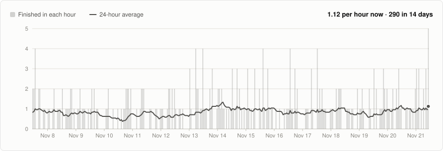

# Fishtest status

Updated Wed 25 Nov 2026, 00:45 UTC

## Trends

### Last 14 days

#### Cores by test type

<picture>
  <source media="(prefers-color-scheme: dark)" srcset="https://raw.githubusercontent.com/xu-shawn/fishtest_track/6f4237a212af9e54c84cc7418f70ed9b99ae64af/types-dark.svg">
  
</picture>

#### Tests by type

<picture>
  <source media="(prefers-color-scheme: dark)" srcset="https://raw.githubusercontent.com/xu-shawn/fishtest_track/6f4237a212af9e54c84cc7418f70ed9b99ae64af/type-counts-dark.svg">
  
</picture>

#### Net tests and search tests

<picture>
  <source media="(prefers-color-scheme: dark)" srcset="https://raw.githubusercontent.com/xu-shawn/fishtest_track/6f4237a212af9e54c84cc7418f70ed9b99ae64af/net-search-trend-dark.svg">
  
</picture>

#### Gainer and simplification bounds

<picture>
  <source media="(prefers-color-scheme: dark)" srcset="https://raw.githubusercontent.com/xu-shawn/fishtest_track/6f4237a212af9e54c84cc7418f70ed9b99ae64af/bounds-trend-dark.svg">
  
</picture>

#### Cores by test

<picture>
  <source media="(prefers-color-scheme: dark)" srcset="https://raw.githubusercontent.com/xu-shawn/fishtest_track/6f4237a212af9e54c84cc7418f70ed9b99ae64af/tests-trend-dark.svg">
  
</picture>

#### Cores by author

<picture>
  <source media="(prefers-color-scheme: dark)" srcset="https://raw.githubusercontent.com/xu-shawn/fishtest_track/6f4237a212af9e54c84cc7418f70ed9b99ae64af/authors-trend-dark.svg">
  
</picture>

#### Tests per author

<picture>
  <source media="(prefers-color-scheme: dark)" srcset="https://raw.githubusercontent.com/xu-shawn/fishtest_track/6f4237a212af9e54c84cc7418f70ed9b99ae64af/author-tests-trend-dark.svg">
  
</picture>

#### Cores contributed by user

<picture>
  <source media="(prefers-color-scheme: dark)" srcset="https://raw.githubusercontent.com/xu-shawn/fishtest_track/6f4237a212af9e54c84cc7418f70ed9b99ae64af/contributors-trend-dark.svg">
  
</picture>

#### MNps contributed by user

<picture>
  <source media="(prefers-color-scheme: dark)" srcset="https://raw.githubusercontent.com/xu-shawn/fishtest_track/6f4237a212af9e54c84cc7418f70ed9b99ae64af/contributors-mnps-trend-dark.svg">
  
</picture>

#### Tests, authors, contributors and throughput

<picture>
  <source media="(prefers-color-scheme: dark)" srcset="https://raw.githubusercontent.com/xu-shawn/fishtest_track/6f4237a212af9e54c84cc7418f70ed9b99ae64af/activity-dark.svg">
  
</picture>

#### Tests finished per hour

<picture>
  <source media="(prefers-color-scheme: dark)" srcset="https://raw.githubusercontent.com/xu-shawn/fishtest_track/6f4237a212af9e54c84cc7418f70ed9b99ae64af/throughput-dark.svg">
  
</picture>

#### LLR distribution of running tests

<picture>
  <source media="(prefers-color-scheme: dark)" srcset="https://raw.githubusercontent.com/xu-shawn/fishtest_track/6f4237a212af9e54c84cc7418f70ed9b99ae64af/llr-dark.svg">
  
</picture>

### Last 30 days

#### Finished tests per day

<picture>
  <source media="(prefers-color-scheme: dark)" srcset="https://raw.githubusercontent.com/xu-shawn/fishtest_track/6f4237a212af9e54c84cc7418f70ed9b99ae64af/finished-dark.svg">
  
</picture>

Last 7 days: **176 tests** finished, 15.8M games. **28 passed** (25 STC, 2 LTC, 1 nodestime), 93 rejected, 44 stopped, 5 completed (SPSA or fixed games), 6 failed. SPRT pass rate 23.1%: 14.0% for gainers (100), 66.7% for simplifications (21); 40.0% for net tests (10), 21.6% for search tests (111).

#### Cores by architecture

<picture>
  <source media="(prefers-color-scheme: dark)" srcset="https://raw.githubusercontent.com/xu-shawn/fishtest_track/6f4237a212af9e54c84cc7418f70ed9b99ae64af/monthly-arch-dark.svg">
  
</picture>

#### Cores by compiler

<picture>
  <source media="(prefers-color-scheme: dark)" srcset="https://raw.githubusercontent.com/xu-shawn/fishtest_track/6f4237a212af9e54c84cc7418f70ed9b99ae64af/monthly-compiler-dark.svg">
  
</picture>

### Last year

#### Finished tests per week

<picture>
  <source media="(prefers-color-scheme: dark)" srcset="https://raw.githubusercontent.com/xu-shawn/fishtest_track/6f4237a212af9e54c84cc7418f70ed9b99ae64af/weekly-finished-dark.svg">
  
</picture>

#### Runtime of finished tests

<picture>
  <source media="(prefers-color-scheme: dark)" srcset="https://raw.githubusercontent.com/xu-shawn/fishtest_track/6f4237a212af9e54c84cc7418f70ed9b99ae64af/runtime-trend-dark.svg">
  
</picture>

#### Average cores per week by test type

<picture>
  <source media="(prefers-color-scheme: dark)" srcset="https://raw.githubusercontent.com/xu-shawn/fishtest_track/6f4237a212af9e54c84cc7418f70ed9b99ae64af/weekly-types-dark.svg">
  
</picture>

#### Cores by architecture

<picture>
  <source media="(prefers-color-scheme: dark)" srcset="https://raw.githubusercontent.com/xu-shawn/fishtest_track/6f4237a212af9e54c84cc7418f70ed9b99ae64af/yearly-arch-dark.svg">
  
</picture>

#### Cores by compiler

<picture>
  <source media="(prefers-color-scheme: dark)" srcset="https://raw.githubusercontent.com/xu-shawn/fishtest_track/6f4237a212af9e54c84cc7418f70ed9b99ae64af/yearly-compiler-dark.svg">
  
</picture>

#### Gainer bounds

<picture>
  <source media="(prefers-color-scheme: dark)" srcset="https://raw.githubusercontent.com/xu-shawn/fishtest_track/6f4237a212af9e54c84cc7418f70ed9b99ae64af/weekly-gainers-dark.svg">
  
</picture>

#### Simplification bounds

<picture>
  <source media="(prefers-color-scheme: dark)" srcset="https://raw.githubusercontent.com/xu-shawn/fishtest_track/6f4237a212af9e54c84cc7418f70ed9b99ae64af/weekly-simplifications-dark.svg">
  
</picture>

#### Net tests

<picture>
  <source media="(prefers-color-scheme: dark)" srcset="https://raw.githubusercontent.com/xu-shawn/fishtest_track/6f4237a212af9e54c84cc7418f70ed9b99ae64af/weekly-net-dark.svg">
  
</picture>

#### Search tests

<picture>
  <source media="(prefers-color-scheme: dark)" srcset="https://raw.githubusercontent.com/xu-shawn/fishtest_track/6f4237a212af9e54c84cc7418f70ed9b99ae64af/weekly-search-dark.svg">
  
</picture>

### Since 19 Oct 2026, daily averages

#### Cores by test type

<picture>
  <source media="(prefers-color-scheme: dark)" srcset="https://raw.githubusercontent.com/xu-shawn/fishtest_track/6f4237a212af9e54c84cc7418f70ed9b99ae64af/long-types-dark.svg">
  
</picture>

#### Cores by author

<picture>
  <source media="(prefers-color-scheme: dark)" srcset="https://raw.githubusercontent.com/xu-shawn/fishtest_track/6f4237a212af9e54c84cc7418f70ed9b99ae64af/long-authors-dark.svg">
  
</picture>

#### Tests per author

<picture>
  <source media="(prefers-color-scheme: dark)" srcset="https://raw.githubusercontent.com/xu-shawn/fishtest_track/6f4237a212af9e54c84cc7418f70ed9b99ae64af/long-author-tests-dark.svg">
  
</picture>

#### Cores contributed by user

<picture>
  <source media="(prefers-color-scheme: dark)" srcset="https://raw.githubusercontent.com/xu-shawn/fishtest_track/6f4237a212af9e54c84cc7418f70ed9b99ae64af/long-contributors-dark.svg">
  
</picture>

#### MNps contributed by user

<picture>
  <source media="(prefers-color-scheme: dark)" srcset="https://raw.githubusercontent.com/xu-shawn/fishtest_track/6f4237a212af9e54c84cc7418f70ed9b99ae64af/long-contributors-mnps-dark.svg">
  
</picture>

#### Tests, authors, contributors and throughput

<picture>
  <source media="(prefers-color-scheme: dark)" srcset="https://raw.githubusercontent.com/xu-shawn/fishtest_track/6f4237a212af9e54c84cc7418f70ed9b99ae64af/long-activity-dark.svg">
  
</picture>

## Right now

**64 tests** from **22 authors** are running on **3,099 cores** (286 workers from 65 contributors). About 99 hours of work is queued.

| | Now | 24 h avg | 7 d avg | 30 d avg |
|:--|--:|--:|--:|--:|
| Tests running | 64 | 65 | 67 | 51 |
| Authors with running tests | 22 | 21 | 21 | 19 |
| Cores | 3,099 | 2,142 | 2,655 | 2,003 |
| Workers | 286 | 235 | 264 | 219 |
| Contributors with workers | 65 | 64 | 65 | 63 |
| Net tests running | 5 | 5 | 5 | 5 |
| Cores on net tests | 307 | 164 | 512 | 324 |
| Nodes per second | 1.59G | 1.20G | 1.45G | 1.10G |
| Games per minute | 2,065 | 1,715 | 1,959 | 1,734 |
| Pending hours | 99 h | 148 h | 126 h | 94 h |

### Cores by test

<picture>
  <source media="(prefers-color-scheme: dark)" srcset="https://raw.githubusercontent.com/xu-shawn/fishtest_track/6f4237a212af9e54c84cc7418f70ed9b99ae64af/tests-dark.svg">
  
</picture>

### Runtime of running tests

<picture>
  <source media="(prefers-color-scheme: dark)" srcset="https://raw.githubusercontent.com/xu-shawn/fishtest_track/6f4237a212af9e54c84cc7418f70ed9b99ae64af/runtime-dark.svg">
  
</picture>

### Cores by author

<picture>
  <source media="(prefers-color-scheme: dark)" srcset="https://raw.githubusercontent.com/xu-shawn/fishtest_track/6f4237a212af9e54c84cc7418f70ed9b99ae64af/authors-dark.svg">
  
</picture>

### Cores contributed by user

<picture>
  <source media="(prefers-color-scheme: dark)" srcset="https://raw.githubusercontent.com/xu-shawn/fishtest_track/6f4237a212af9e54c84cc7418f70ed9b99ae64af/contributors-dark.svg">
  
</picture>

### MNps contributed by user

<picture>
  <source media="(prefers-color-scheme: dark)" srcset="https://raw.githubusercontent.com/xu-shawn/fishtest_track/6f4237a212af9e54c84cc7418f70ed9b99ae64af/contributors-mnps-dark.svg">
  
</picture>

## Last 30 days in detail

### Recently passed

| Finished | Author | Test | TC | Bounds | Elo |
|:--|:--|:--|:--|:--|--:|
| Nov 24 | [sscg13](https://tests.stockfishchess.org/tests/user/sscg13) | [`pp-k2h3`](https://tests.stockfishchess.org/tests/view/6b036fcab9d0e035d605ff6a) | 10+0.1 | [0,2] | +1.76 ±1.28 |
| Nov 24 | [Shreeyans](https://tests.stockfishchess.org/tests/user/Shreeyans) | [`remove-correl`](https://tests.stockfishchess.org/tests/view/6b026703b9d0e035d605fb9b) | 10+0.1 | [-1.75,0.25] | +0.77 ±1.21 |
| Nov 24 | [shawnxu](https://tests.stockfishchess.org/tests/user/shawnxu) | [`test1772`](https://tests.stockfishchess.org/tests/view/6b032de9b9d0e035d605fef9) | 10+0.1 | [0,2] | +2.22 ±1.49 |
| Nov 24 | [noobpwnftw](https://tests.stockfishchess.org/tests/user/noobpwnftw) | [`remove-constexpr-limits`](https://tests.stockfishchess.org/tests/view/6b0232fab9d0e035d605fb12) | 10+0.1 | [-1.75,0.25] | +0.33 ±0.92 |
| Nov 23 | [Vizvezdenec](https://tests.stockfishchess.org/tests/user/Vizvezdenec) | [`checksMpM3`](https://tests.stockfishchess.org/tests/view/6b006cbe2ff81bd6a63445e3) | 10+0.1 | [0,2] | +1.15 ±0.91 |
| Nov 23 | [Martin](https://tests.stockfishchess.org/tests/user/Martin) | [`inline-st`](https://tests.stockfishchess.org/tests/view/6b017d9cb9d0e035d605f8b2) | 10+0.1 | [-1.75,0.25] | +0.22 ±0.83 |
| Nov 22 | [rn](https://tests.stockfishchess.org/tests/user/rn) | [`fix-1-move-pvs-take3`](https://tests.stockfishchess.org/tests/view/6b006d9b2ff81bd6a63445e7) | 10+0.1 | [-1.75,0.25] | +0.42 ±1.00 |
| Nov 22 | [fwoodruff](https://tests.stockfishchess.org/tests/user/fwoodruff) | [`correction-rfp-scale-06`](https://tests.stockfishchess.org/tests/view/6aff7b9f2ff81bd6a63444a3) | 10+0.1 | [0,2] | +1.18 ±0.94 |
| Nov 22 | [Vizvezdenec](https://tests.stockfishchess.org/tests/user/Vizvezdenec) | [`qsSimpCiek3`](https://tests.stockfishchess.org/tests/view/6afc928a8e7fb2e78bc1dd0f) | 10+0.1 | [-1.75,0.25] | +0.12 ±0.78 |
| Nov 22 | [Martin](https://tests.stockfishchess.org/tests/user/Martin) | [`pliesFromNull-to-repWin…`](https://tests.stockfishchess.org/tests/view/6b0190ecb9d0e035d605f8d1) | 10+0.1 | [-1.75,0.25] | +1.14 ±1.33 |
| Nov 22 | [Fisherman](https://tests.stockfishchess.org/tests/user/Fisherman) | [`PawnHistQueen`](https://tests.stockfishchess.org/tests/view/6afd1bd82ff81bd6a63440ec) | 10+0.1 | [0,2] | +1.09 ±0.88 |
| Nov 21 | [vdv](https://tests.stockfishchess.org/tests/user/vdv) | [`NMPStaticTrustDynReb`](https://tests.stockfishchess.org/tests/view/6b0171a3b9d0e035d605f877) | 60+0.6 | [-1.75,0.25] | +0.25 ±0.84 |

### Most active authors

| Author | Finished | Passed | Running now | Core-hours | Share |
|:--|--:|--:|--:|--:|--:|
| [Gruenerapfel](https://tests.stockfishchess.org/tests/user/Gruenerapfel) | 30 | 8 | 5 | 98,276 | 9.1% |
| [fauzi2](https://tests.stockfishchess.org/tests/user/fauzi2) | 46 | 4 | 8 | 95,406 | 8.9% |
| [shawnxu](https://tests.stockfishchess.org/tests/user/shawnxu) | 48 | 21 | 3 | 93,370 | 8.7% |
| [sg](https://tests.stockfishchess.org/tests/user/sg) | 38 | 6 | 4 | 84,530 | 7.8% |
| [vdv](https://tests.stockfishchess.org/tests/user/vdv) | 15 | 3 | 0 | 74,611 | 6.9% |
| [Vizvezdenec](https://tests.stockfishchess.org/tests/user/Vizvezdenec) | 50 | 8 | 6 | 72,382 | 6.7% |
| [rn](https://tests.stockfishchess.org/tests/user/rn) | 13 | 8 | 3 | 65,014 | 6.0% |
| [Disservin](https://tests.stockfishchess.org/tests/user/Disservin) | 5 | 0 | 0 | 59,540 | 5.5% |
| [AdrianStockfish](https://tests.stockfishchess.org/tests/user/AdrianStockfish) | 44 | 4 | 2 | 51,538 | 4.8% |
| [Kaz](https://tests.stockfishchess.org/tests/user/Kaz) | 12 | 3 | 0 | 39,115 | 3.6% |

### Top contributors

| Contributor | Core-hours | Share | Cores now | MNps now | Workers now |
|:--|--:|--:|--:|--:|--:|
| [ChessDBCN](https://tests.stockfishchess.org/tests/user/ChessDBCN) | 312,834 | 22.7% | 456 | 196 | 57 |
| [vdv](https://tests.stockfishchess.org/tests/user/vdv) | 150,827 | 10.9% | 1,536 | 641 | 96 |
| [niklasf](https://tests.stockfishchess.org/tests/user/niklasf) | 118,652 | 8.6% | 63 | 33 | 1 |
| [Wencey](https://tests.stockfishchess.org/tests/user/Wencey) | 103,008 | 7.5% | 150 | 54 | 4 |
| [MediumBerry5575](https://tests.stockfishchess.org/tests/user/MediumBerry5575) | 86,403 | 6.3% | 0 | 0.0 | 0 |
| [okrout](https://tests.stockfishchess.org/tests/user/okrout) | 57,648 | 4.2% | 94 | 66 | 7 |
| [wizzouk](https://tests.stockfishchess.org/tests/user/wizzouk) | 54,389 | 3.9% | 43 | 25 | 2 |
| [beginnerchess10002551](https://tests.stockfishchess.org/tests/user/beginnerchess10002551) | 49,897 | 3.6% | 80 | 67 | 20 |
| [CypressChess](https://tests.stockfishchess.org/tests/user/CypressChess) | 27,443 | 2.0% | 40 | 17 | 5 |
| [fogleman](https://tests.stockfishchess.org/tests/user/fogleman) | 25,688 | 1.9% | 53 | 37 | 5 |
