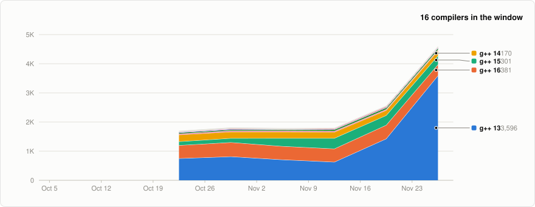
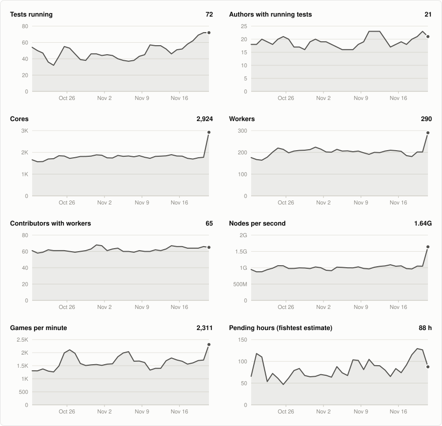
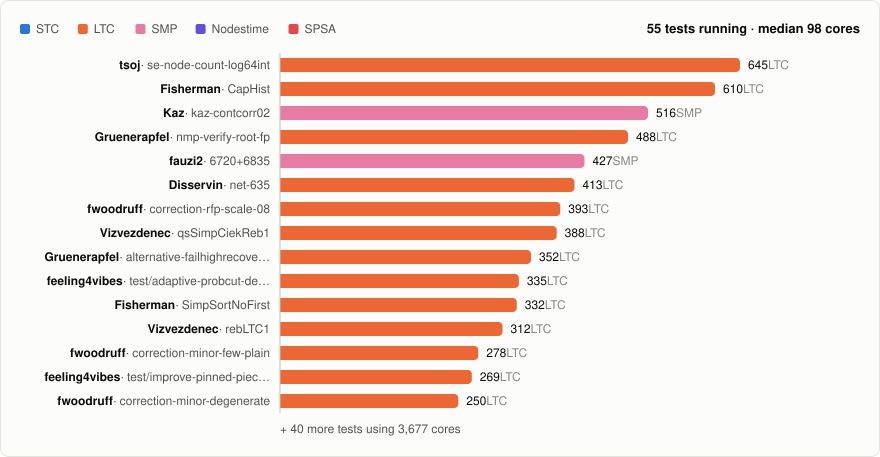

# Fishtest status

Updated Mon 16 Nov 2026, 02:49 UTC

## Trends

### Last 14 days

#### Cores by test type

<picture>
  <source media="(prefers-color-scheme: dark)" srcset="https://raw.githubusercontent.com/xu-shawn/fishtest_track/1d8dd24f277619d56aa33c5227b4e15e3260175f/types-dark.svg">
  
</picture>

#### Tests by type

<picture>
  <source media="(prefers-color-scheme: dark)" srcset="https://raw.githubusercontent.com/xu-shawn/fishtest_track/1d8dd24f277619d56aa33c5227b4e15e3260175f/type-counts-dark.svg">
  
</picture>

#### Net tests and search tests

<picture>
  <source media="(prefers-color-scheme: dark)" srcset="https://raw.githubusercontent.com/xu-shawn/fishtest_track/1d8dd24f277619d56aa33c5227b4e15e3260175f/net-search-trend-dark.svg">
  
</picture>

#### Gainer and simplification bounds

<picture>
  <source media="(prefers-color-scheme: dark)" srcset="https://raw.githubusercontent.com/xu-shawn/fishtest_track/1d8dd24f277619d56aa33c5227b4e15e3260175f/bounds-trend-dark.svg">
  
</picture>

#### Cores by test

<picture>
  <source media="(prefers-color-scheme: dark)" srcset="https://raw.githubusercontent.com/xu-shawn/fishtest_track/1d8dd24f277619d56aa33c5227b4e15e3260175f/tests-trend-dark.svg">
  
</picture>

#### Cores by author

<picture>
  <source media="(prefers-color-scheme: dark)" srcset="https://raw.githubusercontent.com/xu-shawn/fishtest_track/1d8dd24f277619d56aa33c5227b4e15e3260175f/authors-trend-dark.svg">
  
</picture>

#### Tests per author

<picture>
  <source media="(prefers-color-scheme: dark)" srcset="https://raw.githubusercontent.com/xu-shawn/fishtest_track/1d8dd24f277619d56aa33c5227b4e15e3260175f/author-tests-trend-dark.svg">
  
</picture>

#### Cores contributed by user

<picture>
  <source media="(prefers-color-scheme: dark)" srcset="https://raw.githubusercontent.com/xu-shawn/fishtest_track/1d8dd24f277619d56aa33c5227b4e15e3260175f/contributors-trend-dark.svg">
  
</picture>

#### MNps contributed by user

<picture>
  <source media="(prefers-color-scheme: dark)" srcset="https://raw.githubusercontent.com/xu-shawn/fishtest_track/1d8dd24f277619d56aa33c5227b4e15e3260175f/contributors-mnps-trend-dark.svg">
  
</picture>

#### Tests, authors, contributors and throughput

<picture>
  <source media="(prefers-color-scheme: dark)" srcset="https://raw.githubusercontent.com/xu-shawn/fishtest_track/1d8dd24f277619d56aa33c5227b4e15e3260175f/activity-dark.svg">
  
</picture>

#### Tests finished per hour

<picture>
  <source media="(prefers-color-scheme: dark)" srcset="https://raw.githubusercontent.com/xu-shawn/fishtest_track/1d8dd24f277619d56aa33c5227b4e15e3260175f/throughput-dark.svg">
  
</picture>

#### LLR distribution of running tests

<picture>
  <source media="(prefers-color-scheme: dark)" srcset="https://raw.githubusercontent.com/xu-shawn/fishtest_track/1d8dd24f277619d56aa33c5227b4e15e3260175f/llr-dark.svg">
  
</picture>

### Last 30 days

#### Finished tests per day

<picture>
  <source media="(prefers-color-scheme: dark)" srcset="https://raw.githubusercontent.com/xu-shawn/fishtest_track/1d8dd24f277619d56aa33c5227b4e15e3260175f/finished-dark.svg">
  
</picture>

Last 7 days: **158 tests** finished, 14.1M games. **26 passed** (19 STC, 4 LTC, 2 SMP, 1 nodestime), 76 rejected, 52 stopped, 3 completed (SPSA or fixed games), 1 failed. SPRT pass rate 25.5%: 19.8% for gainers (86), 56.2% for simplifications (16); 66.7% for net tests (12), 20.0% for search tests (90).

#### Cores by architecture

<picture>
  <source media="(prefers-color-scheme: dark)" srcset="https://raw.githubusercontent.com/xu-shawn/fishtest_track/1d8dd24f277619d56aa33c5227b4e15e3260175f/monthly-arch-dark.svg">
  
</picture>

#### Cores by compiler

<picture>
  <source media="(prefers-color-scheme: dark)" srcset="https://raw.githubusercontent.com/xu-shawn/fishtest_track/1d8dd24f277619d56aa33c5227b4e15e3260175f/monthly-compiler-dark.svg">
  
</picture>

### Last year

#### Finished tests per week

<picture>
  <source media="(prefers-color-scheme: dark)" srcset="https://raw.githubusercontent.com/xu-shawn/fishtest_track/1d8dd24f277619d56aa33c5227b4e15e3260175f/weekly-finished-dark.svg">
  
</picture>

#### Runtime of finished tests

<picture>
  <source media="(prefers-color-scheme: dark)" srcset="https://raw.githubusercontent.com/xu-shawn/fishtest_track/1d8dd24f277619d56aa33c5227b4e15e3260175f/runtime-trend-dark.svg">
  
</picture>

#### Average cores per week by test type

<picture>
  <source media="(prefers-color-scheme: dark)" srcset="https://raw.githubusercontent.com/xu-shawn/fishtest_track/1d8dd24f277619d56aa33c5227b4e15e3260175f/weekly-types-dark.svg">
  
</picture>

#### Cores by architecture

<picture>
  <source media="(prefers-color-scheme: dark)" srcset="https://raw.githubusercontent.com/xu-shawn/fishtest_track/1d8dd24f277619d56aa33c5227b4e15e3260175f/yearly-arch-dark.svg">
  
</picture>

#### Cores by compiler

<picture>
  <source media="(prefers-color-scheme: dark)" srcset="https://raw.githubusercontent.com/xu-shawn/fishtest_track/1d8dd24f277619d56aa33c5227b4e15e3260175f/yearly-compiler-dark.svg">
  
</picture>

#### Gainer bounds

<picture>
  <source media="(prefers-color-scheme: dark)" srcset="https://raw.githubusercontent.com/xu-shawn/fishtest_track/1d8dd24f277619d56aa33c5227b4e15e3260175f/weekly-gainers-dark.svg">
  
</picture>

#### Simplification bounds

<picture>
  <source media="(prefers-color-scheme: dark)" srcset="https://raw.githubusercontent.com/xu-shawn/fishtest_track/1d8dd24f277619d56aa33c5227b4e15e3260175f/weekly-simplifications-dark.svg">
  
</picture>

#### Net tests

<picture>
  <source media="(prefers-color-scheme: dark)" srcset="https://raw.githubusercontent.com/xu-shawn/fishtest_track/1d8dd24f277619d56aa33c5227b4e15e3260175f/weekly-net-dark.svg">
  
</picture>

#### Search tests

<picture>
  <source media="(prefers-color-scheme: dark)" srcset="https://raw.githubusercontent.com/xu-shawn/fishtest_track/1d8dd24f277619d56aa33c5227b4e15e3260175f/weekly-search-dark.svg">
  
</picture>

### Since 19 Oct 2026, daily averages

#### Cores by test type

<picture>
  <source media="(prefers-color-scheme: dark)" srcset="https://raw.githubusercontent.com/xu-shawn/fishtest_track/1d8dd24f277619d56aa33c5227b4e15e3260175f/long-types-dark.svg">
  
</picture>

#### Cores by author

<picture>
  <source media="(prefers-color-scheme: dark)" srcset="https://raw.githubusercontent.com/xu-shawn/fishtest_track/1d8dd24f277619d56aa33c5227b4e15e3260175f/long-authors-dark.svg">
  
</picture>

#### Tests per author

<picture>
  <source media="(prefers-color-scheme: dark)" srcset="https://raw.githubusercontent.com/xu-shawn/fishtest_track/1d8dd24f277619d56aa33c5227b4e15e3260175f/long-author-tests-dark.svg">
  
</picture>

#### Cores contributed by user

<picture>
  <source media="(prefers-color-scheme: dark)" srcset="https://raw.githubusercontent.com/xu-shawn/fishtest_track/1d8dd24f277619d56aa33c5227b4e15e3260175f/long-contributors-dark.svg">
  
</picture>

#### MNps contributed by user

<picture>
  <source media="(prefers-color-scheme: dark)" srcset="https://raw.githubusercontent.com/xu-shawn/fishtest_track/1d8dd24f277619d56aa33c5227b4e15e3260175f/long-contributors-mnps-dark.svg">
  
</picture>

#### Tests, authors, contributors and throughput

<picture>
  <source media="(prefers-color-scheme: dark)" srcset="https://raw.githubusercontent.com/xu-shawn/fishtest_track/1d8dd24f277619d56aa33c5227b4e15e3260175f/long-activity-dark.svg">
  
</picture>

## Right now

**47 tests** from **19 authors** are running on **1,887 cores** (223 workers from 66 contributors). About 68 hours of work is queued.

| | Now | 24 h avg | 7 d avg | 30 d avg |
|:--|--:|--:|--:|--:|
| Tests running | 47 | 50 | 52 | 46 |
| Authors with running tests | 19 | 19 | 20 | 19 |
| Cores | 1,887 | 1,836 | 1,817 | 1,782 |
| Workers | 223 | 208 | 202 | 201 |
| Contributors with workers | 66 | 66 | 63 | 62 |
| Net tests running | 2 | 2 | 5 | 5 |
| Cores on net tests | 85 | 93 | 336 | 258 |
| Nodes per second | 1.07G | 1.05G | 1.03G | 991M |
| Games per minute | 1,711 | 1,721 | 1,566 | 1,610 |
| Pending hours | 68 h | 83 h | 85 h | 148 h |

### Cores by test

<picture>
  <source media="(prefers-color-scheme: dark)" srcset="https://raw.githubusercontent.com/xu-shawn/fishtest_track/1d8dd24f277619d56aa33c5227b4e15e3260175f/tests-dark.svg">
  
</picture>

### Runtime of running tests

<picture>
  <source media="(prefers-color-scheme: dark)" srcset="https://raw.githubusercontent.com/xu-shawn/fishtest_track/1d8dd24f277619d56aa33c5227b4e15e3260175f/runtime-dark.svg">
  
</picture>

### Cores by author

<picture>
  <source media="(prefers-color-scheme: dark)" srcset="https://raw.githubusercontent.com/xu-shawn/fishtest_track/1d8dd24f277619d56aa33c5227b4e15e3260175f/authors-dark.svg">
  
</picture>

### Cores contributed by user

<picture>
  <source media="(prefers-color-scheme: dark)" srcset="https://raw.githubusercontent.com/xu-shawn/fishtest_track/1d8dd24f277619d56aa33c5227b4e15e3260175f/contributors-dark.svg">
  
</picture>

### MNps contributed by user

<picture>
  <source media="(prefers-color-scheme: dark)" srcset="https://raw.githubusercontent.com/xu-shawn/fishtest_track/1d8dd24f277619d56aa33c5227b4e15e3260175f/contributors-mnps-dark.svg">
  
</picture>

## Last 30 days in detail

### Recently passed

| Finished | Author | Test | TC | Bounds | Elo |
|:--|:--|:--|:--|:--|--:|
| Nov 15 | [Gruenerapfel](https://tests.stockfishchess.org/tests/user/Gruenerapfel) | [`recipe-simp`](https://tests.stockfishchess.org/tests/view/6af447668e7fb2e78bc1cf4b) | 10+0.1 | [-1.75,0.25] | +0.03 ±0.72 |
| Nov 15 | [Kaz](https://tests.stockfishchess.org/tests/user/Kaz) | [`key-stack-contcorr-01`](https://tests.stockfishchess.org/tests/view/6af1a4d68e7fb2e78bc1cb59) | 20+0.2 ×8 | [0.5,2.5] | +1.58 ±1.03 |
| Nov 15 | [Dubslow](https://tests.stockfishchess.org/tests/user/Dubslow) | [`rm-optimism`](https://tests.stockfishchess.org/tests/view/6af533468e7fb2e78bc1d0fd) | 10+0.1 | [-1.75,0.25] | +0.16 ±0.82 |
| Nov 14 | [shawnxu](https://tests.stockfishchess.org/tests/user/shawnxu) | [`test1762`](https://tests.stockfishchess.org/tests/view/6af7ab678e7fb2e78bc1d537) | 60+0.6 | [0.5,2.5] | +3.11 ±1.71 |
| Nov 14 | [rjhanson](https://tests.stockfishchess.org/tests/user/rjhanson) | [`movegen-lazy-king-threa…`](https://tests.stockfishchess.org/tests/view/6af7f6b58e7fb2e78bc1d5a5) | 10+0.1 | [0,2] | +3.16 ±1.81 |
| Nov 14 | [Vizvezdenec](https://tests.stockfishchess.org/tests/user/Vizvezdenec) | [`alphabetaEval3`](https://tests.stockfishchess.org/tests/view/6af212f28e7fb2e78bc1cbcf) | 10+0.1 | [0,2] | +1.08 ±0.87 |
| Nov 14 | [0x539](https://tests.stockfishchess.org/tests/user/0x539) | [`tt-stm`](https://tests.stockfishchess.org/tests/view/6af520a18e7fb2e78bc1d0ea) | 60+0.6 | [-1.75,0.25] | +0.78 ±1.16 |
| Nov 14 | [shawnxu](https://tests.stockfishchess.org/tests/user/shawnxu) | [`test1762`](https://tests.stockfishchess.org/tests/view/6af7979e8e7fb2e78bc1d512) | 10+0.1 | [0,2] | +3.64 ±2.03 |
| Nov 13 | [rjhanson](https://tests.stockfishchess.org/tests/user/rjhanson) | [`movepick-hoist-histories`](https://tests.stockfishchess.org/tests/view/6af0914289c6931c272dea9e) | 10+0.1 | [0,2] | +0.75 ±0.59 |
| Nov 12 | [rn](https://tests.stockfishchess.org/tests/user/rn) | [`fix-multipv-tm`](https://tests.stockfishchess.org/tests/view/6af5a0f88e7fb2e78bc1d1cd) | 10+0.1 | [0,2] | +30.88 ±6.42 |
| Nov 12 | [shawnxu](https://tests.stockfishchess.org/tests/user/shawnxu) | [`test1760`](https://tests.stockfishchess.org/tests/view/6af45b3f8e7fb2e78bc1cf67) | 100+1 nodestime | [0,2] | +5.03 ±2.43 |
| Nov 12 | [Vizvezdenec](https://tests.stockfishchess.org/tests/user/Vizvezdenec) | [`pvnodeLmrExt5`](https://tests.stockfishchess.org/tests/view/6af0dcd98e7fb2e78bc1ca1b) | 10+0.1 | [0,2] | +1.30 ±1.02 |

### Most active authors

| Author | Finished | Passed | Running now | Core-hours | Share |
|:--|--:|--:|--:|--:|--:|
| [Vizvezdenec](https://tests.stockfishchess.org/tests/user/Vizvezdenec) | 49 | 5 | 6 | 124,732 | 11.0% |
| [Gruenerapfel](https://tests.stockfishchess.org/tests/user/Gruenerapfel) | 23 | 7 | 5 | 114,433 | 10.1% |
| [fauzi2](https://tests.stockfishchess.org/tests/user/fauzi2) | 39 | 4 | 3 | 104,513 | 9.2% |
| [sg](https://tests.stockfishchess.org/tests/user/sg) | 41 | 8 | 5 | 81,146 | 7.1% |
| [shawnxu](https://tests.stockfishchess.org/tests/user/shawnxu) | 51 | 23 | 4 | 76,502 | 6.7% |
| [vdv](https://tests.stockfishchess.org/tests/user/vdv) | 11 | 2 | 0 | 74,997 | 6.6% |
| [Disservin](https://tests.stockfishchess.org/tests/user/Disservin) | 5 | 0 | 0 | 59,540 | 5.2% |
| [rn](https://tests.stockfishchess.org/tests/user/rn) | 15 | 6 | 2 | 54,607 | 4.8% |
| [DeadK1ng](https://tests.stockfishchess.org/tests/user/DeadK1ng) | 4 | 1 | 0 | 53,670 | 4.7% |
| [AdrianStockfish](https://tests.stockfishchess.org/tests/user/AdrianStockfish) | 51 | 5 | 3 | 41,093 | 3.6% |

### Top contributors

| Contributor | Core-hours | Share | Cores now | MNps now | Workers now |
|:--|--:|--:|--:|--:|--:|
| [ChessDBCN](https://tests.stockfishchess.org/tests/user/ChessDBCN) | 305,037 | 25.9% | 456 | 194 | 57 |
| [niklasf](https://tests.stockfishchess.org/tests/user/niklasf) | 122,342 | 10.4% | 189 | 80 | 3 |
| [Wencey](https://tests.stockfishchess.org/tests/user/Wencey) | 98,285 | 8.3% | 150 | 43 | 4 |
| [MediumBerry5575](https://tests.stockfishchess.org/tests/user/MediumBerry5575) | 75,882 | 6.4% | 192 | 147 | 48 |
| [wizzouk](https://tests.stockfishchess.org/tests/user/wizzouk) | 58,729 | 5.0% | 43 | 20 | 2 |
| [okrout](https://tests.stockfishchess.org/tests/user/okrout) | 55,105 | 4.7% | 82 | 59 | 5 |
| [beginnerchess10002551](https://tests.stockfishchess.org/tests/user/beginnerchess10002551) | 51,229 | 4.3% | 80 | 61 | 20 |
| [CypressChess](https://tests.stockfishchess.org/tests/user/CypressChess) | 26,095 | 2.2% | 40 | 19 | 5 |
| [maximmasiutin](https://tests.stockfishchess.org/tests/user/maximmasiutin) | 21,808 | 1.9% | 10 | 3.5 | 2 |
| [technologov](https://tests.stockfishchess.org/tests/user/technologov) | 21,657 | 1.8% | 44 | 19 | 2 |
