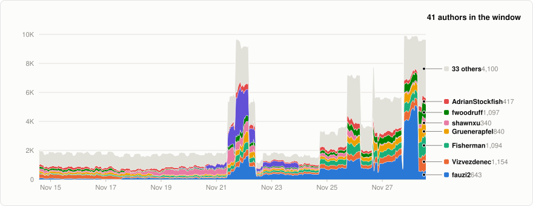
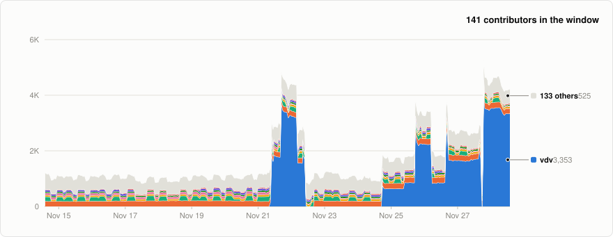

# Fishtest status

Updated Sat 21 Nov 2026, 23:45 UTC

## Trends

### Last 14 days

#### Cores by test type

<picture>
  <source media="(prefers-color-scheme: dark)" srcset="https://raw.githubusercontent.com/xu-shawn/fishtest_track/b7cd0f26b70e64b0de35ea5991e8c5c32325ae63/types-dark.svg">
  
</picture>

#### Tests by type

<picture>
  <source media="(prefers-color-scheme: dark)" srcset="https://raw.githubusercontent.com/xu-shawn/fishtest_track/b7cd0f26b70e64b0de35ea5991e8c5c32325ae63/type-counts-dark.svg">
  
</picture>

#### Net tests and search tests

<picture>
  <source media="(prefers-color-scheme: dark)" srcset="https://raw.githubusercontent.com/xu-shawn/fishtest_track/b7cd0f26b70e64b0de35ea5991e8c5c32325ae63/net-search-trend-dark.svg">
  
</picture>

#### Gainer and simplification bounds

<picture>
  <source media="(prefers-color-scheme: dark)" srcset="https://raw.githubusercontent.com/xu-shawn/fishtest_track/b7cd0f26b70e64b0de35ea5991e8c5c32325ae63/bounds-trend-dark.svg">
  
</picture>

#### Cores by test

<picture>
  <source media="(prefers-color-scheme: dark)" srcset="https://raw.githubusercontent.com/xu-shawn/fishtest_track/b7cd0f26b70e64b0de35ea5991e8c5c32325ae63/tests-trend-dark.svg">
  
</picture>

#### Cores by author

<picture>
  <source media="(prefers-color-scheme: dark)" srcset="https://raw.githubusercontent.com/xu-shawn/fishtest_track/b7cd0f26b70e64b0de35ea5991e8c5c32325ae63/authors-trend-dark.svg">
  
</picture>

#### Tests per author

<picture>
  <source media="(prefers-color-scheme: dark)" srcset="https://raw.githubusercontent.com/xu-shawn/fishtest_track/b7cd0f26b70e64b0de35ea5991e8c5c32325ae63/author-tests-trend-dark.svg">
  
</picture>

#### Cores contributed by user

<picture>
  <source media="(prefers-color-scheme: dark)" srcset="https://raw.githubusercontent.com/xu-shawn/fishtest_track/b7cd0f26b70e64b0de35ea5991e8c5c32325ae63/contributors-trend-dark.svg">
  
</picture>

#### MNps contributed by user

<picture>
  <source media="(prefers-color-scheme: dark)" srcset="https://raw.githubusercontent.com/xu-shawn/fishtest_track/b7cd0f26b70e64b0de35ea5991e8c5c32325ae63/contributors-mnps-trend-dark.svg">
  
</picture>

#### Tests, authors, contributors and throughput

<picture>
  <source media="(prefers-color-scheme: dark)" srcset="https://raw.githubusercontent.com/xu-shawn/fishtest_track/b7cd0f26b70e64b0de35ea5991e8c5c32325ae63/activity-dark.svg">
  
</picture>

#### Tests finished per hour

<picture>
  <source media="(prefers-color-scheme: dark)" srcset="https://raw.githubusercontent.com/xu-shawn/fishtest_track/b7cd0f26b70e64b0de35ea5991e8c5c32325ae63/throughput-dark.svg">
  
</picture>

#### LLR distribution of running tests

<picture>
  <source media="(prefers-color-scheme: dark)" srcset="https://raw.githubusercontent.com/xu-shawn/fishtest_track/b7cd0f26b70e64b0de35ea5991e8c5c32325ae63/llr-dark.svg">
  
</picture>

### Last 30 days

#### Finished tests per day

<picture>
  <source media="(prefers-color-scheme: dark)" srcset="https://raw.githubusercontent.com/xu-shawn/fishtest_track/b7cd0f26b70e64b0de35ea5991e8c5c32325ae63/finished-dark.svg">
  
</picture>

Last 7 days: **184 tests** finished, 15.2M games. **25 passed** (21 STC, 2 LTC, 1 SMP, 1 nodestime), 101 rejected, 49 stopped, 2 completed (SPSA or fixed games), 7 failed. SPRT pass rate 19.8%: 12.1% for gainers (107), 63.2% for simplifications (19); 37.5% for net tests (8), 18.6% for search tests (118).

#### Cores by architecture

<picture>
  <source media="(prefers-color-scheme: dark)" srcset="https://raw.githubusercontent.com/xu-shawn/fishtest_track/b7cd0f26b70e64b0de35ea5991e8c5c32325ae63/monthly-arch-dark.svg">
  
</picture>

#### Cores by compiler

<picture>
  <source media="(prefers-color-scheme: dark)" srcset="https://raw.githubusercontent.com/xu-shawn/fishtest_track/b7cd0f26b70e64b0de35ea5991e8c5c32325ae63/monthly-compiler-dark.svg">
  
</picture>

### Last year

#### Finished tests per week

<picture>
  <source media="(prefers-color-scheme: dark)" srcset="https://raw.githubusercontent.com/xu-shawn/fishtest_track/b7cd0f26b70e64b0de35ea5991e8c5c32325ae63/weekly-finished-dark.svg">
  
</picture>

#### Runtime of finished tests

<picture>
  <source media="(prefers-color-scheme: dark)" srcset="https://raw.githubusercontent.com/xu-shawn/fishtest_track/b7cd0f26b70e64b0de35ea5991e8c5c32325ae63/runtime-trend-dark.svg">
  
</picture>

#### Average cores per week by test type

<picture>
  <source media="(prefers-color-scheme: dark)" srcset="https://raw.githubusercontent.com/xu-shawn/fishtest_track/b7cd0f26b70e64b0de35ea5991e8c5c32325ae63/weekly-types-dark.svg">
  
</picture>

#### Cores by architecture

<picture>
  <source media="(prefers-color-scheme: dark)" srcset="https://raw.githubusercontent.com/xu-shawn/fishtest_track/b7cd0f26b70e64b0de35ea5991e8c5c32325ae63/yearly-arch-dark.svg">
  
</picture>

#### Cores by compiler

<picture>
  <source media="(prefers-color-scheme: dark)" srcset="https://raw.githubusercontent.com/xu-shawn/fishtest_track/b7cd0f26b70e64b0de35ea5991e8c5c32325ae63/yearly-compiler-dark.svg">
  
</picture>

#### Gainer bounds

<picture>
  <source media="(prefers-color-scheme: dark)" srcset="https://raw.githubusercontent.com/xu-shawn/fishtest_track/b7cd0f26b70e64b0de35ea5991e8c5c32325ae63/weekly-gainers-dark.svg">
  
</picture>

#### Simplification bounds

<picture>
  <source media="(prefers-color-scheme: dark)" srcset="https://raw.githubusercontent.com/xu-shawn/fishtest_track/b7cd0f26b70e64b0de35ea5991e8c5c32325ae63/weekly-simplifications-dark.svg">
  
</picture>

#### Net tests

<picture>
  <source media="(prefers-color-scheme: dark)" srcset="https://raw.githubusercontent.com/xu-shawn/fishtest_track/b7cd0f26b70e64b0de35ea5991e8c5c32325ae63/weekly-net-dark.svg">
  
</picture>

#### Search tests

<picture>
  <source media="(prefers-color-scheme: dark)" srcset="https://raw.githubusercontent.com/xu-shawn/fishtest_track/b7cd0f26b70e64b0de35ea5991e8c5c32325ae63/weekly-search-dark.svg">
  
</picture>

### Since 19 Oct 2026, daily averages

#### Cores by test type

<picture>
  <source media="(prefers-color-scheme: dark)" srcset="https://raw.githubusercontent.com/xu-shawn/fishtest_track/b7cd0f26b70e64b0de35ea5991e8c5c32325ae63/long-types-dark.svg">
  
</picture>

#### Cores by author

<picture>
  <source media="(prefers-color-scheme: dark)" srcset="https://raw.githubusercontent.com/xu-shawn/fishtest_track/b7cd0f26b70e64b0de35ea5991e8c5c32325ae63/long-authors-dark.svg">
  
</picture>

#### Tests per author

<picture>
  <source media="(prefers-color-scheme: dark)" srcset="https://raw.githubusercontent.com/xu-shawn/fishtest_track/b7cd0f26b70e64b0de35ea5991e8c5c32325ae63/long-author-tests-dark.svg">
  
</picture>

#### Cores contributed by user

<picture>
  <source media="(prefers-color-scheme: dark)" srcset="https://raw.githubusercontent.com/xu-shawn/fishtest_track/b7cd0f26b70e64b0de35ea5991e8c5c32325ae63/long-contributors-dark.svg">
  
</picture>

#### MNps contributed by user

<picture>
  <source media="(prefers-color-scheme: dark)" srcset="https://raw.githubusercontent.com/xu-shawn/fishtest_track/b7cd0f26b70e64b0de35ea5991e8c5c32325ae63/long-contributors-mnps-dark.svg">
  
</picture>

#### Tests, authors, contributors and throughput

<picture>
  <source media="(prefers-color-scheme: dark)" srcset="https://raw.githubusercontent.com/xu-shawn/fishtest_track/b7cd0f26b70e64b0de35ea5991e8c5c32325ae63/long-activity-dark.svg">
  
</picture>

## Right now

**64 tests** from **21 authors** are running on **9,189 cores** (701 workers from 70 contributors). About 34 hours of work is queued.

| | Now | 24 h avg | 7 d avg | 30 d avg |
|:--|--:|--:|--:|--:|
| Tests running | 64 | 70 | 62 | 49 |
| Authors with running tests | 21 | 21 | 20 | 19 |
| Cores | 9,189 | 5,522 | 2,304 | 1,922 |
| Workers | 701 | 454 | 234 | 213 |
| Contributors with workers | 70 | 67 | 65 | 63 |
| Net tests running | 4 | 6 | 4 | 5 |
| Cores on net tests | 2,171 | 1,189 | 346 | 292 |
| Nodes per second | 4.40G | 2.71G | 1.26G | 1.06G |
| Games per minute | 5,007 | 3,443 | 1,917 | 1,718 |
| Pending hours | 34 h | 75 h | 99 h | 85 h |

### Cores by test

<picture>
  <source media="(prefers-color-scheme: dark)" srcset="https://raw.githubusercontent.com/xu-shawn/fishtest_track/b7cd0f26b70e64b0de35ea5991e8c5c32325ae63/tests-dark.svg">
  
</picture>

### Runtime of running tests

<picture>
  <source media="(prefers-color-scheme: dark)" srcset="https://raw.githubusercontent.com/xu-shawn/fishtest_track/b7cd0f26b70e64b0de35ea5991e8c5c32325ae63/runtime-dark.svg">
  
</picture>

### Cores by author

<picture>
  <source media="(prefers-color-scheme: dark)" srcset="https://raw.githubusercontent.com/xu-shawn/fishtest_track/b7cd0f26b70e64b0de35ea5991e8c5c32325ae63/authors-dark.svg">
  
</picture>

### Cores contributed by user

<picture>
  <source media="(prefers-color-scheme: dark)" srcset="https://raw.githubusercontent.com/xu-shawn/fishtest_track/b7cd0f26b70e64b0de35ea5991e8c5c32325ae63/contributors-dark.svg">
  
</picture>

### MNps contributed by user

<picture>
  <source media="(prefers-color-scheme: dark)" srcset="https://raw.githubusercontent.com/xu-shawn/fishtest_track/b7cd0f26b70e64b0de35ea5991e8c5c32325ae63/contributors-mnps-dark.svg">
  
</picture>

## Last 30 days in detail

### Recently passed

| Finished | Author | Test | TC | Bounds | Elo |
|:--|:--|:--|:--|:--|--:|
| Nov 21 | [vdv](https://tests.stockfishchess.org/tests/user/vdv) | [`NMPStaticTrustDynReb`](https://tests.stockfishchess.org/tests/view/6b0171a3b9d0e035d605f877) | 60+0.6 | [-1.75,0.25] | +0.25 ±0.84 |
| Nov 21 | [Fisherman](https://tests.stockfishchess.org/tests/user/Fisherman) | [`PawnPairCache`](https://tests.stockfishchess.org/tests/view/6afeb69c2ff81bd6a6344345) | 10+0.1 | [0,2] | +1.38 ±1.05 |
| Nov 21 | [fauzi2](https://tests.stockfishchess.org/tests/user/fauzi2) | [`altre1`](https://tests.stockfishchess.org/tests/view/6aff078a2ff81bd6a63443e8) | 10+0.1 | [0,2] | +1.76 ±1.28 |
| Nov 21 | [noobpwnftw](https://tests.stockfishchess.org/tests/user/noobpwnftw) | [`simplify-hyperbola`](https://tests.stockfishchess.org/tests/view/6b015ca5b9d0e035d605f83a) | 10+0.1 | [-1.75,0.25] | +1.26 ±1.40 |
| Nov 21 | [Dubslow](https://tests.stockfishchess.org/tests/user/Dubslow) | [`rm-optimism-rb`](https://tests.stockfishchess.org/tests/view/6af922988e7fb2e78bc1d79f) | 60+0.6 | [-1.75,0.25] | -0.07 ±0.57 |
| Nov 21 | [Vizvezdenec](https://tests.stockfishchess.org/tests/user/Vizvezdenec) | [`qsSimpCiek1`](https://tests.stockfishchess.org/tests/view/6afc91428e7fb2e78bc1dd03) | 10+0.1 | [-1.75,0.25] | +0.25 ±0.89 |
| Nov 21 | [rawbee](https://tests.stockfishchess.org/tests/user/rawbee) | [`simp-nfc-combo`](https://tests.stockfishchess.org/tests/view/6afb6f598e7fb2e78bc1db97) | 10+0.1 | [-1.75,0.25] | -0.03 ±0.62 |
| Nov 21 | [Gruenerapfel](https://tests.stockfishchess.org/tests/user/Gruenerapfel) | [`nettest603`](https://tests.stockfishchess.org/tests/view/6afeee7e2ff81bd6a63443b3) | 10+0.1 | [0,2] | +1.53 ±1.16 |
| Nov 21 | [AdrianStockfish](https://tests.stockfishchess.org/tests/user/AdrianStockfish) | [`moreFP`](https://tests.stockfishchess.org/tests/view/6b003c5d2ff81bd6a63445b3) | 10+0.1 | [-1.75,0.25] | +1.89 ±1.69 |
| Nov 21 | [vdv](https://tests.stockfishchess.org/tests/user/vdv) | [`NMPStaticTrustDyn`](https://tests.stockfishchess.org/tests/view/6afefe3e2ff81bd6a63443cf) | 10+0.1 | [-1.75,0.25] | +0.90 ±1.26 |
| Nov 21 | [fwoodruff](https://tests.stockfishchess.org/tests/user/fwoodruff) | [`correction-rfp-scale-08`](https://tests.stockfishchess.org/tests/view/6afd547a2ff81bd6a6344177) | 10+0.1 | [0,2] | +1.17 ±0.94 |
| Nov 21 | [Kaz](https://tests.stockfishchess.org/tests/user/Kaz) | [`kaz-contcorr02`](https://tests.stockfishchess.org/tests/view/6afead0f2ff81bd6a634433e) | 10+0.1 | [0,2] | +1.41 ±1.09 |

### Most active authors

| Author | Finished | Passed | Running now | Core-hours | Share |
|:--|--:|--:|--:|--:|--:|
| [Gruenerapfel](https://tests.stockfishchess.org/tests/user/Gruenerapfel) | 32 | 8 | 2 | 104,920 | 9.7% |
| [sg](https://tests.stockfishchess.org/tests/user/sg) | 42 | 7 | 2 | 91,220 | 8.4% |
| [fauzi2](https://tests.stockfishchess.org/tests/user/fauzi2) | 42 | 4 | 9 | 89,537 | 8.3% |
| [shawnxu](https://tests.stockfishchess.org/tests/user/shawnxu) | 45 | 22 | 5 | 76,997 | 7.1% |
| [Vizvezdenec](https://tests.stockfishchess.org/tests/user/Vizvezdenec) | 50 | 6 | 6 | 70,116 | 6.5% |
| [rn](https://tests.stockfishchess.org/tests/user/rn) | 12 | 7 | 4 | 64,023 | 5.9% |
| [Disservin](https://tests.stockfishchess.org/tests/user/Disservin) | 5 | 0 | 0 | 59,540 | 5.5% |
| [DeadK1ng](https://tests.stockfishchess.org/tests/user/DeadK1ng) | 4 | 1 | 0 | 53,670 | 5.0% |
| [AdrianStockfish](https://tests.stockfishchess.org/tests/user/AdrianStockfish) | 46 | 5 | 4 | 53,357 | 4.9% |
| [vdv](https://tests.stockfishchess.org/tests/user/vdv) | 13 | 3 | 2 | 46,790 | 4.3% |

### Top contributors

| Contributor | Core-hours | Share | Cores now | MNps now | Workers now |
|:--|--:|--:|--:|--:|--:|
| [ChessDBCN](https://tests.stockfishchess.org/tests/user/ChessDBCN) | 327,263 | 24.0% | 424 | 188 | 53 |
| [niklasf](https://tests.stockfishchess.org/tests/user/niklasf) | 130,922 | 9.6% | 63 | 33 | 1 |
| [Wencey](https://tests.stockfishchess.org/tests/user/Wencey) | 106,002 | 7.8% | 150 | 57 | 4 |
| [MediumBerry5575](https://tests.stockfishchess.org/tests/user/MediumBerry5575) | 91,185 | 6.7% | 188 | 163 | 47 |
| [vdv](https://tests.stockfishchess.org/tests/user/vdv) | 86,598 | 6.4% | 7,424 | 3,277 | 464 |
| [okrout](https://tests.stockfishchess.org/tests/user/okrout) | 59,435 | 4.4% | 94 | 70 | 7 |
| [wizzouk](https://tests.stockfishchess.org/tests/user/wizzouk) | 57,994 | 4.3% | 43 | 23 | 2 |
| [beginnerchess10002551](https://tests.stockfishchess.org/tests/user/beginnerchess10002551) | 51,739 | 3.8% | 76 | 66 | 19 |
| [CypressChess](https://tests.stockfishchess.org/tests/user/CypressChess) | 28,153 | 2.1% | 40 | 17 | 5 |
| [fogleman](https://tests.stockfishchess.org/tests/user/fogleman) | 25,077 | 1.8% | 48 | 26 | 4 |
