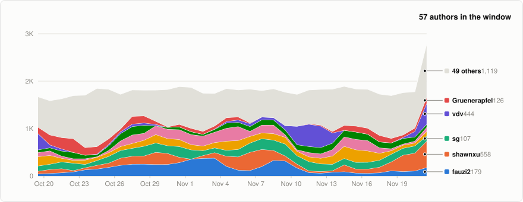

# Fishtest status

Updated Tue 24 Nov 2026, 20:45 UTC

## Trends

### Last 14 days

#### Cores by test type

<picture>
  <source media="(prefers-color-scheme: dark)" srcset="https://raw.githubusercontent.com/xu-shawn/fishtest_track/5df541a3556f64d72c6b79e68c698aab7a0f4dfd/types-dark.svg">
  
</picture>

#### Tests by type

<picture>
  <source media="(prefers-color-scheme: dark)" srcset="https://raw.githubusercontent.com/xu-shawn/fishtest_track/5df541a3556f64d72c6b79e68c698aab7a0f4dfd/type-counts-dark.svg">
  
</picture>

#### Net tests and search tests

<picture>
  <source media="(prefers-color-scheme: dark)" srcset="https://raw.githubusercontent.com/xu-shawn/fishtest_track/5df541a3556f64d72c6b79e68c698aab7a0f4dfd/net-search-trend-dark.svg">
  
</picture>

#### Gainer and simplification bounds

<picture>
  <source media="(prefers-color-scheme: dark)" srcset="https://raw.githubusercontent.com/xu-shawn/fishtest_track/5df541a3556f64d72c6b79e68c698aab7a0f4dfd/bounds-trend-dark.svg">
  
</picture>

#### Cores by test

<picture>
  <source media="(prefers-color-scheme: dark)" srcset="https://raw.githubusercontent.com/xu-shawn/fishtest_track/5df541a3556f64d72c6b79e68c698aab7a0f4dfd/tests-trend-dark.svg">
  
</picture>

#### Cores by author

<picture>
  <source media="(prefers-color-scheme: dark)" srcset="https://raw.githubusercontent.com/xu-shawn/fishtest_track/5df541a3556f64d72c6b79e68c698aab7a0f4dfd/authors-trend-dark.svg">
  
</picture>

#### Tests per author

<picture>
  <source media="(prefers-color-scheme: dark)" srcset="https://raw.githubusercontent.com/xu-shawn/fishtest_track/5df541a3556f64d72c6b79e68c698aab7a0f4dfd/author-tests-trend-dark.svg">
  
</picture>

#### Cores contributed by user

<picture>
  <source media="(prefers-color-scheme: dark)" srcset="https://raw.githubusercontent.com/xu-shawn/fishtest_track/5df541a3556f64d72c6b79e68c698aab7a0f4dfd/contributors-trend-dark.svg">
  
</picture>

#### MNps contributed by user

<picture>
  <source media="(prefers-color-scheme: dark)" srcset="https://raw.githubusercontent.com/xu-shawn/fishtest_track/5df541a3556f64d72c6b79e68c698aab7a0f4dfd/contributors-mnps-trend-dark.svg">
  
</picture>

#### Tests, authors, contributors and throughput

<picture>
  <source media="(prefers-color-scheme: dark)" srcset="https://raw.githubusercontent.com/xu-shawn/fishtest_track/5df541a3556f64d72c6b79e68c698aab7a0f4dfd/activity-dark.svg">
  
</picture>

#### Tests finished per hour

<picture>
  <source media="(prefers-color-scheme: dark)" srcset="https://raw.githubusercontent.com/xu-shawn/fishtest_track/5df541a3556f64d72c6b79e68c698aab7a0f4dfd/throughput-dark.svg">
  
</picture>

#### LLR distribution of running tests

<picture>
  <source media="(prefers-color-scheme: dark)" srcset="https://raw.githubusercontent.com/xu-shawn/fishtest_track/5df541a3556f64d72c6b79e68c698aab7a0f4dfd/llr-dark.svg">
  
</picture>

### Last 30 days

#### Finished tests per day

<picture>
  <source media="(prefers-color-scheme: dark)" srcset="https://raw.githubusercontent.com/xu-shawn/fishtest_track/5df541a3556f64d72c6b79e68c698aab7a0f4dfd/finished-dark.svg">
  
</picture>

Last 7 days: **174 tests** finished, 15.1M games. **27 passed** (24 STC, 2 LTC, 1 nodestime), 91 rejected, 45 stopped, 5 completed (SPSA or fixed games), 6 failed. SPRT pass rate 22.9%: 13.3% for gainers (98), 70.0% for simplifications (20); 33.3% for net tests (9), 22.0% for search tests (109).

#### Cores by architecture

<picture>
  <source media="(prefers-color-scheme: dark)" srcset="https://raw.githubusercontent.com/xu-shawn/fishtest_track/5df541a3556f64d72c6b79e68c698aab7a0f4dfd/monthly-arch-dark.svg">
  
</picture>

#### Cores by compiler

<picture>
  <source media="(prefers-color-scheme: dark)" srcset="https://raw.githubusercontent.com/xu-shawn/fishtest_track/5df541a3556f64d72c6b79e68c698aab7a0f4dfd/monthly-compiler-dark.svg">
  
</picture>

### Last year

#### Finished tests per week

<picture>
  <source media="(prefers-color-scheme: dark)" srcset="https://raw.githubusercontent.com/xu-shawn/fishtest_track/5df541a3556f64d72c6b79e68c698aab7a0f4dfd/weekly-finished-dark.svg">
  
</picture>

#### Runtime of finished tests

<picture>
  <source media="(prefers-color-scheme: dark)" srcset="https://raw.githubusercontent.com/xu-shawn/fishtest_track/5df541a3556f64d72c6b79e68c698aab7a0f4dfd/runtime-trend-dark.svg">
  
</picture>

#### Average cores per week by test type

<picture>
  <source media="(prefers-color-scheme: dark)" srcset="https://raw.githubusercontent.com/xu-shawn/fishtest_track/5df541a3556f64d72c6b79e68c698aab7a0f4dfd/weekly-types-dark.svg">
  
</picture>

#### Cores by architecture

<picture>
  <source media="(prefers-color-scheme: dark)" srcset="https://raw.githubusercontent.com/xu-shawn/fishtest_track/5df541a3556f64d72c6b79e68c698aab7a0f4dfd/yearly-arch-dark.svg">
  
</picture>

#### Cores by compiler

<picture>
  <source media="(prefers-color-scheme: dark)" srcset="https://raw.githubusercontent.com/xu-shawn/fishtest_track/5df541a3556f64d72c6b79e68c698aab7a0f4dfd/yearly-compiler-dark.svg">
  
</picture>

#### Gainer bounds

<picture>
  <source media="(prefers-color-scheme: dark)" srcset="https://raw.githubusercontent.com/xu-shawn/fishtest_track/5df541a3556f64d72c6b79e68c698aab7a0f4dfd/weekly-gainers-dark.svg">
  
</picture>

#### Simplification bounds

<picture>
  <source media="(prefers-color-scheme: dark)" srcset="https://raw.githubusercontent.com/xu-shawn/fishtest_track/5df541a3556f64d72c6b79e68c698aab7a0f4dfd/weekly-simplifications-dark.svg">
  
</picture>

#### Net tests

<picture>
  <source media="(prefers-color-scheme: dark)" srcset="https://raw.githubusercontent.com/xu-shawn/fishtest_track/5df541a3556f64d72c6b79e68c698aab7a0f4dfd/weekly-net-dark.svg">
  
</picture>

#### Search tests

<picture>
  <source media="(prefers-color-scheme: dark)" srcset="https://raw.githubusercontent.com/xu-shawn/fishtest_track/5df541a3556f64d72c6b79e68c698aab7a0f4dfd/weekly-search-dark.svg">
  
</picture>

### Since 19 Oct 2026, daily averages

#### Cores by test type

<picture>
  <source media="(prefers-color-scheme: dark)" srcset="https://raw.githubusercontent.com/xu-shawn/fishtest_track/5df541a3556f64d72c6b79e68c698aab7a0f4dfd/long-types-dark.svg">
  
</picture>

#### Cores by author

<picture>
  <source media="(prefers-color-scheme: dark)" srcset="https://raw.githubusercontent.com/xu-shawn/fishtest_track/5df541a3556f64d72c6b79e68c698aab7a0f4dfd/long-authors-dark.svg">
  
</picture>

#### Tests per author

<picture>
  <source media="(prefers-color-scheme: dark)" srcset="https://raw.githubusercontent.com/xu-shawn/fishtest_track/5df541a3556f64d72c6b79e68c698aab7a0f4dfd/long-author-tests-dark.svg">
  
</picture>

#### Cores contributed by user

<picture>
  <source media="(prefers-color-scheme: dark)" srcset="https://raw.githubusercontent.com/xu-shawn/fishtest_track/5df541a3556f64d72c6b79e68c698aab7a0f4dfd/long-contributors-dark.svg">
  
</picture>

#### MNps contributed by user

<picture>
  <source media="(prefers-color-scheme: dark)" srcset="https://raw.githubusercontent.com/xu-shawn/fishtest_track/5df541a3556f64d72c6b79e68c698aab7a0f4dfd/long-contributors-mnps-dark.svg">
  
</picture>

#### Tests, authors, contributors and throughput

<picture>
  <source media="(prefers-color-scheme: dark)" srcset="https://raw.githubusercontent.com/xu-shawn/fishtest_track/5df541a3556f64d72c6b79e68c698aab7a0f4dfd/long-activity-dark.svg">
  
</picture>

## Right now

**63 tests** from **19 authors** are running on **3,311 cores** (332 workers from 67 contributors). About 96 hours of work is queued.

| | Now | 24 h avg | 7 d avg | 30 d avg |
|:--|--:|--:|--:|--:|
| Tests running | 63 | 65 | 66 | 51 |
| Authors with running tests | 19 | 21 | 21 | 19 |
| Cores | 3,311 | 1,870 | 2,614 | 1,995 |
| Workers | 332 | 219 | 260 | 218 |
| Contributors with workers | 67 | 63 | 65 | 63 |
| Net tests running | 5 | 5 | 5 | 5 |
| Cores on net tests | 283 | 166 | 509 | 324 |
| Nodes per second | 1.71G | 1.09G | 1.43G | 1.10G |
| Games per minute | 2,470 | 1,558 | 1,940 | 1,734 |
| Pending hours | 96 h | 159 h | 126 h | 94 h |

### Cores by test

<picture>
  <source media="(prefers-color-scheme: dark)" srcset="https://raw.githubusercontent.com/xu-shawn/fishtest_track/5df541a3556f64d72c6b79e68c698aab7a0f4dfd/tests-dark.svg">
  
</picture>

### Runtime of running tests

<picture>
  <source media="(prefers-color-scheme: dark)" srcset="https://raw.githubusercontent.com/xu-shawn/fishtest_track/5df541a3556f64d72c6b79e68c698aab7a0f4dfd/runtime-dark.svg">
  
</picture>

### Cores by author

<picture>
  <source media="(prefers-color-scheme: dark)" srcset="https://raw.githubusercontent.com/xu-shawn/fishtest_track/5df541a3556f64d72c6b79e68c698aab7a0f4dfd/authors-dark.svg">
  
</picture>

### Cores contributed by user

<picture>
  <source media="(prefers-color-scheme: dark)" srcset="https://raw.githubusercontent.com/xu-shawn/fishtest_track/5df541a3556f64d72c6b79e68c698aab7a0f4dfd/contributors-dark.svg">
  
</picture>

### MNps contributed by user

<picture>
  <source media="(prefers-color-scheme: dark)" srcset="https://raw.githubusercontent.com/xu-shawn/fishtest_track/5df541a3556f64d72c6b79e68c698aab7a0f4dfd/contributors-mnps-dark.svg">
  
</picture>

## Last 30 days in detail

### Recently passed

| Finished | Author | Test | TC | Bounds | Elo |
|:--|:--|:--|:--|:--|--:|
| Nov 24 | [Shreeyans](https://tests.stockfishchess.org/tests/user/Shreeyans) | [`remove-correl`](https://tests.stockfishchess.org/tests/view/6b026703b9d0e035d605fb9b) | 10+0.1 | [-1.75,0.25] | +0.77 ±1.21 |
| Nov 24 | [shawnxu](https://tests.stockfishchess.org/tests/user/shawnxu) | [`test1772`](https://tests.stockfishchess.org/tests/view/6b032de9b9d0e035d605fef9) | 10+0.1 | [0,2] | +2.22 ±1.49 |
| Nov 24 | [noobpwnftw](https://tests.stockfishchess.org/tests/user/noobpwnftw) | [`remove-constexpr-limits`](https://tests.stockfishchess.org/tests/view/6b0232fab9d0e035d605fb12) | 10+0.1 | [-1.75,0.25] | +0.33 ±0.92 |
| Nov 23 | [Vizvezdenec](https://tests.stockfishchess.org/tests/user/Vizvezdenec) | [`checksMpM3`](https://tests.stockfishchess.org/tests/view/6b006cbe2ff81bd6a63445e3) | 10+0.1 | [0,2] | +1.15 ±0.91 |
| Nov 23 | [Martin](https://tests.stockfishchess.org/tests/user/Martin) | [`inline-st`](https://tests.stockfishchess.org/tests/view/6b017d9cb9d0e035d605f8b2) | 10+0.1 | [-1.75,0.25] | +0.22 ±0.83 |
| Nov 22 | [rn](https://tests.stockfishchess.org/tests/user/rn) | [`fix-1-move-pvs-take3`](https://tests.stockfishchess.org/tests/view/6b006d9b2ff81bd6a63445e7) | 10+0.1 | [-1.75,0.25] | +0.42 ±1.00 |
| Nov 22 | [fwoodruff](https://tests.stockfishchess.org/tests/user/fwoodruff) | [`correction-rfp-scale-06`](https://tests.stockfishchess.org/tests/view/6aff7b9f2ff81bd6a63444a3) | 10+0.1 | [0,2] | +1.18 ±0.94 |
| Nov 22 | [Vizvezdenec](https://tests.stockfishchess.org/tests/user/Vizvezdenec) | [`qsSimpCiek3`](https://tests.stockfishchess.org/tests/view/6afc928a8e7fb2e78bc1dd0f) | 10+0.1 | [-1.75,0.25] | +0.12 ±0.78 |
| Nov 22 | [Martin](https://tests.stockfishchess.org/tests/user/Martin) | [`pliesFromNull-to-repWin…`](https://tests.stockfishchess.org/tests/view/6b0190ecb9d0e035d605f8d1) | 10+0.1 | [-1.75,0.25] | +1.14 ±1.33 |
| Nov 22 | [Fisherman](https://tests.stockfishchess.org/tests/user/Fisherman) | [`PawnHistQueen`](https://tests.stockfishchess.org/tests/view/6afd1bd82ff81bd6a63440ec) | 10+0.1 | [0,2] | +1.09 ±0.88 |
| Nov 21 | [vdv](https://tests.stockfishchess.org/tests/user/vdv) | [`NMPStaticTrustDynReb`](https://tests.stockfishchess.org/tests/view/6b0171a3b9d0e035d605f877) | 60+0.6 | [-1.75,0.25] | +0.25 ±0.84 |
| Nov 21 | [Fisherman](https://tests.stockfishchess.org/tests/user/Fisherman) | [`PawnPairCache`](https://tests.stockfishchess.org/tests/view/6afeb69c2ff81bd6a6344345) | 10+0.1 | [0,2] | +1.38 ±1.05 |

### Most active authors

| Author | Finished | Passed | Running now | Core-hours | Share |
|:--|--:|--:|--:|--:|--:|
| [Gruenerapfel](https://tests.stockfishchess.org/tests/user/Gruenerapfel) | 30 | 8 | 5 | 98,276 | 9.1% |
| [fauzi2](https://tests.stockfishchess.org/tests/user/fauzi2) | 46 | 4 | 8 | 95,406 | 8.8% |
| [shawnxu](https://tests.stockfishchess.org/tests/user/shawnxu) | 48 | 21 | 3 | 93,370 | 8.7% |
| [sg](https://tests.stockfishchess.org/tests/user/sg) | 38 | 6 | 4 | 84,530 | 7.8% |
| [vdv](https://tests.stockfishchess.org/tests/user/vdv) | 15 | 3 | 0 | 74,611 | 6.9% |
| [Vizvezdenec](https://tests.stockfishchess.org/tests/user/Vizvezdenec) | 50 | 8 | 6 | 72,382 | 6.7% |
| [rn](https://tests.stockfishchess.org/tests/user/rn) | 12 | 8 | 4 | 62,819 | 5.8% |
| [Disservin](https://tests.stockfishchess.org/tests/user/Disservin) | 5 | 0 | 0 | 59,540 | 5.5% |
| [AdrianStockfish](https://tests.stockfishchess.org/tests/user/AdrianStockfish) | 43 | 4 | 3 | 49,977 | 4.6% |
| [Kaz](https://tests.stockfishchess.org/tests/user/Kaz) | 12 | 3 | 0 | 39,115 | 3.6% |

### Top contributors

| Contributor | Core-hours | Share | Cores now | MNps now | Workers now |
|:--|--:|--:|--:|--:|--:|
| [ChessDBCN](https://tests.stockfishchess.org/tests/user/ChessDBCN) | 322,114 | 22.9% | 456 | 194 | 57 |
| [vdv](https://tests.stockfishchess.org/tests/user/vdv) | 144,694 | 10.3% | 1,536 | 646 | 96 |
| [niklasf](https://tests.stockfishchess.org/tests/user/niklasf) | 122,402 | 8.7% | 63 | 33 | 1 |
| [Wencey](https://tests.stockfishchess.org/tests/user/Wencey) | 106,000 | 7.5% | 150 | 52 | 4 |
| [MediumBerry5575](https://tests.stockfishchess.org/tests/user/MediumBerry5575) | 89,023 | 6.3% | 192 | 154 | 48 |
| [okrout](https://tests.stockfishchess.org/tests/user/okrout) | 59,490 | 4.2% | 94 | 69 | 7 |
| [wizzouk](https://tests.stockfishchess.org/tests/user/wizzouk) | 56,364 | 4.0% | 43 | 21 | 2 |
| [beginnerchess10002551](https://tests.stockfishchess.org/tests/user/beginnerchess10002551) | 51,485 | 3.7% | 80 | 68 | 20 |
| [CypressChess](https://tests.stockfishchess.org/tests/user/CypressChess) | 28,230 | 2.0% | 40 | 19 | 5 |
| [fogleman](https://tests.stockfishchess.org/tests/user/fogleman) | 26,268 | 1.9% | 53 | 39 | 5 |
