# Fishtest status

Updated Fri 13 Nov 2026, 01:54 UTC

## Trends

### Last 14 days

#### Cores by test type

<picture>
  <source media="(prefers-color-scheme: dark)" srcset="https://raw.githubusercontent.com/xu-shawn/fishtest_track/591d035bd16b4171208963931a7d7f6020b12e51/types-dark.svg">
  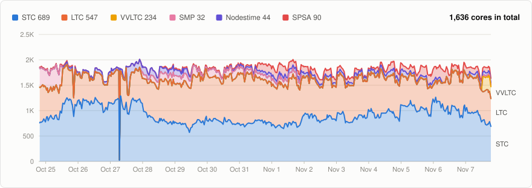
</picture>

#### Tests by type

<picture>
  <source media="(prefers-color-scheme: dark)" srcset="https://raw.githubusercontent.com/xu-shawn/fishtest_track/591d035bd16b4171208963931a7d7f6020b12e51/type-counts-dark.svg">
  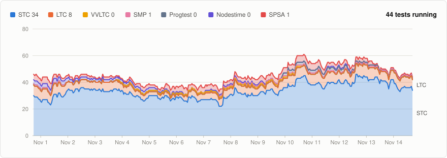
</picture>

#### Net tests and search tests

<picture>
  <source media="(prefers-color-scheme: dark)" srcset="https://raw.githubusercontent.com/xu-shawn/fishtest_track/591d035bd16b4171208963931a7d7f6020b12e51/net-search-trend-dark.svg">
  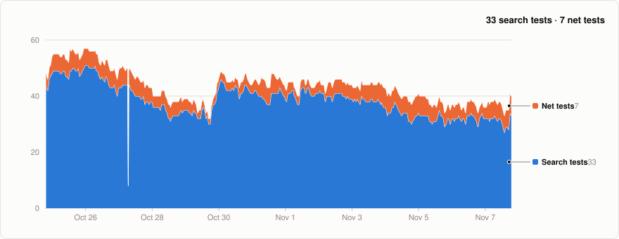
</picture>

#### Gainer and simplification bounds

<picture>
  <source media="(prefers-color-scheme: dark)" srcset="https://raw.githubusercontent.com/xu-shawn/fishtest_track/591d035bd16b4171208963931a7d7f6020b12e51/bounds-trend-dark.svg">
  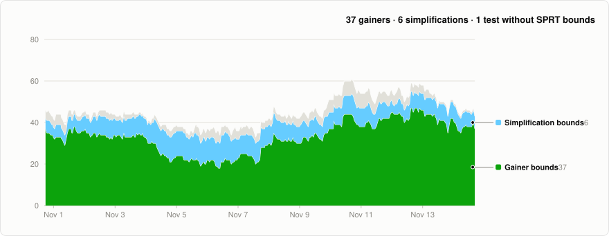
</picture>

#### Cores by test

<picture>
  <source media="(prefers-color-scheme: dark)" srcset="https://raw.githubusercontent.com/xu-shawn/fishtest_track/591d035bd16b4171208963931a7d7f6020b12e51/tests-trend-dark.svg">
  
</picture>

#### Cores by author

<picture>
  <source media="(prefers-color-scheme: dark)" srcset="https://raw.githubusercontent.com/xu-shawn/fishtest_track/591d035bd16b4171208963931a7d7f6020b12e51/authors-trend-dark.svg">
  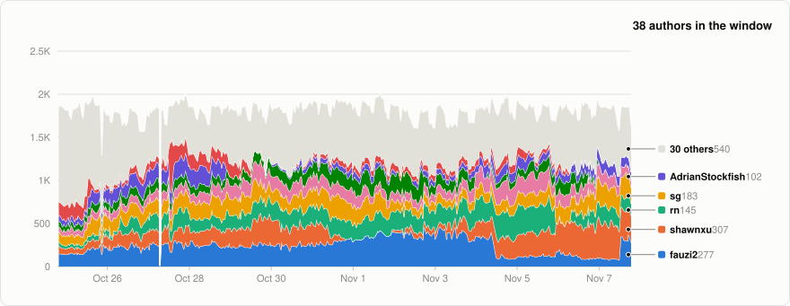
</picture>

#### Tests per author

<picture>
  <source media="(prefers-color-scheme: dark)" srcset="https://raw.githubusercontent.com/xu-shawn/fishtest_track/591d035bd16b4171208963931a7d7f6020b12e51/author-tests-trend-dark.svg">
  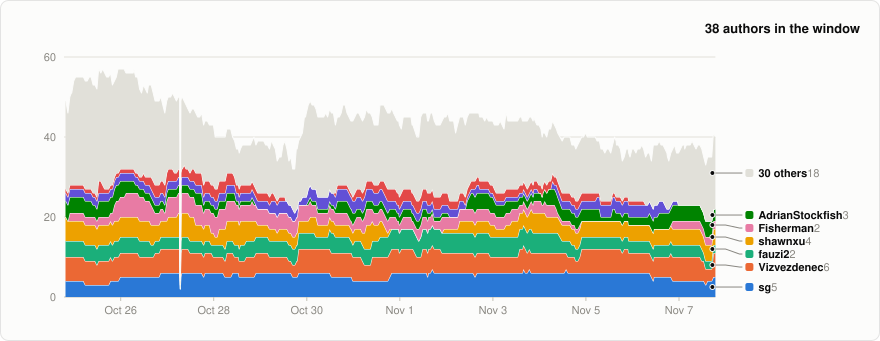
</picture>

#### Cores contributed by user

<picture>
  <source media="(prefers-color-scheme: dark)" srcset="https://raw.githubusercontent.com/xu-shawn/fishtest_track/591d035bd16b4171208963931a7d7f6020b12e51/contributors-trend-dark.svg">
  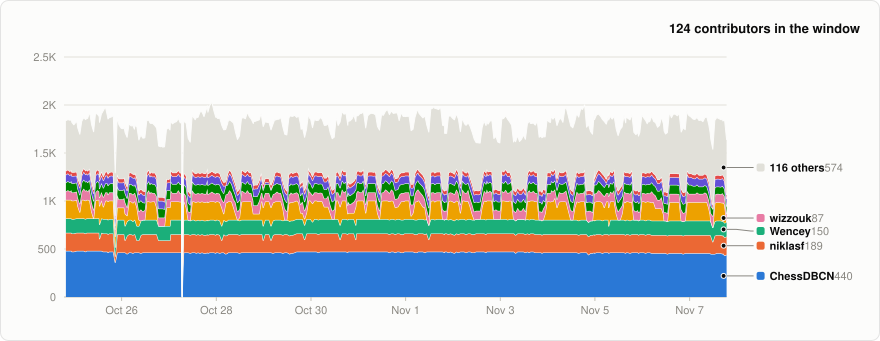
</picture>

#### MNps contributed by user

<picture>
  <source media="(prefers-color-scheme: dark)" srcset="https://raw.githubusercontent.com/xu-shawn/fishtest_track/591d035bd16b4171208963931a7d7f6020b12e51/contributors-mnps-trend-dark.svg">
  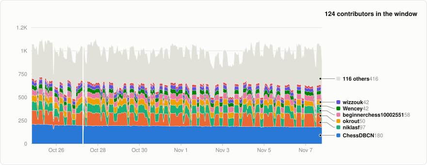
</picture>

#### Tests, authors, contributors and throughput

<picture>
  <source media="(prefers-color-scheme: dark)" srcset="https://raw.githubusercontent.com/xu-shawn/fishtest_track/591d035bd16b4171208963931a7d7f6020b12e51/activity-dark.svg">
  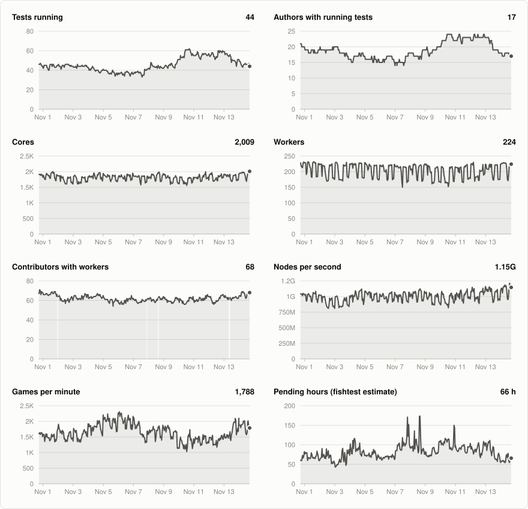
</picture>

#### Tests finished per hour

<picture>
  <source media="(prefers-color-scheme: dark)" srcset="https://raw.githubusercontent.com/xu-shawn/fishtest_track/591d035bd16b4171208963931a7d7f6020b12e51/throughput-dark.svg">
  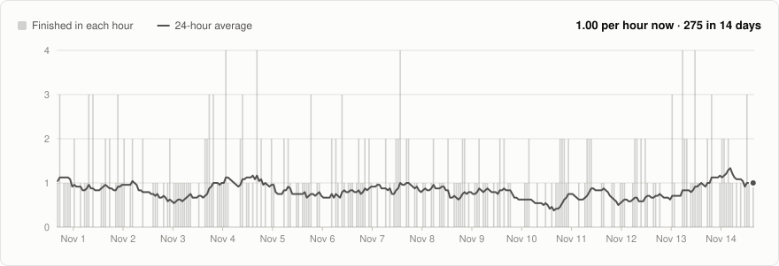
</picture>

#### LLR distribution of running tests

<picture>
  <source media="(prefers-color-scheme: dark)" srcset="https://raw.githubusercontent.com/xu-shawn/fishtest_track/591d035bd16b4171208963931a7d7f6020b12e51/llr-dark.svg">
  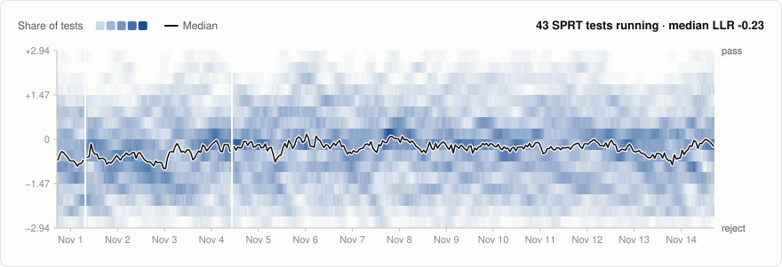
</picture>

### Last 30 days

#### Finished tests per day

<picture>
  <source media="(prefers-color-scheme: dark)" srcset="https://raw.githubusercontent.com/xu-shawn/fishtest_track/591d035bd16b4171208963931a7d7f6020b12e51/finished-dark.svg">
  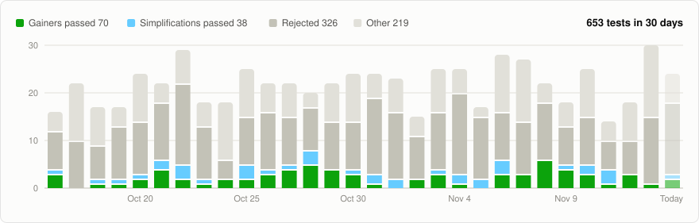
</picture>

Last 7 days: **157 tests** finished, 11.7M games. **32 passed** (25 STC, 4 LTC, 1 SMP, 2 nodestime), 66 rejected, 54 stopped, 2 completed (SPSA or fixed games), 3 failed. SPRT pass rate 32.7%: 28.8% for gainers (80), 50.0% for simplifications (18); 62.5% for net tests (16), 26.8% for search tests (82).

#### Cores by architecture

<picture>
  <source media="(prefers-color-scheme: dark)" srcset="https://raw.githubusercontent.com/xu-shawn/fishtest_track/591d035bd16b4171208963931a7d7f6020b12e51/monthly-arch-dark.svg">
  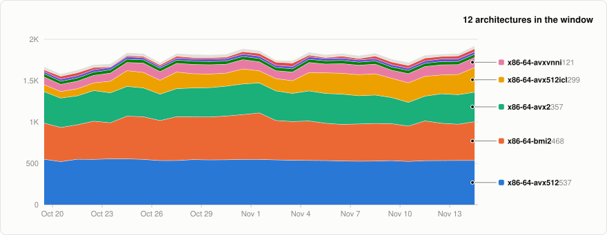
</picture>

#### Cores by compiler

<picture>
  <source media="(prefers-color-scheme: dark)" srcset="https://raw.githubusercontent.com/xu-shawn/fishtest_track/591d035bd16b4171208963931a7d7f6020b12e51/monthly-compiler-dark.svg">
  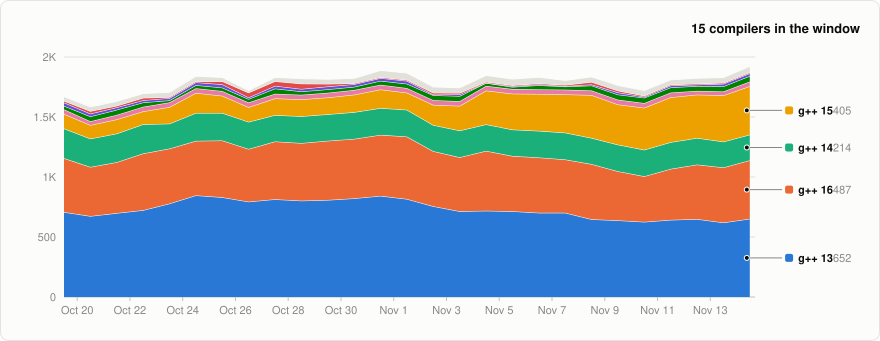
</picture>

### Last year

#### Finished tests per week

<picture>
  <source media="(prefers-color-scheme: dark)" srcset="https://raw.githubusercontent.com/xu-shawn/fishtest_track/591d035bd16b4171208963931a7d7f6020b12e51/weekly-finished-dark.svg">
  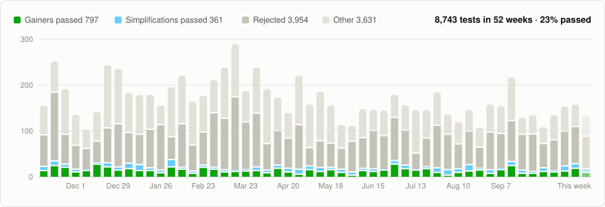
</picture>

#### Runtime of finished tests

<picture>
  <source media="(prefers-color-scheme: dark)" srcset="https://raw.githubusercontent.com/xu-shawn/fishtest_track/591d035bd16b4171208963931a7d7f6020b12e51/runtime-trend-dark.svg">
  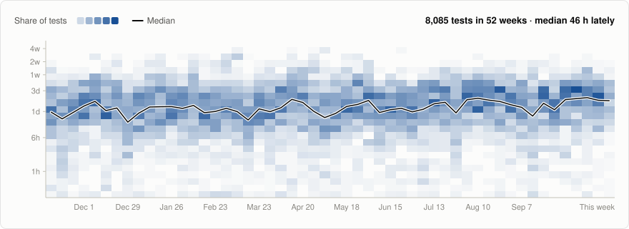
</picture>

#### Average cores per week by test type

<picture>
  <source media="(prefers-color-scheme: dark)" srcset="https://raw.githubusercontent.com/xu-shawn/fishtest_track/591d035bd16b4171208963931a7d7f6020b12e51/weekly-types-dark.svg">
  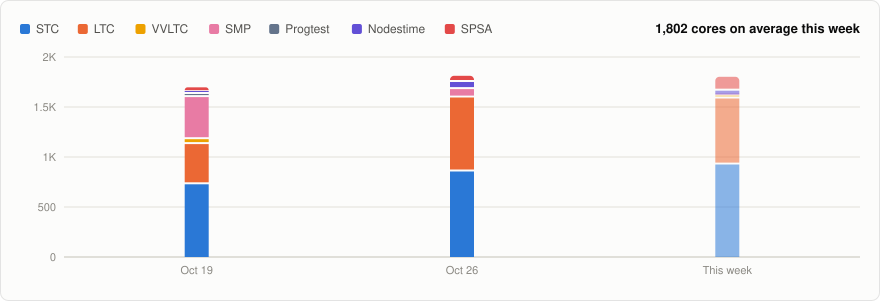
</picture>

#### Cores by architecture

<picture>
  <source media="(prefers-color-scheme: dark)" srcset="https://raw.githubusercontent.com/xu-shawn/fishtest_track/591d035bd16b4171208963931a7d7f6020b12e51/yearly-arch-dark.svg">
  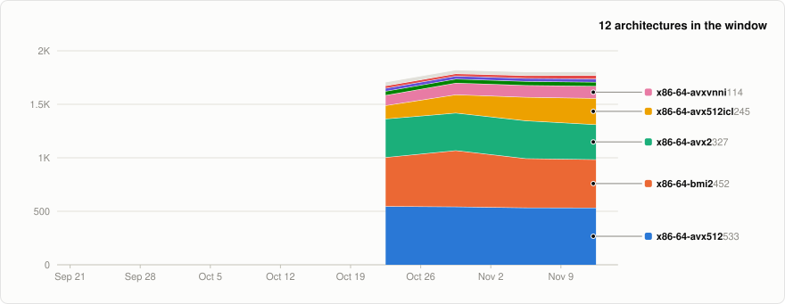
</picture>

#### Cores by compiler

<picture>
  <source media="(prefers-color-scheme: dark)" srcset="https://raw.githubusercontent.com/xu-shawn/fishtest_track/591d035bd16b4171208963931a7d7f6020b12e51/yearly-compiler-dark.svg">
  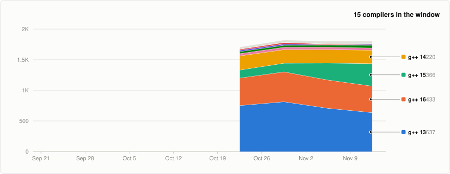
</picture>

#### Gainer bounds

<picture>
  <source media="(prefers-color-scheme: dark)" srcset="https://raw.githubusercontent.com/xu-shawn/fishtest_track/591d035bd16b4171208963931a7d7f6020b12e51/weekly-gainers-dark.svg">
  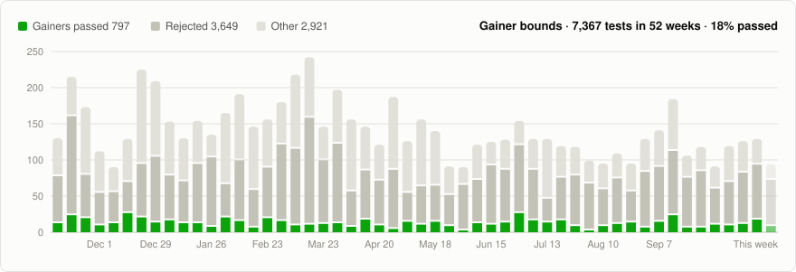
</picture>

#### Simplification bounds

<picture>
  <source media="(prefers-color-scheme: dark)" srcset="https://raw.githubusercontent.com/xu-shawn/fishtest_track/591d035bd16b4171208963931a7d7f6020b12e51/weekly-simplifications-dark.svg">
  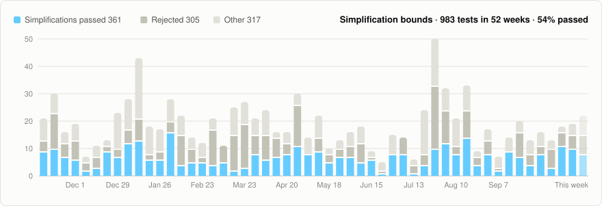
</picture>

#### Net tests

<picture>
  <source media="(prefers-color-scheme: dark)" srcset="https://raw.githubusercontent.com/xu-shawn/fishtest_track/591d035bd16b4171208963931a7d7f6020b12e51/weekly-net-dark.svg">
  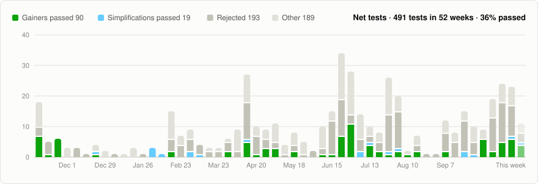
</picture>

#### Search tests

<picture>
  <source media="(prefers-color-scheme: dark)" srcset="https://raw.githubusercontent.com/xu-shawn/fishtest_track/591d035bd16b4171208963931a7d7f6020b12e51/weekly-search-dark.svg">
  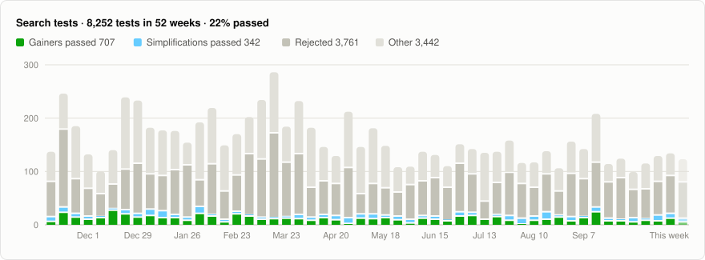
</picture>

### Since 19 Oct 2026, daily averages

#### Cores by test type

<picture>
  <source media="(prefers-color-scheme: dark)" srcset="https://raw.githubusercontent.com/xu-shawn/fishtest_track/591d035bd16b4171208963931a7d7f6020b12e51/long-types-dark.svg">
  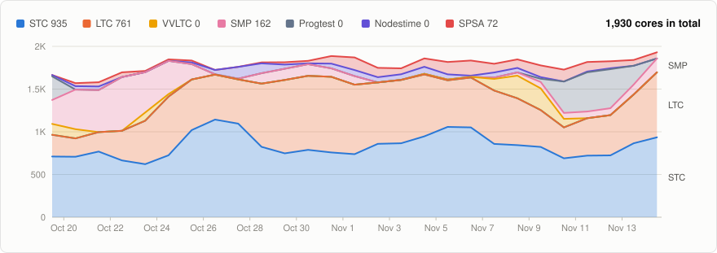
</picture>

#### Cores by author

<picture>
  <source media="(prefers-color-scheme: dark)" srcset="https://raw.githubusercontent.com/xu-shawn/fishtest_track/591d035bd16b4171208963931a7d7f6020b12e51/long-authors-dark.svg">
  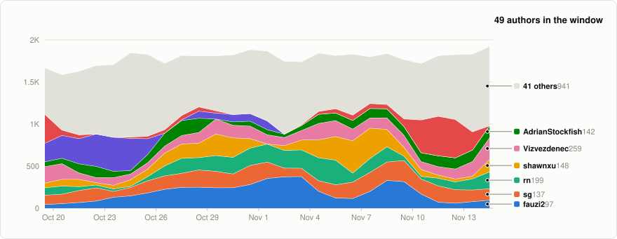
</picture>

#### Tests per author

<picture>
  <source media="(prefers-color-scheme: dark)" srcset="https://raw.githubusercontent.com/xu-shawn/fishtest_track/591d035bd16b4171208963931a7d7f6020b12e51/long-author-tests-dark.svg">
  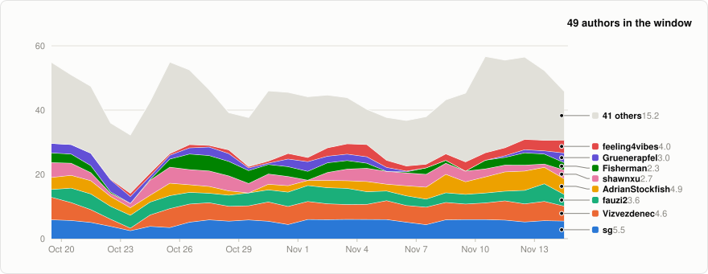
</picture>

#### Cores contributed by user

<picture>
  <source media="(prefers-color-scheme: dark)" srcset="https://raw.githubusercontent.com/xu-shawn/fishtest_track/591d035bd16b4171208963931a7d7f6020b12e51/long-contributors-dark.svg">
  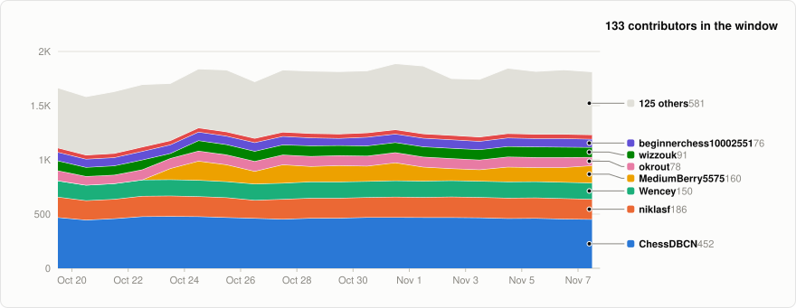
</picture>

#### MNps contributed by user

<picture>
  <source media="(prefers-color-scheme: dark)" srcset="https://raw.githubusercontent.com/xu-shawn/fishtest_track/591d035bd16b4171208963931a7d7f6020b12e51/long-contributors-mnps-dark.svg">
  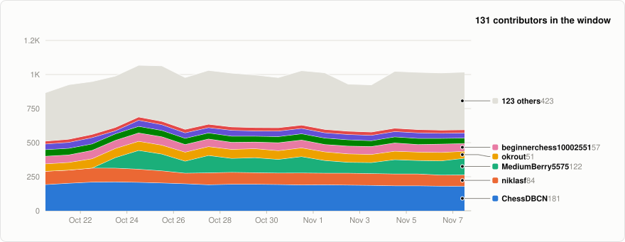
</picture>

#### Tests, authors, contributors and throughput

<picture>
  <source media="(prefers-color-scheme: dark)" srcset="https://raw.githubusercontent.com/xu-shawn/fishtest_track/591d035bd16b4171208963931a7d7f6020b12e51/long-activity-dark.svg">
  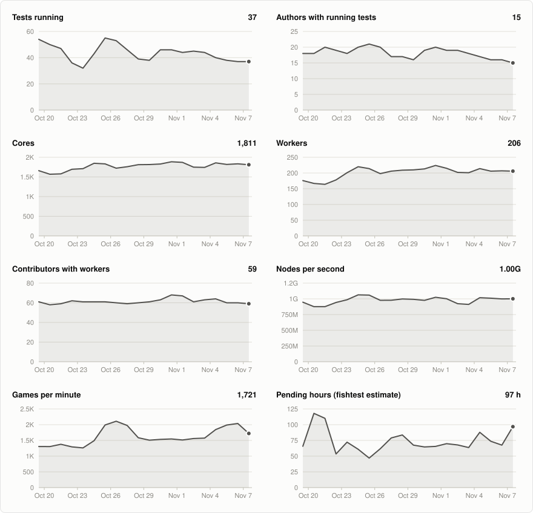
</picture>

## Right now

**56 tests** from **23 authors** are running on **1,893 cores** (209 workers from 65 contributors). About 85 hours of work is queued.

| | Now | 24 h avg | 7 d avg | 30 d avg |
|:--|--:|--:|--:|--:|
| Tests running | 56 | 57 | 48 | 45 |
| Authors with running tests | 23 | 23 | 20 | 19 |
| Cores | 1,893 | 1,830 | 1,805 | 1,773 |
| Workers | 209 | 199 | 201 | 200 |
| Contributors with workers | 65 | 62 | 61 | 61 |
| Net tests running | 4 | 5 | 5 | 5 |
| Cores on net tests | 585 | 523 | 419 | 264 |
| Nodes per second | 1.12G | 1.05G | 1.01G | 982M |
| Games per minute | 1,502 | 1,407 | 1,586 | 1,594 |
| Pending hours | 85 h | 90 h | 92 h | 157 h |

### Cores by test

<picture>
  <source media="(prefers-color-scheme: dark)" srcset="https://raw.githubusercontent.com/xu-shawn/fishtest_track/591d035bd16b4171208963931a7d7f6020b12e51/tests-dark.svg">
  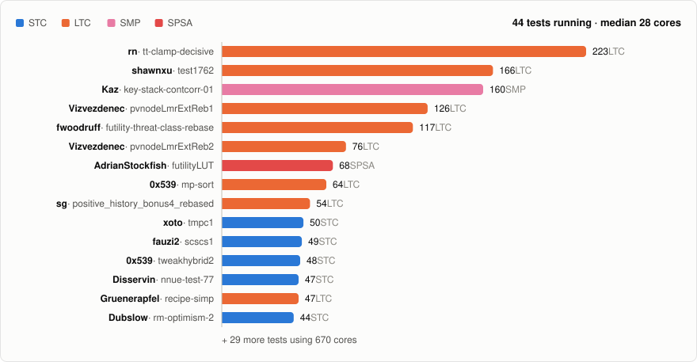
</picture>

### Runtime of running tests

<picture>
  <source media="(prefers-color-scheme: dark)" srcset="https://raw.githubusercontent.com/xu-shawn/fishtest_track/591d035bd16b4171208963931a7d7f6020b12e51/runtime-dark.svg">
  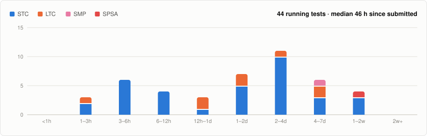
</picture>

### Cores by author

<picture>
  <source media="(prefers-color-scheme: dark)" srcset="https://raw.githubusercontent.com/xu-shawn/fishtest_track/591d035bd16b4171208963931a7d7f6020b12e51/authors-dark.svg">
  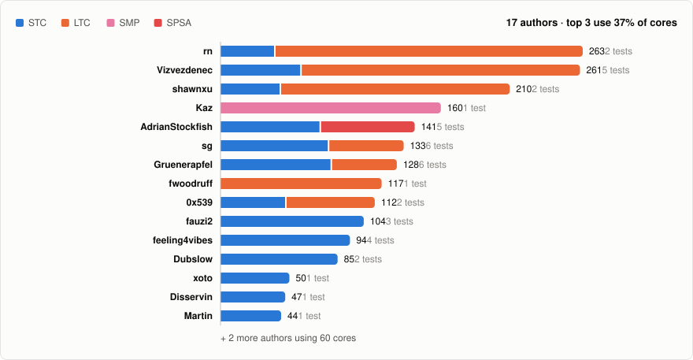
</picture>

### Cores contributed by user

<picture>
  <source media="(prefers-color-scheme: dark)" srcset="https://raw.githubusercontent.com/xu-shawn/fishtest_track/591d035bd16b4171208963931a7d7f6020b12e51/contributors-dark.svg">
  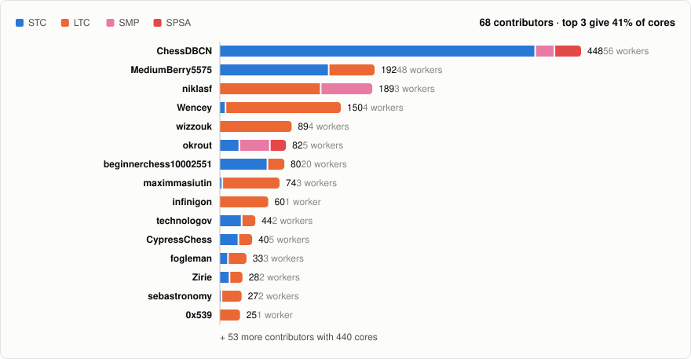
</picture>

### MNps contributed by user

<picture>
  <source media="(prefers-color-scheme: dark)" srcset="https://raw.githubusercontent.com/xu-shawn/fishtest_track/591d035bd16b4171208963931a7d7f6020b12e51/contributors-mnps-dark.svg">
  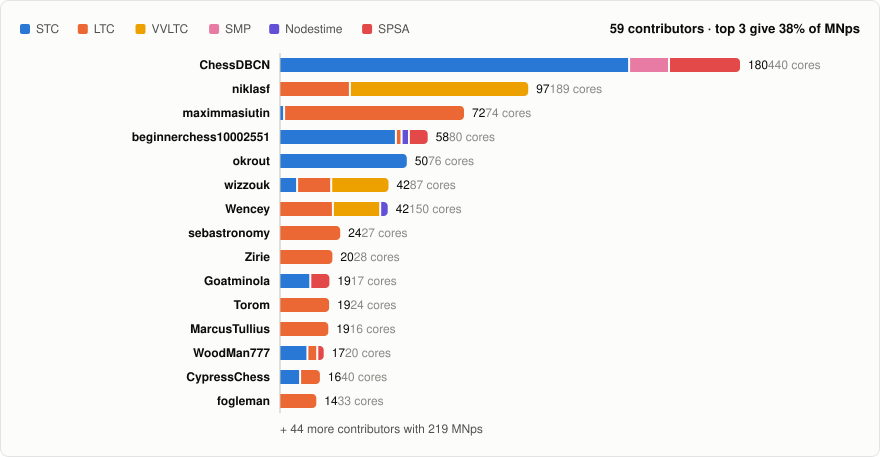
</picture>

## Last 30 days in detail

### Recently passed

| Finished | Author | Test | TC | Bounds | Elo |
|:--|:--|:--|:--|:--|--:|
| Nov 12 | [rn](https://tests.stockfishchess.org/tests/user/rn) | [`fix-multipv-tm`](https://tests.stockfishchess.org/tests/view/6af5a0f88e7fb2e78bc1d1cd) | 10+0.1 | [0,2] | +30.88 ±6.42 |
| Nov 12 | [shawnxu](https://tests.stockfishchess.org/tests/user/shawnxu) | [`test1760`](https://tests.stockfishchess.org/tests/view/6af45b3f8e7fb2e78bc1cf67) | 100+1 nodestime | [0,2] | +5.03 ±2.43 |
| Nov 12 | [Vizvezdenec](https://tests.stockfishchess.org/tests/user/Vizvezdenec) | [`pvnodeLmrExt5`](https://tests.stockfishchess.org/tests/view/6af0dcd98e7fb2e78bc1ca1b) | 10+0.1 | [0,2] | +1.30 ±1.02 |
| Nov 11 | [rn](https://tests.stockfishchess.org/tests/user/rn) | [`fix-multipv-tm`](https://tests.stockfishchess.org/tests/view/6af342e68e7fb2e78bc1cd86) | 10+0.1 | [-1.75,0.25] | +1.52 ±1.50 |
| Nov 11 | [sg](https://tests.stockfishchess.org/tests/user/sg) | [`simple_pv_history_update`](https://tests.stockfishchess.org/tests/view/6aedc23d20cd2dc3f03d20fb) | 60+0.6 | [-1.75,0.25] | +0.28 ±0.86 |
| Nov 11 | [0x539](https://tests.stockfishchess.org/tests/user/0x539) | [`tt-stm`](https://tests.stockfishchess.org/tests/view/6af2c8b68e7fb2e78bc1ccec) | 10+0.1 | [-1.75,0.25] | +1.61 ±1.59 |
| Nov 11 | [sanityeclipse000](https://tests.stockfishchess.org/tests/user/sanityeclipse000) | [`prefetch-next-tile-v4`](https://tests.stockfishchess.org/tests/view/6af2eeb28e7fb2e78bc1cd1a) | 10+0.1 | [0,2] | +2.91 ±1.73 |
| Nov 10 | [rn](https://tests.stockfishchess.org/tests/user/rn) | [`tt-clamp-decisive`](https://tests.stockfishchess.org/tests/view/6af16e498e7fb2e78bc1cb07) | 10+0.1 | [-1.75,0.25] | +0.89 ±1.27 |
| Nov 10 | [rn](https://tests.stockfishchess.org/tests/user/rn) | [`fix-multipv-tm`](https://tests.stockfishchess.org/tests/view/6af34b228e7fb2e78bc1cd8e) | 10+0.1 | [0,2] | +24.51 ±5.78 |
| Nov 10 | [shawnxu](https://tests.stockfishchess.org/tests/user/shawnxu) | [`test1755`](https://tests.stockfishchess.org/tests/view/6ae828fd20cd2dc3f03d17ac) | 10+0.1 | [-1.75,0.25] | -0.21 ±0.45 |
| Nov 10 | [shawnxu](https://tests.stockfishchess.org/tests/user/shawnxu) | [`test1758`](https://tests.stockfishchess.org/tests/view/6af207e98e7fb2e78bc1cbc2) | 60+0.6 | [0.5,2.5] | +5.30 ±2.36 |
| Nov 10 | [sawmaker](https://tests.stockfishchess.org/tests/user/sawmaker) | [`arena/f4242ee7-stockfish`](https://tests.stockfishchess.org/tests/view/6af09f2189c6931c272deab0) | 10+0.1 | [0,2] | +1.99 ±1.37 |

### Most active authors

| Author | Finished | Passed | Running now | Core-hours | Share |
|:--|--:|--:|--:|--:|--:|
| [Gruenerapfel](https://tests.stockfishchess.org/tests/user/Gruenerapfel) | 26 | 7 | 1 | 124,614 | 11.5% |
| [Vizvezdenec](https://tests.stockfishchess.org/tests/user/Vizvezdenec) | 49 | 4 | 6 | 124,131 | 11.5% |
| [fauzi2](https://tests.stockfishchess.org/tests/user/fauzi2) | 31 | 4 | 7 | 107,978 | 10.0% |
| [shawnxu](https://tests.stockfishchess.org/tests/user/shawnxu) | 49 | 21 | 1 | 74,498 | 6.9% |
| [sg](https://tests.stockfishchess.org/tests/user/sg) | 36 | 9 | 6 | 71,813 | 6.7% |
| [DeadK1ng](https://tests.stockfishchess.org/tests/user/DeadK1ng) | 5 | 2 | 0 | 63,262 | 5.9% |
| [Disservin](https://tests.stockfishchess.org/tests/user/Disservin) | 4 | 0 | 1 | 58,207 | 5.4% |
| [rn](https://tests.stockfishchess.org/tests/user/rn) | 19 | 6 | 2 | 56,744 | 5.3% |
| [vdv](https://tests.stockfishchess.org/tests/user/vdv) | 10 | 2 | 1 | 50,267 | 4.7% |
| [AdrianStockfish](https://tests.stockfishchess.org/tests/user/AdrianStockfish) | 50 | 5 | 5 | 37,718 | 3.5% |

### Top contributors

| Contributor | Core-hours | Share | Cores now | MNps now | Workers now |
|:--|--:|--:|--:|--:|--:|
| [ChessDBCN](https://tests.stockfishchess.org/tests/user/ChessDBCN) | 272,165 | 26.0% | 464 | 197 | 58 |
| [niklasf](https://tests.stockfishchess.org/tests/user/niklasf) | 108,817 | 10.4% | 189 | 92 | 3 |
| [Wencey](https://tests.stockfishchess.org/tests/user/Wencey) | 87,500 | 8.4% | 150 | 51 | 4 |
| [MediumBerry5575](https://tests.stockfishchess.org/tests/user/MediumBerry5575) | 66,460 | 6.4% | 128 | 106 | 32 |
| [wizzouk](https://tests.stockfishchess.org/tests/user/wizzouk) | 53,705 | 5.1% | 87 | 48 | 3 |
| [okrout](https://tests.stockfishchess.org/tests/user/okrout) | 48,864 | 4.7% | 94 | 66 | 7 |
| [beginnerchess10002551](https://tests.stockfishchess.org/tests/user/beginnerchess10002551) | 45,501 | 4.4% | 80 | 55 | 20 |
| [CypressChess](https://tests.stockfishchess.org/tests/user/CypressChess) | 23,235 | 2.2% | 40 | 16 | 5 |
| [technologov](https://tests.stockfishchess.org/tests/user/technologov) | 18,872 | 1.8% | 44 | 20 | 2 |
| [fogleman](https://tests.stockfishchess.org/tests/user/fogleman) | 18,842 | 1.8% | 33 | 16 | 3 |
