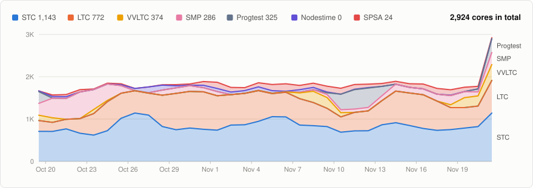

# Fishtest status

Updated Tue 17 Nov 2026, 14:45 UTC

## Trends

### Last 14 days

#### Cores by test type

<picture>
  <source media="(prefers-color-scheme: dark)" srcset="https://raw.githubusercontent.com/xu-shawn/fishtest_track/33138d09f5a207d526a622037fcf3200c8daf923/types-dark.svg">
  
</picture>

#### Tests by type

<picture>
  <source media="(prefers-color-scheme: dark)" srcset="https://raw.githubusercontent.com/xu-shawn/fishtest_track/33138d09f5a207d526a622037fcf3200c8daf923/type-counts-dark.svg">
  
</picture>

#### Net tests and search tests

<picture>
  <source media="(prefers-color-scheme: dark)" srcset="https://raw.githubusercontent.com/xu-shawn/fishtest_track/33138d09f5a207d526a622037fcf3200c8daf923/net-search-trend-dark.svg">
  
</picture>

#### Gainer and simplification bounds

<picture>
  <source media="(prefers-color-scheme: dark)" srcset="https://raw.githubusercontent.com/xu-shawn/fishtest_track/33138d09f5a207d526a622037fcf3200c8daf923/bounds-trend-dark.svg">
  
</picture>

#### Cores by test

<picture>
  <source media="(prefers-color-scheme: dark)" srcset="https://raw.githubusercontent.com/xu-shawn/fishtest_track/33138d09f5a207d526a622037fcf3200c8daf923/tests-trend-dark.svg">
  
</picture>

#### Cores by author

<picture>
  <source media="(prefers-color-scheme: dark)" srcset="https://raw.githubusercontent.com/xu-shawn/fishtest_track/33138d09f5a207d526a622037fcf3200c8daf923/authors-trend-dark.svg">
  
</picture>

#### Tests per author

<picture>
  <source media="(prefers-color-scheme: dark)" srcset="https://raw.githubusercontent.com/xu-shawn/fishtest_track/33138d09f5a207d526a622037fcf3200c8daf923/author-tests-trend-dark.svg">
  
</picture>

#### Cores contributed by user

<picture>
  <source media="(prefers-color-scheme: dark)" srcset="https://raw.githubusercontent.com/xu-shawn/fishtest_track/33138d09f5a207d526a622037fcf3200c8daf923/contributors-trend-dark.svg">
  
</picture>

#### MNps contributed by user

<picture>
  <source media="(prefers-color-scheme: dark)" srcset="https://raw.githubusercontent.com/xu-shawn/fishtest_track/33138d09f5a207d526a622037fcf3200c8daf923/contributors-mnps-trend-dark.svg">
  
</picture>

#### Tests, authors, contributors and throughput

<picture>
  <source media="(prefers-color-scheme: dark)" srcset="https://raw.githubusercontent.com/xu-shawn/fishtest_track/33138d09f5a207d526a622037fcf3200c8daf923/activity-dark.svg">
  
</picture>

#### Tests finished per hour

<picture>
  <source media="(prefers-color-scheme: dark)" srcset="https://raw.githubusercontent.com/xu-shawn/fishtest_track/33138d09f5a207d526a622037fcf3200c8daf923/throughput-dark.svg">
  
</picture>

#### LLR distribution of running tests

<picture>
  <source media="(prefers-color-scheme: dark)" srcset="https://raw.githubusercontent.com/xu-shawn/fishtest_track/33138d09f5a207d526a622037fcf3200c8daf923/llr-dark.svg">
  
</picture>

### Last 30 days

#### Finished tests per day

<picture>
  <source media="(prefers-color-scheme: dark)" srcset="https://raw.githubusercontent.com/xu-shawn/fishtest_track/33138d09f5a207d526a622037fcf3200c8daf923/finished-dark.svg">
  
</picture>

Last 7 days: **165 tests** finished, 15.2M games. **24 passed** (18 STC, 4 LTC, 1 SMP, 1 nodestime), 85 rejected, 51 stopped, 3 completed (SPSA or fixed games), 2 failed. SPRT pass rate 22.0%: 15.2% for gainers (92), 58.8% for simplifications (17); 66.7% for net tests (9), 18.0% for search tests (100).

#### Cores by architecture

<picture>
  <source media="(prefers-color-scheme: dark)" srcset="https://raw.githubusercontent.com/xu-shawn/fishtest_track/33138d09f5a207d526a622037fcf3200c8daf923/monthly-arch-dark.svg">
  
</picture>

#### Cores by compiler

<picture>
  <source media="(prefers-color-scheme: dark)" srcset="https://raw.githubusercontent.com/xu-shawn/fishtest_track/33138d09f5a207d526a622037fcf3200c8daf923/monthly-compiler-dark.svg">
  
</picture>

### Last year

#### Finished tests per week

<picture>
  <source media="(prefers-color-scheme: dark)" srcset="https://raw.githubusercontent.com/xu-shawn/fishtest_track/33138d09f5a207d526a622037fcf3200c8daf923/weekly-finished-dark.svg">
  
</picture>

#### Runtime of finished tests

<picture>
  <source media="(prefers-color-scheme: dark)" srcset="https://raw.githubusercontent.com/xu-shawn/fishtest_track/33138d09f5a207d526a622037fcf3200c8daf923/runtime-trend-dark.svg">
  
</picture>

#### Average cores per week by test type

<picture>
  <source media="(prefers-color-scheme: dark)" srcset="https://raw.githubusercontent.com/xu-shawn/fishtest_track/33138d09f5a207d526a622037fcf3200c8daf923/weekly-types-dark.svg">
  
</picture>

#### Cores by architecture

<picture>
  <source media="(prefers-color-scheme: dark)" srcset="https://raw.githubusercontent.com/xu-shawn/fishtest_track/33138d09f5a207d526a622037fcf3200c8daf923/yearly-arch-dark.svg">
  
</picture>

#### Cores by compiler

<picture>
  <source media="(prefers-color-scheme: dark)" srcset="https://raw.githubusercontent.com/xu-shawn/fishtest_track/33138d09f5a207d526a622037fcf3200c8daf923/yearly-compiler-dark.svg">
  
</picture>

#### Gainer bounds

<picture>
  <source media="(prefers-color-scheme: dark)" srcset="https://raw.githubusercontent.com/xu-shawn/fishtest_track/33138d09f5a207d526a622037fcf3200c8daf923/weekly-gainers-dark.svg">
  
</picture>

#### Simplification bounds

<picture>
  <source media="(prefers-color-scheme: dark)" srcset="https://raw.githubusercontent.com/xu-shawn/fishtest_track/33138d09f5a207d526a622037fcf3200c8daf923/weekly-simplifications-dark.svg">
  
</picture>

#### Net tests

<picture>
  <source media="(prefers-color-scheme: dark)" srcset="https://raw.githubusercontent.com/xu-shawn/fishtest_track/33138d09f5a207d526a622037fcf3200c8daf923/weekly-net-dark.svg">
  
</picture>

#### Search tests

<picture>
  <source media="(prefers-color-scheme: dark)" srcset="https://raw.githubusercontent.com/xu-shawn/fishtest_track/33138d09f5a207d526a622037fcf3200c8daf923/weekly-search-dark.svg">
  
</picture>

### Since 19 Oct 2026, daily averages

#### Cores by test type

<picture>
  <source media="(prefers-color-scheme: dark)" srcset="https://raw.githubusercontent.com/xu-shawn/fishtest_track/33138d09f5a207d526a622037fcf3200c8daf923/long-types-dark.svg">
  
</picture>

#### Cores by author

<picture>
  <source media="(prefers-color-scheme: dark)" srcset="https://raw.githubusercontent.com/xu-shawn/fishtest_track/33138d09f5a207d526a622037fcf3200c8daf923/long-authors-dark.svg">
  
</picture>

#### Tests per author

<picture>
  <source media="(prefers-color-scheme: dark)" srcset="https://raw.githubusercontent.com/xu-shawn/fishtest_track/33138d09f5a207d526a622037fcf3200c8daf923/long-author-tests-dark.svg">
  
</picture>

#### Cores contributed by user

<picture>
  <source media="(prefers-color-scheme: dark)" srcset="https://raw.githubusercontent.com/xu-shawn/fishtest_track/33138d09f5a207d526a622037fcf3200c8daf923/long-contributors-dark.svg">
  
</picture>

#### MNps contributed by user

<picture>
  <source media="(prefers-color-scheme: dark)" srcset="https://raw.githubusercontent.com/xu-shawn/fishtest_track/33138d09f5a207d526a622037fcf3200c8daf923/long-contributors-mnps-dark.svg">
  
</picture>

#### Tests, authors, contributors and throughput

<picture>
  <source media="(prefers-color-scheme: dark)" srcset="https://raw.githubusercontent.com/xu-shawn/fishtest_track/33138d09f5a207d526a622037fcf3200c8daf923/long-activity-dark.svg">
  
</picture>

## Right now

**56 tests** from **18 authors** are running on **1,557 cores** (153 workers from 59 contributors). About 93 hours of work is queued.

| | Now | 24 h avg | 7 d avg | 30 d avg |
|:--|--:|--:|--:|--:|
| Tests running | 56 | 59 | 53 | 46 |
| Authors with running tests | 18 | 19 | 20 | 19 |
| Cores | 1,557 | 1,777 | 1,827 | 1,782 |
| Workers | 153 | 192 | 203 | 201 |
| Contributors with workers | 59 | 65 | 64 | 62 |
| Net tests running | 2 | 2 | 4 | 5 |
| Cores on net tests | 145 | 129 | 298 | 251 |
| Nodes per second | 850M | 1.01G | 1.04G | 993M |
| Games per minute | 1,440 | 1,558 | 1,594 | 1,609 |
| Pending hours | 93 h | 91 h | 83 h | 145 h |

### Cores by test

<picture>
  <source media="(prefers-color-scheme: dark)" srcset="https://raw.githubusercontent.com/xu-shawn/fishtest_track/33138d09f5a207d526a622037fcf3200c8daf923/tests-dark.svg">
  
</picture>

### Runtime of running tests

<picture>
  <source media="(prefers-color-scheme: dark)" srcset="https://raw.githubusercontent.com/xu-shawn/fishtest_track/33138d09f5a207d526a622037fcf3200c8daf923/runtime-dark.svg">
  
</picture>

### Cores by author

<picture>
  <source media="(prefers-color-scheme: dark)" srcset="https://raw.githubusercontent.com/xu-shawn/fishtest_track/33138d09f5a207d526a622037fcf3200c8daf923/authors-dark.svg">
  
</picture>

### Cores contributed by user

<picture>
  <source media="(prefers-color-scheme: dark)" srcset="https://raw.githubusercontent.com/xu-shawn/fishtest_track/33138d09f5a207d526a622037fcf3200c8daf923/contributors-dark.svg">
  
</picture>

### MNps contributed by user

<picture>
  <source media="(prefers-color-scheme: dark)" srcset="https://raw.githubusercontent.com/xu-shawn/fishtest_track/33138d09f5a207d526a622037fcf3200c8daf923/contributors-mnps-dark.svg">
  
</picture>

## Last 30 days in detail

### Recently passed

| Finished | Author | Test | TC | Bounds | Elo |
|:--|:--|:--|:--|:--|--:|
| Nov 17 | [penneponne](https://tests.stockfishchess.org/tests/user/penneponne) | [`c2s/24-se-margin-history`](https://tests.stockfishchess.org/tests/view/6afabccd8e7fb2e78bc1d9f5) | 10+0.1 | [0,2] | +4.14 ±2.16 |
| Nov 16 | [shawnxu](https://tests.stockfishchess.org/tests/user/shawnxu) | [`test1764`](https://tests.stockfishchess.org/tests/view/6af8f5da8e7fb2e78bc1d754) | 10+0.1 | [0,2] | +1.58 ±1.18 |
| Nov 16 | [Bush3r](https://tests.stockfishchess.org/tests/user/Bush3r) | [`nmp-count-fail-high-once`](https://tests.stockfishchess.org/tests/view/6af91cd08e7fb2e78bc1d795) | 10+0.1 | [-1.75,0.25] | +0.69 ±1.12 |
| Nov 16 | [Martin](https://tests.stockfishchess.org/tests/user/Martin) | [`master`](https://tests.stockfishchess.org/tests/view/6af6206b8e7fb2e78bc1d2bd) | 10+0.1 | [-1.75,0.25] | -0.05 ±0.61 |
| Nov 15 | [Gruenerapfel](https://tests.stockfishchess.org/tests/user/Gruenerapfel) | [`recipe-simp`](https://tests.stockfishchess.org/tests/view/6af447668e7fb2e78bc1cf4b) | 10+0.1 | [-1.75,0.25] | +0.03 ±0.72 |
| Nov 15 | [Kaz](https://tests.stockfishchess.org/tests/user/Kaz) | [`key-stack-contcorr-01`](https://tests.stockfishchess.org/tests/view/6af1a4d68e7fb2e78bc1cb59) | 20+0.2 ×8 | [0.5,2.5] | +1.58 ±1.03 |
| Nov 15 | [Dubslow](https://tests.stockfishchess.org/tests/user/Dubslow) | [`rm-optimism`](https://tests.stockfishchess.org/tests/view/6af533468e7fb2e78bc1d0fd) | 10+0.1 | [-1.75,0.25] | +0.16 ±0.82 |
| Nov 14 | [shawnxu](https://tests.stockfishchess.org/tests/user/shawnxu) | [`test1762`](https://tests.stockfishchess.org/tests/view/6af7ab678e7fb2e78bc1d537) | 60+0.6 | [0.5,2.5] | +3.11 ±1.71 |
| Nov 14 | [rjhanson](https://tests.stockfishchess.org/tests/user/rjhanson) | [`movegen-lazy-king-threa…`](https://tests.stockfishchess.org/tests/view/6af7f6b58e7fb2e78bc1d5a5) | 10+0.1 | [0,2] | +3.16 ±1.81 |
| Nov 14 | [Vizvezdenec](https://tests.stockfishchess.org/tests/user/Vizvezdenec) | [`alphabetaEval3`](https://tests.stockfishchess.org/tests/view/6af212f28e7fb2e78bc1cbcf) | 10+0.1 | [0,2] | +1.08 ±0.87 |
| Nov 14 | [0x539](https://tests.stockfishchess.org/tests/user/0x539) | [`tt-stm`](https://tests.stockfishchess.org/tests/view/6af520a18e7fb2e78bc1d0ea) | 60+0.6 | [-1.75,0.25] | +0.78 ±1.16 |
| Nov 14 | [shawnxu](https://tests.stockfishchess.org/tests/user/shawnxu) | [`test1762`](https://tests.stockfishchess.org/tests/view/6af7979e8e7fb2e78bc1d512) | 10+0.1 | [0,2] | +3.64 ±2.03 |

### Most active authors

| Author | Finished | Passed | Running now | Core-hours | Share |
|:--|--:|--:|--:|--:|--:|
| [Vizvezdenec](https://tests.stockfishchess.org/tests/user/Vizvezdenec) | 51 | 5 | 3 | 139,695 | 12.0% |
| [Gruenerapfel](https://tests.stockfishchess.org/tests/user/Gruenerapfel) | 27 | 7 | 4 | 116,434 | 10.0% |
| [fauzi2](https://tests.stockfishchess.org/tests/user/fauzi2) | 39 | 4 | 2 | 105,833 | 9.1% |
| [sg](https://tests.stockfishchess.org/tests/user/sg) | 42 | 8 | 4 | 82,400 | 7.1% |
| [shawnxu](https://tests.stockfishchess.org/tests/user/shawnxu) | 47 | 24 | 4 | 73,730 | 6.3% |
| [vdv](https://tests.stockfishchess.org/tests/user/vdv) | 10 | 2 | 0 | 71,906 | 6.2% |
| [rn](https://tests.stockfishchess.org/tests/user/rn) | 16 | 6 | 1 | 68,213 | 5.8% |
| [Disservin](https://tests.stockfishchess.org/tests/user/Disservin) | 5 | 0 | 0 | 59,540 | 5.1% |
| [DeadK1ng](https://tests.stockfishchess.org/tests/user/DeadK1ng) | 4 | 1 | 0 | 53,670 | 4.6% |
| [AdrianStockfish](https://tests.stockfishchess.org/tests/user/AdrianStockfish) | 50 | 5 | 3 | 41,002 | 3.5% |

### Top contributors

| Contributor | Core-hours | Share | Cores now | MNps now | Workers now |
|:--|--:|--:|--:|--:|--:|
| [ChessDBCN](https://tests.stockfishchess.org/tests/user/ChessDBCN) | 321,755 | 25.9% | 472 | 204 | 59 |
| [niklasf](https://tests.stockfishchess.org/tests/user/niklasf) | 129,122 | 10.4% | 189 | 86 | 3 |
| [Wencey](https://tests.stockfishchess.org/tests/user/Wencey) | 103,666 | 8.3% | 150 | 43 | 4 |
| [MediumBerry5575](https://tests.stockfishchess.org/tests/user/MediumBerry5575) | 79,251 | 6.4% | 0 | 0.0 | 0 |
| [wizzouk](https://tests.stockfishchess.org/tests/user/wizzouk) | 60,490 | 4.9% | 43 | 21 | 2 |
| [okrout](https://tests.stockfishchess.org/tests/user/okrout) | 58,038 | 4.7% | 82 | 60 | 5 |
| [beginnerchess10002551](https://tests.stockfishchess.org/tests/user/beginnerchess10002551) | 53,368 | 4.3% | 0 | 0.0 | 0 |
| [CypressChess](https://tests.stockfishchess.org/tests/user/CypressChess) | 27,530 | 2.2% | 40 | 18 | 5 |
| [technologov](https://tests.stockfishchess.org/tests/user/technologov) | 22,985 | 1.9% | 44 | 18 | 2 |
| [fogleman](https://tests.stockfishchess.org/tests/user/fogleman) | 22,732 | 1.8% | 55 | 36 | 5 |
