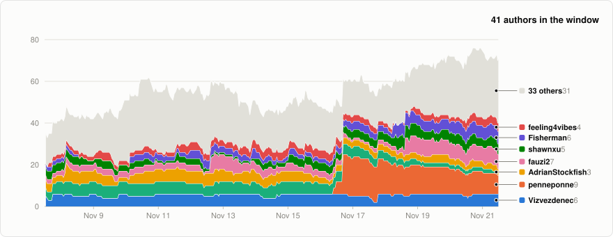

# Fishtest status

Updated Thu 26 Nov 2026, 01:45 UTC

## Trends

### Last 14 days

#### Cores by test type

<picture>
  <source media="(prefers-color-scheme: dark)" srcset="https://raw.githubusercontent.com/xu-shawn/fishtest_track/d2f56e15718043587d1defa062486e0eba914145/types-dark.svg">
  
</picture>

#### Tests by type

<picture>
  <source media="(prefers-color-scheme: dark)" srcset="https://raw.githubusercontent.com/xu-shawn/fishtest_track/d2f56e15718043587d1defa062486e0eba914145/type-counts-dark.svg">
  
</picture>

#### Net tests and search tests

<picture>
  <source media="(prefers-color-scheme: dark)" srcset="https://raw.githubusercontent.com/xu-shawn/fishtest_track/d2f56e15718043587d1defa062486e0eba914145/net-search-trend-dark.svg">
  
</picture>

#### Gainer and simplification bounds

<picture>
  <source media="(prefers-color-scheme: dark)" srcset="https://raw.githubusercontent.com/xu-shawn/fishtest_track/d2f56e15718043587d1defa062486e0eba914145/bounds-trend-dark.svg">
  
</picture>

#### Cores by test

<picture>
  <source media="(prefers-color-scheme: dark)" srcset="https://raw.githubusercontent.com/xu-shawn/fishtest_track/d2f56e15718043587d1defa062486e0eba914145/tests-trend-dark.svg">
  
</picture>

#### Cores by author

<picture>
  <source media="(prefers-color-scheme: dark)" srcset="https://raw.githubusercontent.com/xu-shawn/fishtest_track/d2f56e15718043587d1defa062486e0eba914145/authors-trend-dark.svg">
  
</picture>

#### Tests per author

<picture>
  <source media="(prefers-color-scheme: dark)" srcset="https://raw.githubusercontent.com/xu-shawn/fishtest_track/d2f56e15718043587d1defa062486e0eba914145/author-tests-trend-dark.svg">
  
</picture>

#### Cores contributed by user

<picture>
  <source media="(prefers-color-scheme: dark)" srcset="https://raw.githubusercontent.com/xu-shawn/fishtest_track/d2f56e15718043587d1defa062486e0eba914145/contributors-trend-dark.svg">
  
</picture>

#### MNps contributed by user

<picture>
  <source media="(prefers-color-scheme: dark)" srcset="https://raw.githubusercontent.com/xu-shawn/fishtest_track/d2f56e15718043587d1defa062486e0eba914145/contributors-mnps-trend-dark.svg">
  
</picture>

#### Tests, authors, contributors and throughput

<picture>
  <source media="(prefers-color-scheme: dark)" srcset="https://raw.githubusercontent.com/xu-shawn/fishtest_track/d2f56e15718043587d1defa062486e0eba914145/activity-dark.svg">
  
</picture>

#### Tests finished per hour

<picture>
  <source media="(prefers-color-scheme: dark)" srcset="https://raw.githubusercontent.com/xu-shawn/fishtest_track/d2f56e15718043587d1defa062486e0eba914145/throughput-dark.svg">
  
</picture>

#### LLR distribution of running tests

<picture>
  <source media="(prefers-color-scheme: dark)" srcset="https://raw.githubusercontent.com/xu-shawn/fishtest_track/d2f56e15718043587d1defa062486e0eba914145/llr-dark.svg">
  
</picture>

### Last 30 days

#### Finished tests per day

<picture>
  <source media="(prefers-color-scheme: dark)" srcset="https://raw.githubusercontent.com/xu-shawn/fishtest_track/d2f56e15718043587d1defa062486e0eba914145/finished-dark.svg">
  
</picture>

Last 7 days: **197 tests** finished, 17.6M games. **38 passed** (30 STC, 5 LTC, 3 nodestime), 99 rejected, 47 stopped, 5 completed (SPSA or fixed games), 8 failed. SPRT pass rate 27.7%: 19.1% for gainers (115), 72.7% for simplifications (22); 42.9% for net tests (14), 26.0% for search tests (123).

#### Cores by architecture

<picture>
  <source media="(prefers-color-scheme: dark)" srcset="https://raw.githubusercontent.com/xu-shawn/fishtest_track/d2f56e15718043587d1defa062486e0eba914145/monthly-arch-dark.svg">
  
</picture>

#### Cores by compiler

<picture>
  <source media="(prefers-color-scheme: dark)" srcset="https://raw.githubusercontent.com/xu-shawn/fishtest_track/d2f56e15718043587d1defa062486e0eba914145/monthly-compiler-dark.svg">
  
</picture>

### Last year

#### Finished tests per week

<picture>
  <source media="(prefers-color-scheme: dark)" srcset="https://raw.githubusercontent.com/xu-shawn/fishtest_track/d2f56e15718043587d1defa062486e0eba914145/weekly-finished-dark.svg">
  
</picture>

#### Runtime of finished tests

<picture>
  <source media="(prefers-color-scheme: dark)" srcset="https://raw.githubusercontent.com/xu-shawn/fishtest_track/d2f56e15718043587d1defa062486e0eba914145/runtime-trend-dark.svg">
  
</picture>

#### Average cores per week by test type

<picture>
  <source media="(prefers-color-scheme: dark)" srcset="https://raw.githubusercontent.com/xu-shawn/fishtest_track/d2f56e15718043587d1defa062486e0eba914145/weekly-types-dark.svg">
  
</picture>

#### Cores by architecture

<picture>
  <source media="(prefers-color-scheme: dark)" srcset="https://raw.githubusercontent.com/xu-shawn/fishtest_track/d2f56e15718043587d1defa062486e0eba914145/yearly-arch-dark.svg">
  
</picture>

#### Cores by compiler

<picture>
  <source media="(prefers-color-scheme: dark)" srcset="https://raw.githubusercontent.com/xu-shawn/fishtest_track/d2f56e15718043587d1defa062486e0eba914145/yearly-compiler-dark.svg">
  
</picture>

#### Gainer bounds

<picture>
  <source media="(prefers-color-scheme: dark)" srcset="https://raw.githubusercontent.com/xu-shawn/fishtest_track/d2f56e15718043587d1defa062486e0eba914145/weekly-gainers-dark.svg">
  
</picture>

#### Simplification bounds

<picture>
  <source media="(prefers-color-scheme: dark)" srcset="https://raw.githubusercontent.com/xu-shawn/fishtest_track/d2f56e15718043587d1defa062486e0eba914145/weekly-simplifications-dark.svg">
  
</picture>

#### Net tests

<picture>
  <source media="(prefers-color-scheme: dark)" srcset="https://raw.githubusercontent.com/xu-shawn/fishtest_track/d2f56e15718043587d1defa062486e0eba914145/weekly-net-dark.svg">
  
</picture>

#### Search tests

<picture>
  <source media="(prefers-color-scheme: dark)" srcset="https://raw.githubusercontent.com/xu-shawn/fishtest_track/d2f56e15718043587d1defa062486e0eba914145/weekly-search-dark.svg">
  
</picture>

### Since 19 Oct 2026, daily averages

#### Cores by test type

<picture>
  <source media="(prefers-color-scheme: dark)" srcset="https://raw.githubusercontent.com/xu-shawn/fishtest_track/d2f56e15718043587d1defa062486e0eba914145/long-types-dark.svg">
  
</picture>

#### Cores by author

<picture>
  <source media="(prefers-color-scheme: dark)" srcset="https://raw.githubusercontent.com/xu-shawn/fishtest_track/d2f56e15718043587d1defa062486e0eba914145/long-authors-dark.svg">
  
</picture>

#### Tests per author

<picture>
  <source media="(prefers-color-scheme: dark)" srcset="https://raw.githubusercontent.com/xu-shawn/fishtest_track/d2f56e15718043587d1defa062486e0eba914145/long-author-tests-dark.svg">
  
</picture>

#### Cores contributed by user

<picture>
  <source media="(prefers-color-scheme: dark)" srcset="https://raw.githubusercontent.com/xu-shawn/fishtest_track/d2f56e15718043587d1defa062486e0eba914145/long-contributors-dark.svg">
  
</picture>

#### MNps contributed by user

<picture>
  <source media="(prefers-color-scheme: dark)" srcset="https://raw.githubusercontent.com/xu-shawn/fishtest_track/d2f56e15718043587d1defa062486e0eba914145/long-contributors-mnps-dark.svg">
  
</picture>

#### Tests, authors, contributors and throughput

<picture>
  <source media="(prefers-color-scheme: dark)" srcset="https://raw.githubusercontent.com/xu-shawn/fishtest_track/d2f56e15718043587d1defa062486e0eba914145/long-activity-dark.svg">
  
</picture>

## Right now

**63 tests** from **20 authors** are running on **7,227 cores** (580 workers from 69 contributors). 1 test is waiting for workers, and about 36 hours of work is queued.

| | Now | 24 h avg | 7 d avg | 30 d avg |
|:--|--:|--:|--:|--:|
| Tests running | 63 | 62 | 66 | 51 |
| Authors with running tests | 20 | 20 | 21 | 19 |
| Cores | 7,227 | 4,858 | 3,105 | 2,105 |
| Workers | 580 | 412 | 297 | 225 |
| Contributors with workers | 69 | 66 | 66 | 63 |
| Net tests running | 5 | 5 | 5 | 5 |
| Cores on net tests | 611 | 514 | 559 | 334 |
| Nodes per second | 3.32G | 2.38G | 1.65G | 1.15G |
| Games per minute | 3,523 | 2,608 | 2,099 | 1,749 |
| Pending hours | 36 h | 61 h | 118 h | 94 h |

### Cores by test

<picture>
  <source media="(prefers-color-scheme: dark)" srcset="https://raw.githubusercontent.com/xu-shawn/fishtest_track/d2f56e15718043587d1defa062486e0eba914145/tests-dark.svg">
  
</picture>

### Runtime of running tests

<picture>
  <source media="(prefers-color-scheme: dark)" srcset="https://raw.githubusercontent.com/xu-shawn/fishtest_track/d2f56e15718043587d1defa062486e0eba914145/runtime-dark.svg">
  
</picture>

### Cores by author

<picture>
  <source media="(prefers-color-scheme: dark)" srcset="https://raw.githubusercontent.com/xu-shawn/fishtest_track/d2f56e15718043587d1defa062486e0eba914145/authors-dark.svg">
  
</picture>

### Cores contributed by user

<picture>
  <source media="(prefers-color-scheme: dark)" srcset="https://raw.githubusercontent.com/xu-shawn/fishtest_track/d2f56e15718043587d1defa062486e0eba914145/contributors-dark.svg">
  
</picture>

### MNps contributed by user

<picture>
  <source media="(prefers-color-scheme: dark)" srcset="https://raw.githubusercontent.com/xu-shawn/fishtest_track/d2f56e15718043587d1defa062486e0eba914145/contributors-mnps-dark.svg">
  
</picture>

## Last 30 days in detail

### Recently passed

| Finished | Author | Test | TC | Bounds | Elo |
|:--|:--|:--|:--|:--|--:|
| Nov 26 | [shawnxu](https://tests.stockfishchess.org/tests/user/shawnxu) | [`test1772`](https://tests.stockfishchess.org/tests/view/6b05dec29f65cf9079e25903) | 60+0.6 | [0.5,2.5] | +2.46 ±1.46 |
| Nov 25 | [sg](https://tests.stockfishchess.org/tests/user/sg) | [`cram2_i8_array_embed_mo…`](https://tests.stockfishchess.org/tests/view/6b0497959f65cf9079e2576d) | 100+1 nodestime | [0,2] | +2.17 ±1.47 |
| Nov 25 | [Fisherman](https://tests.stockfishchess.org/tests/user/Fisherman) | [`PawnHistQueen`](https://tests.stockfishchess.org/tests/view/6b022c07b9d0e035d605fb07) | 60+0.6 | [0.5,2.5] | +1.45 ±0.96 |
| Nov 25 | [Mineta](https://tests.stockfishchess.org/tests/user/Mineta) | [`nettest/1`](https://tests.stockfishchess.org/tests/view/6b0735669f65cf9079e25c37) | 67.2+0.672 nodestime | [0,2] | +35.43 ±7.34 |
| Nov 25 | [tsoj](https://tests.stockfishchess.org/tests/user/tsoj) | [`se-node-count`](https://tests.stockfishchess.org/tests/view/6b06009f9f65cf9079e2593f) | 10+0.1 | [0,2] | +1.86 ±1.33 |
| Nov 25 | [fwoodruff](https://tests.stockfishchess.org/tests/user/fwoodruff) | [`correction-minor-degene…`](https://tests.stockfishchess.org/tests/view/6b02987db9d0e035d605fcf6) | 10+0.1 | [0,2] | +1.24 ±0.98 |
| Nov 25 | [fwoodruff](https://tests.stockfishchess.org/tests/user/fwoodruff) | [`correction-minor-few-pl…`](https://tests.stockfishchess.org/tests/view/6b0433109f65cf9079e256e1) | 10+0.1 | [0,2] | +1.66 ±1.22 |
| Nov 25 | [penneponne](https://tests.stockfishchess.org/tests/user/penneponne) | [`c2s/51-se-margin-histor…`](https://tests.stockfishchess.org/tests/view/6b03bbc39f65cf9079e25608) | 10+0.1 | [0,2] | +1.77 ±1.28 |
| Nov 25 | [Gruenerapfel](https://tests.stockfishchess.org/tests/user/Gruenerapfel) | [`nmp-verify-minimal`](https://tests.stockfishchess.org/tests/view/6b031d38b9d0e035d605fed1) | 10+0.1 | [-1.75,0.25] | +0.53 ±1.07 |
| Nov 25 | [Fisherman](https://tests.stockfishchess.org/tests/user/Fisherman) | [`CorrHist`](https://tests.stockfishchess.org/tests/view/6aff816e2ff81bd6a63444aa) | 10+0.1 | [0,2] | +0.82 ±0.66 |
| Nov 25 | [Vizvezdenec](https://tests.stockfishchess.org/tests/user/Vizvezdenec) | [`qsSimpCiekReb3`](https://tests.stockfishchess.org/tests/view/6b028921b9d0e035d605fce6) | 60+0.6 | [-1.75,0.25] | +1.48 ±1.47 |
| Nov 25 | [Shreeyans](https://tests.stockfishchess.org/tests/user/Shreeyans) | [`ttvalue-valid-pv-lmr`](https://tests.stockfishchess.org/tests/view/6b029a03b9d0e035d605fcfa) | 10+0.1 | [-1.75,0.25] | +0.66 ±1.15 |

### Most active authors

| Author | Finished | Passed | Running now | Core-hours | Share |
|:--|--:|--:|--:|--:|--:|
| [shawnxu](https://tests.stockfishchess.org/tests/user/shawnxu) | 50 | 22 | 1 | 101,101 | 9.1% |
| [Gruenerapfel](https://tests.stockfishchess.org/tests/user/Gruenerapfel) | 30 | 9 | 5 | 99,102 | 8.9% |
| [fauzi2](https://tests.stockfishchess.org/tests/user/fauzi2) | 47 | 4 | 8 | 96,240 | 8.7% |
| [sg](https://tests.stockfishchess.org/tests/user/sg) | 38 | 7 | 4 | 87,673 | 7.9% |
| [Vizvezdenec](https://tests.stockfishchess.org/tests/user/Vizvezdenec) | 53 | 9 | 5 | 78,289 | 7.0% |
| [vdv](https://tests.stockfishchess.org/tests/user/vdv) | 15 | 3 | 0 | 74,611 | 6.7% |
| [rn](https://tests.stockfishchess.org/tests/user/rn) | 12 | 7 | 3 | 64,338 | 5.8% |
| [Disservin](https://tests.stockfishchess.org/tests/user/Disservin) | 5 | 0 | 1 | 59,540 | 5.4% |
| [AdrianStockfish](https://tests.stockfishchess.org/tests/user/AdrianStockfish) | 44 | 4 | 4 | 52,910 | 4.8% |
| [Kaz](https://tests.stockfishchess.org/tests/user/Kaz) | 13 | 3 | 2 | 39,115 | 3.5% |

### Top contributors

| Contributor | Core-hours | Share | Cores now | MNps now | Workers now |
|:--|--:|--:|--:|--:|--:|
| [ChessDBCN](https://tests.stockfishchess.org/tests/user/ChessDBCN) | 313,433 | 21.5% | 472 | 204 | 59 |
| [vdv](https://tests.stockfishchess.org/tests/user/vdv) | 227,529 | 15.6% | 5,328 | 2,238 | 333 |
| [niklasf](https://tests.stockfishchess.org/tests/user/niklasf) | 115,796 | 8.0% | 63 | 33 | 1 |
| [Wencey](https://tests.stockfishchess.org/tests/user/Wencey) | 103,206 | 7.1% | 150 | 51 | 4 |
| [MediumBerry5575](https://tests.stockfishchess.org/tests/user/MediumBerry5575) | 84,601 | 5.8% | 188 | 156 | 47 |
| [okrout](https://tests.stockfishchess.org/tests/user/okrout) | 57,806 | 4.0% | 94 | 68 | 7 |
| [wizzouk](https://tests.stockfishchess.org/tests/user/wizzouk) | 53,508 | 3.7% | 74 | 40 | 3 |
| [beginnerchess10002551](https://tests.stockfishchess.org/tests/user/beginnerchess10002551) | 49,929 | 3.4% | 80 | 100 | 20 |
| [CypressChess](https://tests.stockfishchess.org/tests/user/CypressChess) | 27,498 | 1.9% | 40 | 17 | 5 |
| [fogleman](https://tests.stockfishchess.org/tests/user/fogleman) | 26,234 | 1.8% | 53 | 39 | 5 |
